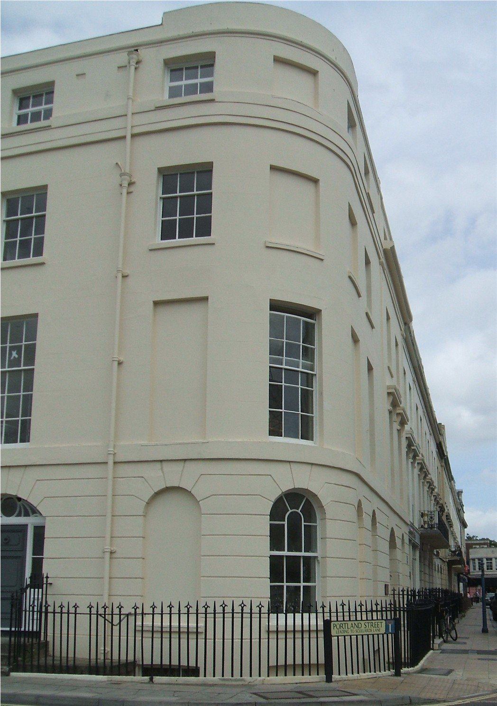
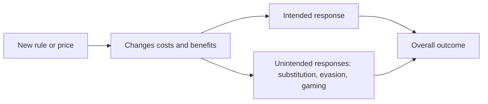

# Incentives

**Prerequisites:** [Opportunity cost](03-opportunity-cost.md).

*Bricked-up windows on houses in Portland Street, Southampton: blocking windows was a way to pay less under the window tax, levied in England from 1696 to 1851. Credit: Whilesteps. License: [CC BY-SA 3.0](https://creativecommons.org/licenses/by-sa/3.0). Source: [File:Window Tax.jpg](https://commons.wikimedia.org/wiki/File:Window_Tax.jpg).*

If people choose by weighing costs and benefits, then changing costs or benefits changes choices. That simple chain is the economics of **incentives**: rewards and penalties that make one action more or less attractive than another. It explains why demand curves slope down, why taxes change behaviour, and why well-meant policies sometimes backfire.

## What an incentive is

An incentive is anything that changes the costs or benefits of a choice. Prices are the most obvious. When the price of gasoline rises, the cost of driving rises, and over time people drive less, carpool, or buy more efficient cars. But incentives include much more than prices:

- **Financial**: wages, bonuses, fines, taxes, subsidies, interest.
- **Social**: praise, shame, status, belonging.
- **Moral**: guilt, a sense of duty, the wish to do the right thing.
- **Legal**: the risk of arrest or lawsuit.

Economists study all of these, though their models focus mainly on the measurable, usually financial, ones.

## People respond to incentives

The working rule is that, other things equal, when an activity becomes more costly people do less of it, and when it becomes more rewarding they do more. This is not a claim that people only care about money. A volunteer firefighter responds to the incentive of community respect; a parent responds to the incentive of a child's happiness. The claim is about direction: raise the cost of something and you will usually see less of it.

## Worked example: a tax on plastic bags

Suppose a city's grocery shoppers use 10 million single-use bags a year when bags are free. The city introduces a 10-cent charge. Each shopper now asks whether the convenience of a bag is worth 10 cents. Many decide it is not and bring a reusable one. If use falls to 4 million bags, the charge has changed behaviour substantially and raised 400,000 dollars. Several jurisdictions that introduced bag charges reported large drops in bag use, though the size varies by place and design. The example shows two separate effects of an incentive: a behavioural change and a revenue effect. The more people respond, the less revenue the charge raises. That tension comes back in [taxes and tax incidence](../02-supply-and-demand/13-taxes-and-tax-incidence.md).

## Unintended consequences

Incentives work on everything people can change, not just the behaviour a rule-maker had in mind. This produces **unintended consequences**, some of them famous:

- **Window taxes.** England taxed houses by their number of windows from 1696 until 1851, as a rough proxy for wealth. Householders bricked up windows to pay less, and buildings of that era still show the blank spaces. The tax raised revenue but reduced light and ventilation.
- **Seat-belt laws.** The economist Sam Peltzman argued in 1975 that mandatory safety equipment might lead drivers to drive less carefully, offsetting some of the safety gain, an idea known as risk compensation or the Peltzman effect. How large the offset is remains disputed; most later studies find seat belts still save many lives on net.
- **Bounties that backfire.** Stories circulate of colonial governments paying bounties for dead cobras or rats, only for people to breed the animals for the reward. The "cobra effect" story about British India is widely told but poorly documented. A better-documented case is the 1902 rat bounty in French-ruled Hanoi, where officials paid for rat tails and later found tailless rats released to keep breeding. Whatever the details, the logic is real: if you pay for a measure of a problem, people may produce the measure rather than solve the problem.

The last pattern is related to **Goodhart's law**, named after the economist Charles Goodhart. It is usually paraphrased as: when a measure becomes a target, it ceases to be a good measure.

## Incentives inside organisations

Firms face the same issue with their own employees. Paying salespeople on commission rewards effort but can also reward pushing customers into products they do not need. Paying a manager a bonus on this year's profit can encourage cutting maintenance that pays off only in later years. These are examples of the [principal-agent problem](../07-market-failure/13-principal-agent-problem.md), where one party (the agent) acts for another (the principal) with different interests and better information.

## Intrinsic motivation and crowding out

A caveat comes from both psychology and economics: paying people to do something they already do for its own sake can sometimes reduce their effort. A well-known 2000 study by Uri Gneezy and Aldo Rustichini of Israeli day-care centres found that introducing a small fine for parents who picked up children late was followed by *more* late pickups. One interpretation is that the fine turned a moral obligation into a price, and many parents decided the price was worth paying. Such cases do not overturn the idea that incentives matter; they show that incentives include social and moral ones, and that a price can change what kind of decision people think they are making. See [social preferences and fairness](../09-behavioural-economics/06-social-preferences-and-fairness.md).

## Key ideas

- Incentives are rewards and penalties that change the costs or benefits of a choice.
- People tend to do less of what becomes more costly and more of what becomes more rewarding.
- Incentives can be financial, social, moral or legal.
- Rules create unintended consequences when people respond in ways planners did not foresee.
- Prices can sometimes crowd out intrinsic or moral motivation.

## Where this leads

- Next: [marginal thinking](05-marginal-thinking.md), which explains how much people respond.
- Applied: [Pigouvian taxes and subsidies](../07-market-failure/05-pigouvian-taxes-and-subsidies.md) use incentives deliberately.
- Glossary: [incentive](../glossary/incentive.md), [unintended consequences](../glossary/unintended-consequences.md), [principal-agent problem](../glossary/principal-agent-problem.md).
