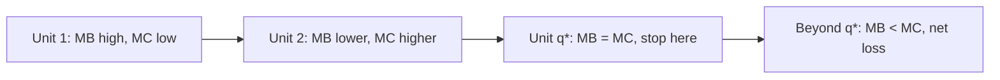

# Marginal thinking

**Prerequisites:** [Opportunity cost](03-opportunity-cost.md), [Incentives](04-incentives.md).

*William Stanley Jevons in 1858; in 1871 he helped launch marginal analysis in economics. Credit: Unknown author. License: Public domain. Source: [File:William Stanley Jevons 1858.jpg](https://commons.wikimedia.org/wiki/File:William_Stanley_Jevons_1858.jpg).*

Most real decisions are not "all or nothing" but "a little more or a little less". Should the café stay open one more hour? Should you study one more chapter? Should a farmer add one more bag of fertiliser? Economists call these **marginal** decisions, from the Latin *margo*, edge. Thinking at the margin is the main analytical tool of microeconomics.

## Marginal benefit and marginal cost

- **Marginal benefit (MB)**: the extra benefit from one more unit of an activity.
- **Marginal cost (MC)**: the extra cost of one more unit.

The rule is simple: **keep doing more of an activity as long as its marginal benefit exceeds its marginal cost; stop where they are equal.** If MB > MC, the next unit adds more than it costs, so do it. If MB < MC, the last unit cost more than it was worth, so do less.

This rule does not say to maximise total benefit, which would mean doing an activity forever, nor to minimise total cost, which would mean doing nothing. It says to maximise **net benefit**, total benefit minus total cost, and the way to find that point is to compare the extra benefit and extra cost of each step.

## Worked example: the café's closing time

A café closes at 6 p.m. and considers staying open later. For each extra hour, the owner estimates the additional revenue and the additional cost of staff, electricity and ingredients:

| Hour | Marginal revenue | Marginal cost | Net from this hour |
|---|---|---|---|
| 6 to 7 p.m. | 300 | 150 | +150 |
| 7 to 8 p.m. | 220 | 150 | +70 |
| 8 to 9 p.m. | 160 | 150 | +10 |
| 9 to 10 p.m. | 90 | 160 | −70 |

The owner should stay open until 9 p.m. The first three extra hours each add to profit; the fourth subtracts. Notice that the *average* revenue per extra hour over all four hours is (300 + 220 + 160 + 90) / 4 = 192.5, which exceeds the average cost of 152.5. Judging by averages would suggest staying open until 10, and would lose 70 dollars. The margin, not the average, is what matters for the decision.

## Why marginal benefits usually fall

In the café, each later hour brings fewer customers. This is a common pattern: the first unit of something tends to be the most valuable and later units less so. The first glass of water on a hot day is precious; the fifth is barely wanted. Economists call this **diminishing marginal benefit**, or in consumer theory [diminishing marginal utility](../03-consumer-theory/02-marginal-utility.md). On the cost side, the opposite tends to happen: as a factory pushes output higher with fixed equipment, each extra unit costs more to make, which the producer-theory lessons explain as [diminishing marginal returns](../04-producer-theory/03-diminishing-marginal-returns.md).

## The diamond-water paradox

Marginal thinking resolved an old puzzle. Water is essential to life and yet cheap; diamonds are inessential and yet expensive. Adam Smith noted the contrast in *The Wealth of Nations* (1776) as a puzzle about "value in use" versus "value in exchange". The answer, worked out by the marginalist economists of the 1870s (William Stanley Jevons, Carl Menger and Léon Walras), is that prices reflect the value of the *marginal* unit, not of the whole supply. Because water is abundant, the last litre a typical person uses goes to something minor, like washing a car, so its marginal value is low. Diamonds are scarce, so the marginal diamond is still highly valued. The total value of water to humanity is vastly greater than that of diamonds; the marginal value is what sets the price. See [[the-marginal-revolution|the marginal revolution]].

## Marginal thinking and sunk costs

Marginal analysis is forward-looking. It asks what changes if you do one more unit. That is why sunk costs drop out: money already spent is the same whether you do the next unit or not, so it cannot affect the comparison of marginal benefit and marginal cost. An airline with an empty seat on a flight that leaves in an hour faces a marginal cost of carrying one more passenger close to zero (a snack and a little fuel). Selling that seat for even a low price adds to profit, which is why last-minute fares sometimes fall, although airlines limit this so travellers do not learn to wait. See [[price-discrimination|price discrimination]].

## Calculus, briefly

If total benefit and total cost are smooth functions of quantity q, the marginal benefit and marginal cost are their derivatives, MB(q) = dB/dq and MC(q) = dC/dq. Net benefit B(q) − C(q) is at a maximum where its derivative is zero, which is where MB(q) = MC(q). You do not need calculus for this course; tables and graphs carry the same logic. But it explains why economics textbooks are full of derivatives: the derivative is the marginal.

## Key ideas

- Marginal means "one more unit": marginal benefit and marginal cost are the extra benefit and extra cost.
- Do more while MB > MC; the best quantity is where MB = MC.
- Decisions should use marginal, not average, figures.
- Marginal benefits usually fall and marginal costs usually rise as quantity grows.
- The diamond-water paradox is resolved by marginal value.

## Where this leads

- Next: [specialization and the division of labour](06-specialization-and-division-of-labour.md).
- Later: [profit maximization](../04-producer-theory/09-profit-maximization.md) (marginal revenue equals marginal cost) and [optimal consumer choice](../03-consumer-theory/06-optimal-choice.md).
- Glossary: [[g:marginal-analysis|marginal analysis]], [[g:marginal-cost|marginal cost]], [[g:diamond-water-paradox|diamond-water paradox]].
