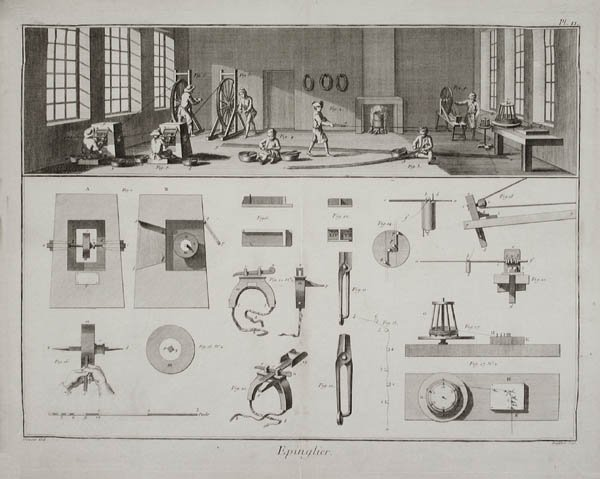
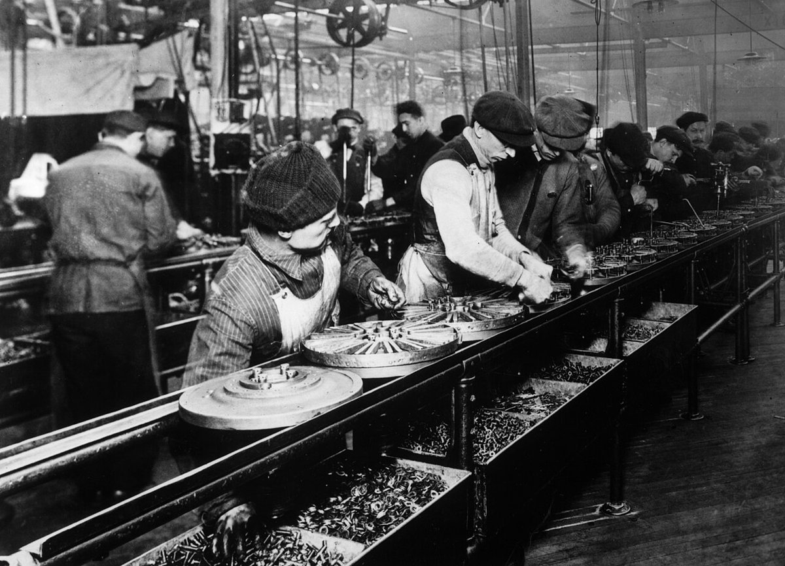

# Specialization and the division of labour

**Prerequisites:** [Scarcity and the economic problem](01-scarcity.md), [Opportunity cost](03-opportunity-cost.md).

*A plate on pin-making from Diderot and d'Alembert's Encyclopédie, the kind of workshop Adam Smith described. Credit: ) Engraver: Defehrt Designer: Goussier. License: Public domain. Source: [File:1762 Diderot's Encyclopedie, Epinglier II.jpg](https://commons.wikimedia.org/wiki/File:1762_Diderot's_Encyclopedie,_Epinglier_II.jpg).*

*Workers on the Ford moving assembly line, 1913. Credit: Unknown authorUnknown author. License: Public domain. Source: [File:Ford assembly line - 1913.jpg](https://commons.wikimedia.org/wiki/File:Ford_assembly_line_-_1913.jpg).*

Imagine having to grow your own food, sew your own clothes, build your own house and make your own phone. You would be very poor. The wealth of modern economies rests on **specialization**: people concentrate on a narrow range of tasks and obtain everything else by trade. Adam Smith opened *The Wealth of Nations* (1776) with this idea, and it remains the starting point for understanding why markets exist at all.

## Smith's pin factory

Smith's famous example was a pin factory. He reported that one untrained worker, making a pin from start to finish, could hardly make one pin a day, and certainly not twenty. In a workshop he had seen, the work was split into about eighteen distinct operations: one person draws out the wire, another straightens it, a third cuts it, a fourth points it, a fifth grinds the top for the head, and so on. Ten workers organised this way could make upwards of 48,000 pins a day, or about 4,800 each. Smith's figures were drawn partly from the French *Encyclopédie*, which had published a detailed article with engraved plates on pin-making, but the point did not depend on exact numbers: dividing a job into specialised tasks raised output per worker enormously.

## Why specialization raises productivity

Smith gave three reasons, and later economists added more:

1. **Dexterity.** Repeating a task builds skill. A worker who only points pins becomes very fast at it.
2. **Time saved switching.** Moving between tasks wastes time: changing tools, changing place, refocusing attention.
3. **Invention of machines.** People focused on one operation notice ways to mechanise it. Specialised tools follow specialised tasks.
4. **Matching talents.** People differ in ability and training. Specialization lets each do what they do relatively best, which is the subject of [comparative advantage](07-comparative-advantage.md).
5. **Economies of scale.** Producing in large volumes lets fixed costs, such as a machine or a design, be spread over many units. See [economies of scale](../04-producer-theory/08-economies-of-scale.md).

## Specialization requires exchange

A pin-pointer cannot eat pins. Specialization only works if people can trade what they make for what they need. That is why Smith said the division of labour is "limited by the extent of the market". In a small village, there is not enough demand to support a full-time watchmaker; in a city of a million, there is room for watchmakers who specialise in one brand. Larger markets, made possible by better transport, communication and trust, allow finer specialization, which raises productivity, which enlarges markets further.

## Specialization in the modern economy

Today specialization extends across firms and countries. A single smartphone combines chips designed in one country and fabricated in another, screens from a third, rare-earth minerals mined in a fourth, and assembly in a fifth. Henry Ford's moving assembly line, introduced at Highland Park, Michigan in 1913, cut the time to assemble a Model T chassis from about twelve hours to about an hour and a half, a modern echo of Smith's workshop. Services specialise too: a hospital employs radiologists, anaesthetists, cardiac nurses and medical coders, each doing a narrow part of the work.

## The costs of specialization

Smith himself was not naive about the downside. Later in *The Wealth of Nations*, he warned that a worker who spends a lifetime performing a few simple operations may become, in his words, "as stupid and ignorant as it is possible for a human creature to become", and he argued for public education partly to offset this. Karl Marx developed a sharper critique of how industrial specialization separates workers from the product and the process of their labour, which he called alienation. Modern concerns include:

- **Vulnerability.** Highly specialised supply chains can break when one link fails, as many firms found during the disruptions of 2020 and 2021.
- **Adjustment costs.** Workers trained for one task can struggle when technology or trade makes that task obsolete.
- **Monotony.** Narrow, repetitive jobs can be unpleasant and harmful to health.

These do not erase the gains, which are enormous, but they explain why the distribution of those gains and support for people displaced are recurring political issues.

## Key ideas

- Specialization means concentrating on a narrow range of tasks and trading for the rest.
- Smith's pin factory showed how dividing work raises output per worker.
- Sources of gains: skill, time saved, mechanisation, matching talents and scale.
- The division of labour is limited by the extent of the market.
- Specialization has costs: fragility, adjustment for displaced workers, and monotony.

## Where this leads

- Next: [comparative advantage](07-comparative-advantage.md), which explains who should specialise in what.
- Related: [economies of scale](../04-producer-theory/08-economies-of-scale.md), [[adam-smith|Adam Smith]], [[karl-marx|Karl Marx]].
- Glossary: [[g:specialization|specialization]], [[g:division-of-labour|division of labour]].
