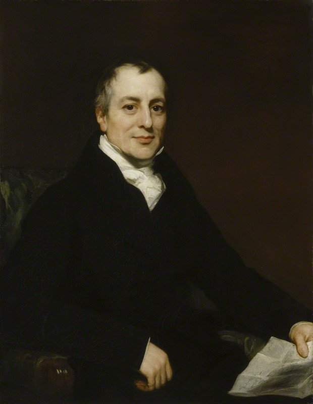
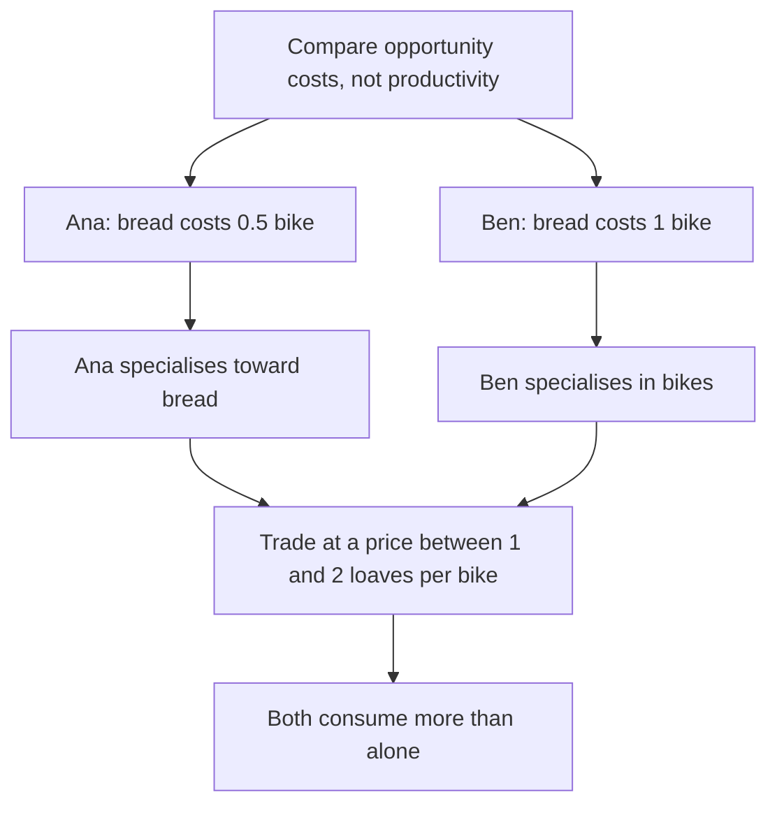

# Comparative advantage

**Prerequisites:** [Opportunity cost](03-opportunity-cost.md), [Specialization and the division of labour](06-specialization-and-division-of-labour.md).

*David Ricardo, portrait by Thomas Phillips; Ricardo set out comparative advantage in 1817. Credit: Thomas Phillips. License: Public domain. Source: [File:Portrait of David Ricardo by Thomas Phillips.jpg](https://commons.wikimedia.org/wiki/File:Portrait_of_David_Ricardo_by_Thomas_Phillips.jpg).*

Specialization raises output, but who should specialise in what? The obvious answer, "whoever is best at it", turns out to be wrong. The correct answer, worked out by David Ricardo in 1817, is **comparative advantage**: each party should specialise in what it can produce at the lowest *opportunity cost*. It is one of the least intuitive and most important results in economics.

## Absolute versus comparative advantage

- A producer has an **absolute advantage** in a good if it can make more of it with the same resources (or the same amount with fewer resources) than another producer.
- A producer has a **comparative advantage** in a good if its **opportunity cost** of making that good is lower than another producer's.

The surprise is that a producer can have an absolute advantage in everything and still gain from trade, and that every producer, however unproductive, has a comparative advantage in something.

## Worked example: two people, two tasks

Ana and Ben each have 8 hours a day to spend making bread or fixing bikes.

| | Loaves per hour | Bikes fixed per hour |
|---|---|---|
| Ana | 4 | 2 |
| Ben | 1 | 1 |

Ana is better at both: she has an absolute advantage in bread and in bikes. Now compute opportunity costs:

- For Ana, fixing 1 bike takes half an hour, which could have baked 2 loaves. So 1 bike costs her 2 loaves, and 1 loaf costs her 0.5 bikes.
- For Ben, 1 bike costs 1 loaf, and 1 loaf costs 1 bike.

Ana's opportunity cost of bread (0.5 bikes) is lower than Ben's (1 bike), so **Ana has a comparative advantage in bread**. Ben's opportunity cost of bikes (1 loaf) is lower than Ana's (2 loaves), so **Ben has a comparative advantage in bikes**.

**Without trade**, suppose each splits the day evenly: Ana makes 16 loaves and 8 bikes; Ben makes 4 loaves and 4 bikes. Total: 20 loaves, 12 bikes.

**With specialization by comparative advantage**, Ben spends all 8 hours on bikes (8 bikes). Ana needs to produce enough bikes to keep the total at 12, so she spends 2 hours on bikes (4 bikes) and 6 hours on bread (24 loaves). Total: 24 loaves, 12 bikes. The same labour now yields 4 extra loaves. Both can share this surplus through trade. If Ben trades 4 bikes for 5 loaves, Ana ends with 19 loaves and 8 bikes (3 more loaves than before, same bikes), and Ben ends with 5 loaves and 4 bikes (1 more loaf, same bikes). Both are better off. Any price between Ben's opportunity cost (1 loaf per bike) and Ana's (2 loaves per bike) lets both gain; here the price is 1.25 loaves per bike.

## Ricardo's wine and cloth

Ricardo's original example in *On the Principles of Political Economy and Taxation* (1817) used England and Portugal. He supposed Portugal could make a given quantity of wine with the labour of 80 men for a year and of cloth with 90, while England needed 120 men for the wine and 100 for the cloth. Portugal was more productive in both. Yet England's opportunity cost of cloth (100/120 of a unit of wine) was lower than Portugal's (90/80), so England should specialise in cloth and Portugal in wine, and both would gain by trading. The numbers were hypothetical, chosen to illustrate the logic, not measured.

## Why the result is surprising, and why it matters

Comparative advantage is counter-intuitive because people think in absolute terms: "they're better at everything, so what could they want from us?" The answer is that even the most productive party has limited time and resources, and every hour spent on a low-value task is an hour not spent on a high-value one. A top lawyer who types faster than any assistant should still hire one, because an hour of legal work is worth far more than an hour of typing.

The idea underpins the economic case for international trade, which the next lesson develops. It also explains why trade between rich and poor countries can benefit both: a country with low productivity across the board still has goods in which its disadvantage is smallest.

## Limits and qualifications

Comparative advantage is a statement about potential gains under its assumptions. Real-world qualifications include:

- **Adjustment and distribution.** The total gain can be positive while particular workers and regions lose, for example when an industry contracts. Whether those losers are compensated is a political choice.
- **Changing advantage.** Comparative advantage is not fixed by nature. It shifts with investment, education and technology. Some economists, notably in the tradition of Friedrich List in the 19th century and later development economists, have argued that temporary protection can help a country build new advantages; others argue such policies usually fail. The debate is live.
- **Scale and increasing returns.** Modern trade theory, associated with Paul Krugman's work from the late 1970s, shows that trade can also arise between similar countries because of economies of scale and consumers' taste for variety, not just because of differing opportunity costs.

## Key ideas

- Absolute advantage is about productivity; comparative advantage is about opportunity cost.
- Everyone has a comparative advantage in something, even if they have an absolute advantage in nothing.
- Specialising by comparative advantage and trading at a price between the parties' opportunity costs makes both better off.
- Ricardo's 1817 wine-and-cloth example is the classic illustration.
- Gains in total can coexist with losses for particular groups.

## Where this leads

- Next: [gains from trade](08-gains-from-trade.md).
- Related: [the production possibilities frontier](09-production-possibilities-frontier.md), [[david-ricardo|David Ricardo]].
- Glossary: [[g:comparative-advantage|comparative advantage]], [[g:absolute-advantage|absolute advantage]], [[g:terms-of-trade|terms of trade]].
