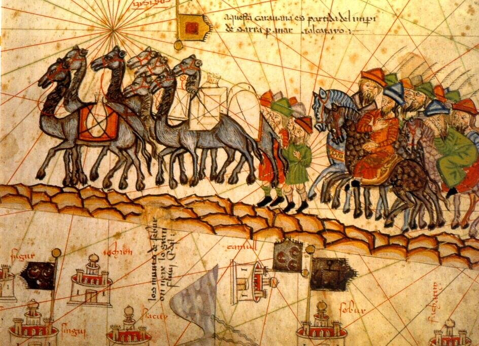
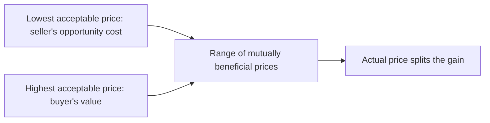

# Gains from trade

**Prerequisites:** [Comparative advantage](07-comparative-advantage.md).

*A trade caravan on the Silk Road, detail from the Catalan Atlas (1375). Credit: w:Abraham Cresques. License: Public domain. Source: [File:Catalan Atlas caravan drawing.jpg](https://commons.wikimedia.org/wiki/File:Catalan_Atlas_caravan_drawing.jpg).*

Voluntary trade is not a contest in which one side's gain is the other's loss. When two people freely agree to an exchange, each expects to come out ahead, or they would not agree. This lesson pulls together the sources of these **gains from trade**, measures them, and looks at the arguments for and against trade between nations.

## Why voluntary exchange creates value

Suppose you value a used guitar at 300 dollars and its owner values it at 200. Any price between 200 and 300 makes both of you better off. At a price of 250, you gain 50 (you pay 250 for something worth 300 to you) and the seller gains 50 (they receive 250 for something worth 200 to them). The guitar has not changed, yet the world has 100 dollars more of value in it, because the guitar has moved to someone who values it more. Economists measure these gains as [consumer surplus](../02-supply-and-demand/09-consumer-surplus.md) and [producer surplus](../02-supply-and-demand/10-producer-surplus-and-total-surplus.md).

This is the first source of gains: **reallocation**. Goods move to those who value them most. The second source, from the previous lessons, is **specialization by comparative advantage**: trade lets people produce more in total. The third is **scale and variety**: larger markets let firms spread fixed costs and let consumers choose among more products.

## Terms of trade

The **terms of trade** are the rate at which one good exchanges for another. In the Ana-and-Ben example of [comparative advantage](07-comparative-advantage.md), bikes traded for loaves at a rate that had to lie between the two producers' opportunity costs, between 1 and 2 loaves per bike. Where exactly in that range the price lands decides how the gain is split. A price near 1 loaf per bike gives most of the gain to Ana; a price near 2 gives it to Ben. Bargaining power, competition from other traders and information all affect where the price ends up.

## Trade between nations

Countries do not trade, people and firms in them do. But the logic of comparative advantage applies to nations in aggregate. If Canada can produce softwood lumber at a lower opportunity cost than Japan, and Japan can produce certain electronics at a lower opportunity cost than Canada, both countries can consume more by specialising and trading than by each making everything.

**Who gains and who loses.** International trade creates winners and losers within each country:

- Consumers gain from lower prices and more variety.
- Producers in exporting industries gain from larger markets.
- Producers and workers in import-competing industries can lose, as prices fall and some firms shrink or close.

Standard theory says the gains to the winners exceed the losses to the losers, so the winners could in principle compensate the losers and everyone could be better off. Whether that compensation actually happens is a political matter. Studies of the effect of rising Chinese imports on US manufacturing regions after 2000, by David Autor, David Dorn and Gordon Hanson, found that local job and income losses were larger and longer-lasting than many economists had expected. These findings sharpened debate about trade policy without overturning the result that trade raises total income.

## Arguments for restricting trade

Several arguments for trade restrictions are commonly made. Economists judge them differently:

- **Jobs.** Trade changes which jobs exist more than how many. Most economists think total employment depends mainly on macroeconomic conditions, not trade policy, though specific communities can suffer lasting losses.
- **National security.** Relying on rivals for weapons, food or critical minerals can be risky. Most economists accept this argument in principle while warning it is easily stretched to cover industries with no real security role.
- **Infant industries.** A young industry may need protection to grow until it can compete. Supporters point to the history of the United States, Germany, Japan and South Korea; critics point out that many protected industries never grow up, and that choosing which ones to protect invites lobbying.
- **Unfair competition.** Foreign subsidies or very low labour and environmental standards can make competition seem unfair. Trade agreements and the World Trade Organization's rules try to address some of these issues.
- **Bargaining.** Threatening restrictions can sometimes win better terms, though threats can also start retaliation.

The tools of trade restriction, tariffs and quotas, are analysed in [subsidies, quotas and tariffs](../02-supply-and-demand/15-subsidies-quotas-and-tariffs.md).

## Mercantilism: the older view

Before Smith and Ricardo, the dominant economic doctrine in Europe was **mercantilism**: the idea that a nation grows rich by exporting more than it imports and accumulating gold and silver. Smith attacked this in *The Wealth of Nations*, arguing that a nation's wealth is the goods and services its people can consume, not its stock of precious metals. The debate about whether trade surpluses signal strength has never fully gone away. See [[before-adam-smith|economic thought before Adam Smith]].

## Key ideas

- Voluntary exchange creates value because both parties expect to gain.
- Gains come from reallocation, specialization and scale and variety.
- The terms of trade decide how the gain is split.
- International trade raises total income but creates losers in import-competing industries.
- Arguments for restriction vary in strength; mercantilism confused wealth with gold.

## Where this leads

- Next: [the production possibilities frontier](09-production-possibilities-frontier.md).
- Related: [subsidies, quotas and tariffs](../02-supply-and-demand/15-subsidies-quotas-and-tariffs.md), [consumer surplus](../02-supply-and-demand/09-consumer-surplus.md).
- Glossary: [[g:gains-from-trade|gains from trade]], [[g:terms-of-trade|terms of trade]], [[g:mercantilism|mercantilism]].
