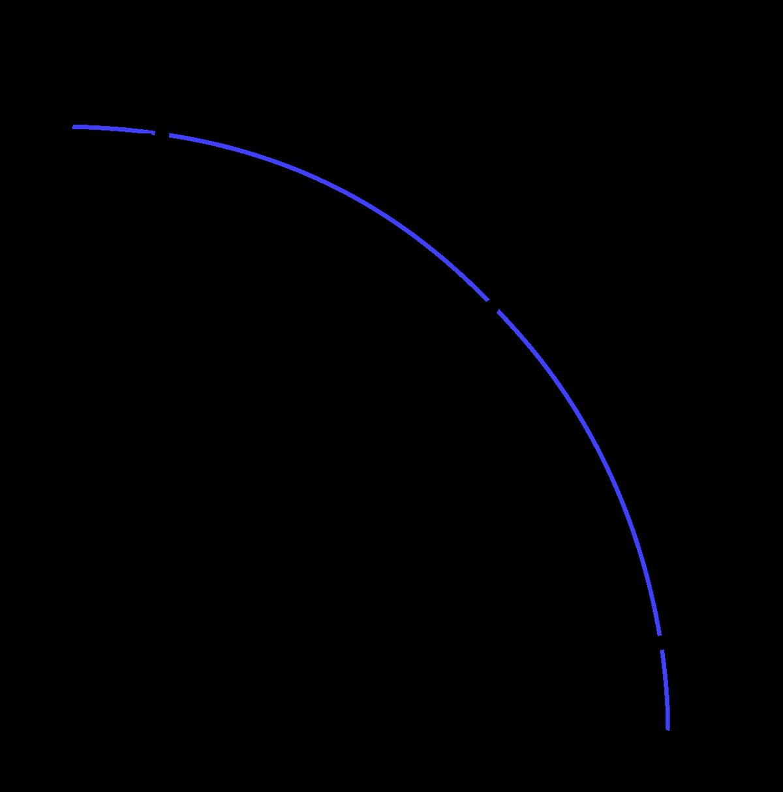
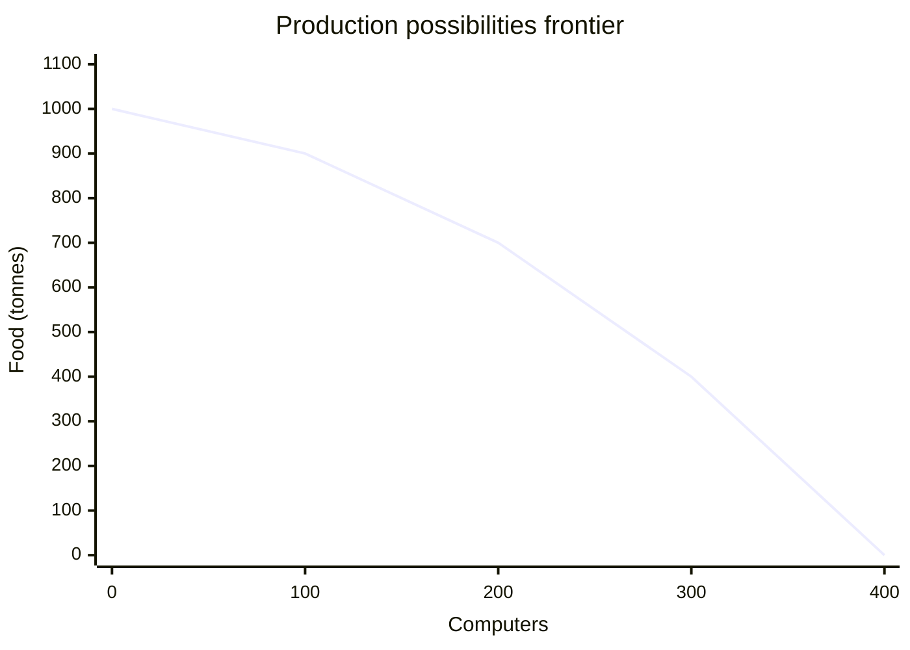

# The production possibilities frontier

**Prerequisites:** [Scarcity](01-scarcity.md), [Opportunity cost](03-opportunity-cost.md), [Comparative advantage](07-comparative-advantage.md).

*A production possibilities frontier: points on the curve are efficient, points inside are attainable but wasteful, points outside are unattainable. Credit: User:Everlong. License: [CC BY-SA 3.0](http://creativecommons.org/licenses/by-sa/3.0/). Source: [File:Production Possibilities Frontier Curve.svg](https://commons.wikimedia.org/wiki/File:Production_Possibilities_Frontier_Curve.svg).*

The **production possibilities frontier** (PPF), also called the production possibilities curve, is the first diagram most economics students learn. It shows, in a single picture, scarcity, choice, opportunity cost, efficiency and growth.

## Building the frontier

Imagine an economy that produces only two goods, say food and computers, using all its available resources and the best technology it has. The PPF shows every combination of the two goods that the economy can produce when it uses all its resources fully and efficiently.

Here is a table for a small economy:

| Point | Food (tonnes) | Computers |
|---|---|---|
| A | 1,000 | 0 |
| B | 900 | 100 |
| C | 700 | 200 |
| D | 400 | 300 |
| E | 0 | 400 |

Plotting computers on the horizontal axis and food on the vertical axis and joining the points gives a curve that bows outward from the origin.

## What the frontier shows

- **Scarcity.** Points outside the frontier, such as 900 tonnes of food and 300 computers, are **unattainable** with current resources and technology.
- **Efficiency.** Points on the frontier are **productively efficient**: you cannot make more of one good without making less of the other.
- **Inefficiency.** Points inside the frontier, such as 400 tonnes and 100 computers, are attainable but wasteful. Resources are idle (unemployment) or misallocated. Moving to the frontier would give more of both.
- **Opportunity cost.** Moving along the frontier shows the trade-off. Going from A to B, 100 computers cost 100 tonnes of food. From B to C, the next 100 computers cost 200 tonnes. From C to D, 300 tonnes. From D to E, 400 tonnes.

## Why the frontier bows outward

The opportunity cost of computers rises as the economy makes more of them. This is called **increasing opportunity cost**, and it happens because resources are not equally good at everything. When the economy first shifts toward computers, it moves the workers and factories best suited to computers and least useful for farming: an engineer leaves a farm, a city lot stops growing vegetables. Each later shift must take resources that are better at farming and worse at computers, so the sacrifice of food per extra computer grows. The slope of the PPF, the opportunity cost, gets steeper.

If resources were equally suited to both goods, the PPF would be a straight line with constant opportunity cost, as in the Ana-and-Ben example of [comparative advantage](07-comparative-advantage.md), where each person's trade-off between bread and bikes was fixed.

## Shifting the frontier: economic growth

The frontier is drawn for given resources and technology. It shifts outward when:

- **Resources grow**: more workers, more capital, newly discovered minerals.
- **Technology improves**: better methods produce more from the same inputs.
- **Human capital rises**: a better-trained workforce is more productive.

Growth need not be even. A breakthrough in chip design shifts the frontier out mostly along the computer axis. A drought shifts it in along the food axis.

Choices today affect the frontier tomorrow. An economy that devotes more resources to capital goods (machines, infrastructure, research) and fewer to consumer goods now gives up current consumption but shifts its future frontier further out. This is the economy-wide version of the personal choice between spending and saving, and it links to the [intertemporal choice](../03-consumer-theory/12-intertemporal-choice.md) lesson and to investment in the finance course.

## Trade lets you consume beyond your frontier

A country's PPF limits what it can **produce**, but not what it can **consume**. By specialising according to comparative advantage and trading, a country can consume a combination of goods outside its own frontier. In the Ana-and-Ben example, specialization and trade let both consume more bread than they could have produced alone while keeping the same number of bikes. This is the clearest picture of the [gains from trade](08-gains-from-trade.md).

## What the PPF does not tell you

The PPF shows what is possible, not what is best. Choosing a point on the frontier requires knowing what people want, which is the subject of demand and of [consumer theory](../03-consumer-theory/01-preferences-and-utility.md). It also says nothing about who gets the output. And it is a simplification: real economies make millions of goods, not two. But the two-good picture captures the essential logic in a way that carries over to the many-good case.

## Key ideas

- The PPF shows all combinations of two goods an economy can produce with full, efficient use of resources and current technology.
- Points outside are unattainable; points inside are inefficient; points on it are efficient.
- The slope is the opportunity cost, which usually rises because resources are specialised.
- Growth in resources or technology shifts the frontier outward.
- Trade allows consumption outside a country's own frontier.

## Where this leads

- Next: [markets, prices and property rights](10-markets-prices-and-property-rights.md).
- Later: [[efficiency-and-pareto-optimality|efficiency and Pareto optimality]] generalises the idea of being "on the frontier".
- Glossary: [[g:production-possibilities-frontier|production possibilities frontier]], [[g:productive-efficiency|productive efficiency]].
