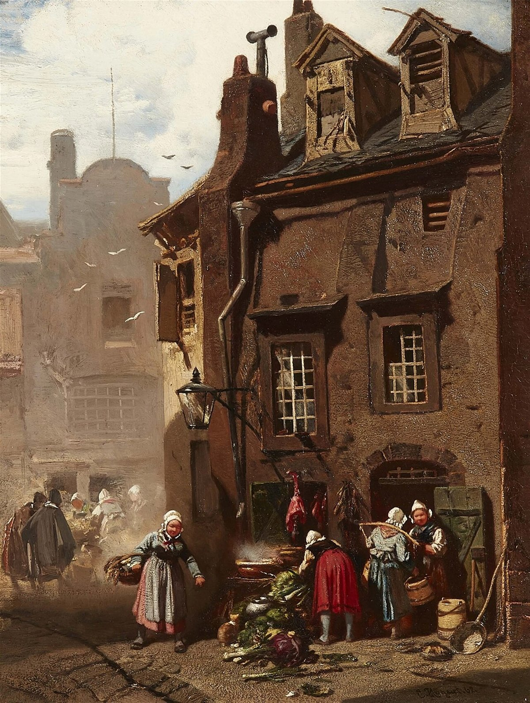
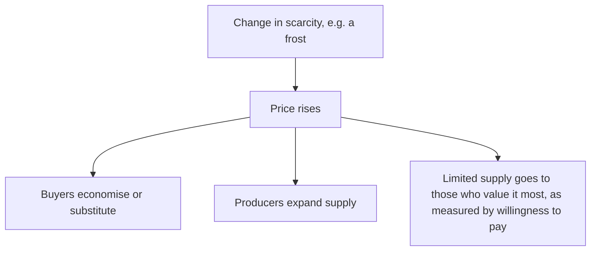

# Markets, prices and property rights

**Prerequisites:** [Gains from trade](08-gains-from-trade.md), [Incentives](04-incentives.md).

*Market Day in a Medieval Town by Charles Hoguet (1862). Credit: Charles Hoguet. License: Public domain. Source: [File:Charles Hoguet - Markttreiben in einer mittelalterlichen Stadt (1862).jpg](https://commons.wikimedia.org/wiki/File:Charles_Hoguet_-_Markttreiben_in_einer_mittelalterlichen_Stadt_(1862).jpg).*

Specialization and trade raise output, but they need a way to coordinate millions of people who have never met. How does a bakery know how much flour to order, or a farmer how much wheat to plant? In market economies the main answer is **prices**, set in **markets**, resting on **property rights**. This lesson explains how the three fit together before the course turns to supply and demand.

## What a market is

A **market** is any arrangement that lets buyers and sellers exchange a good or service. It can be a physical place, like a farmers' market or the old Grand Bazaar in Istanbul, or a network, like an online marketplace or the global market for crude oil. What makes it a market is that many buyers and sellers interact and their interaction determines a price and a quantity traded.

Markets differ in how competitive they are. At one extreme are markets with many buyers and sellers of an identical product, such as wheat, where no one can influence the price. At the other is a single seller, a monopoly. Most real markets fall in between. These **market structures** are the subject of a later section, starting with [perfect competition](../05-market-structures/01-perfect-competition.md).

## Prices as signals

A price carries information. When frost destroys part of Brazil's coffee crop, coffee prices rise around the world. Roasters, cafés and drinkers who have never heard of the frost respond as if they had: they economise on coffee, switch to tea, or pay more. Growers elsewhere plant more. The price rise transmits the news that coffee has become scarcer and gives everyone a reason to act on it.

The Austrian economist Friedrich Hayek made this the centre of his 1945 essay "The Use of Knowledge in Society". He argued that the knowledge needed to run an economy is not held by any one mind but is dispersed among millions of people, much of it local and fleeting: which machine is idle, which shop has spare stock, which field drains badly. A central planner could never gather it all. Prices summarise it. Hayek's example was tin: if a new use for tin appears or a source dries up, the price rises, and users everywhere economise without needing to know why. See [Friedrich Hayek](../10-history-of-thought/thinkers/11-friedrich-hayek.md).

## Prices as incentives and rations

Prices do three jobs at once:

1. **Signal**: they tell people how scarce something is.
2. **Incentive**: they reward producers for supplying what is scarce and encourage buyers to economise.
3. **Rationing**: they allocate a limited supply to those willing to pay the most.

The third job is the most controversial. Willingness to pay depends on ability to pay, so price rationing favours the rich. Alternatives exist, including queues, lotteries, first-come-first-served, need-based allocation and political allocation, and each has its own costs. Queues waste time; lotteries ignore how much people value things; need-based systems require someone to judge need. The [price ceilings](../02-supply-and-demand/11-price-ceilings.md) lesson shows what happens when governments hold prices below market levels.

## The invisible hand

Adam Smith used the phrase "invisible hand" only once in *The Wealth of Nations*. Discussing merchants who prefer to invest at home, he wrote that a person who intends only his own gain is "led by an invisible hand to promote an end which was no part of his intention", namely the public good. In modern economics the phrase has come to stand for the broader idea that competitive markets, guided by prices, can turn self-interested choices into outcomes that benefit society. The [welfare theorems](../08-welfare-economics/03-the-welfare-theorems.md) later in the course state precisely when this holds, and the [market failure](../07-market-failure/01-what-is-market-failure.md) section explains when it does not. Historians of thought note that Smith's own view was more qualified than the slogan suggests; he also wrote *The Theory of Moral Sentiments* (1759) on sympathy and moral judgement.

## Property rights

Markets require **property rights**: clear, enforceable rules about who owns what and what owners may do with it. You cannot sell something you do not own, and you will not invest in a field if anyone can harvest its crop. Property rights give owners an incentive to care for resources and to use them in their most valuable way, since they capture the gains.

Property rights come in bundles: the right to use, to exclude others, to earn income from, and to sell. They need enforcement through courts, contracts and police, and they need trust. Economists such as Douglass North emphasised that **institutions**, the formal and informal rules of the game, are a large part of why some countries grew rich and others did not.

When property rights are missing or unclear, markets fail in predictable ways. Fish in the open ocean belong to no one until caught, so each fishing fleet has an incentive to catch as much as it can before others do, which leads to overfishing. This is the [tragedy of the commons](../07-market-failure/09-common-resources.md). Ronald Coase showed that clear property rights can sometimes let private bargaining solve such problems; see [the Coase theorem](../07-market-failure/06-coase-theorem.md).

## Markets and other systems

Markets are not the only way to coordinate. Economies have also relied on **tradition** (doing what your parents did), **command** (central planning, as in the Soviet Union) and **reciprocity** within families and communities. All modern economies are **mixed**: markets coordinate most production, while governments provide public goods, regulate, redistribute income, and run some industries directly. How much of each is the stuff of political debate. Economics can clarify the trade-offs; it cannot by itself settle the values involved.

## Key ideas

- A market is any arrangement where buyers and sellers interact to set a price and quantity.
- Prices signal scarcity, create incentives, and ration supply.
- Hayek argued prices coordinate dispersed knowledge no planner could gather.
- The invisible hand is the idea that competitive markets can align self-interest with the common good, under conditions.
- Markets rest on property rights and institutions; where rights are unclear, markets fail.

## Where this leads

- Next: [models and economic method](11-models-and-economic-method.md).
- Then: [demand](../02-supply-and-demand/01-demand.md), the first half of supply and demand.
- Related branch: [what an exchange does](../../finance/04-markets/01-what-an-exchange-does.md) in the finance course.
- Glossary: [market](../glossary/market.md), [price signal](../glossary/price-signal.md), [property rights](../glossary/property-rights.md), [invisible hand](../glossary/invisible-hand.md).
