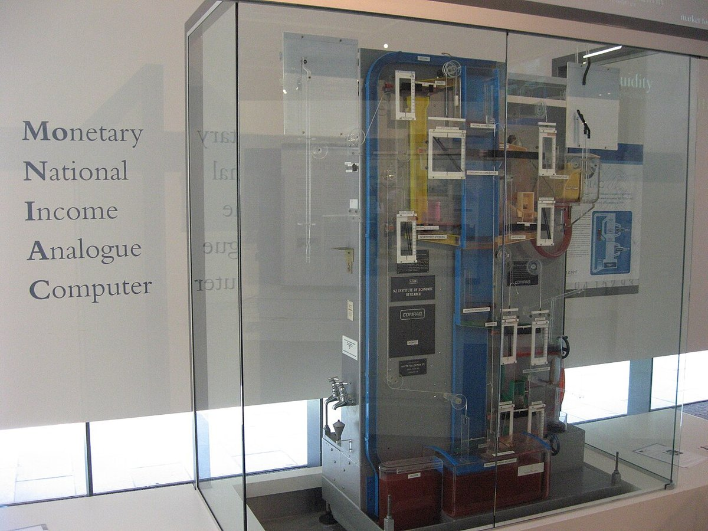
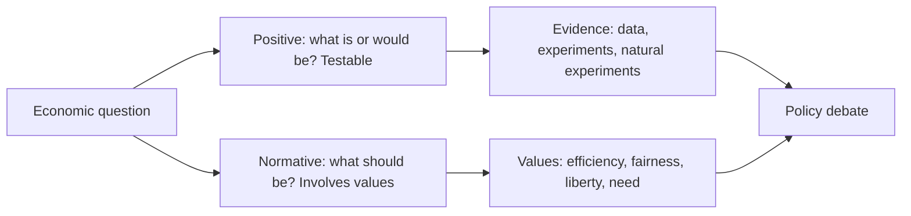

# Models and economic method

**Prerequisites:** [Scarcity and the economic problem](01-scarcity.md). Best read after the earlier foundations lessons.

*A MONIAC, the hydraulic model of a national economy built by Bill Phillips in 1949, using water flowing through tanks and pipes. Credit: Kaihsu Tai. License: Public domain. Source: [File:MONIAC.jpg](https://commons.wikimedia.org/wiki/File:MONIAC.jpg).*

Economics studies systems too large and too tangled to experiment on directly. You cannot double a country's minimum wage just to see what happens, and you cannot rerun history without a recession. So economists rely on **models**: deliberate simplifications that isolate a few causes and trace their effects. Before diving into supply and demand, it helps to understand what models are for, what they can and cannot do, and the habits of reasoning economists use.

## What a model is

A model is a simplified representation of reality built to answer a specific question. A road map is a model: it leaves out trees, houses and traffic because they do not help you find your route. A map that included everything would be as large as the territory and useless. Economic models do the same. The [production possibilities frontier](09-production-possibilities-frontier.md) pretends the economy makes only two goods. Supply and demand pretends a market has a single price. These are not mistakes; they are the point.

Models make **assumptions**, and good models make assumptions that do not matter much for the question at hand. Assuming two goods is harmless if the question is about trade-offs; it would be disastrous if the question were about the variety of consumer products.

A remarkable physical model of an economy is the MONIAC, built in 1949 by the New Zealand economist Bill Phillips at the London School of Economics. It used tanks, pipes and coloured water to represent the flows of income, spending and saving in a national economy. Several copies still exist in museums and universities.

## Ceteris paribus

Economists constantly say **ceteris paribus**, Latin for "other things being equal". When we say "if the price of coffee rises, people buy less coffee", we mean *holding everything else constant*: incomes, the price of tea, tastes and so on. In reality many things change at once, so isolating one cause requires care. Much of the craft of empirical economics is finding situations where other things really are roughly equal, so that one effect can be measured.

## Positive and normative statements

A crucial distinction separates two kinds of economic statement:

- **Positive** statements describe how the world is or would be. They can be tested, at least in principle. "A minimum wage of 20 dollars would reduce employment of teenagers by X percent" is positive. It may be true or false.
- **Normative** statements say how the world ought to be. They involve values. "The minimum wage should be raised to 20 dollars" is normative. Evidence informs it but cannot settle it alone.

Many disagreements among economists that look like arguments about values are really about facts, and vice versa. Being clear about which is which makes debate more productive. This course aims to present positive economics accurately and to flag normative questions honestly.

## Testing models

Economists test models in several ways:

- **Observational data.** Comparing prices, quantities and incomes across places and times, using statistics to control for other factors. The challenge is that correlation is not causation.
- **Natural experiments.** Situations where chance or an arbitrary rule creates something like a controlled experiment. David Card and Alan Krueger's 1994 study of fast-food employment after New Jersey raised its minimum wage, compared with neighbouring Pennsylvania, is a famous example; it found no fall in employment, a result that sparked a long debate. Card shared the 2021 Nobel memorial prize partly for this work.
- **Field and laboratory experiments.** Randomly assigning people to different conditions. Vernon Smith pioneered laboratory market experiments; randomised trials in development economics earned Abhijit Banerjee, Esther Duflo and Michael Kremer the 2019 prize.

## Why economists disagree

Economists agree on more than public debate suggests: most accept that rent control reduces the quality and quantity of rental housing in the long run and that trade raises total income. They disagree for three main reasons:

1. **Different values**, on normative questions.
2. **Different readings of evidence**, on positive questions where data are hard to interpret.
3. **Different models** or schools of thought, which emphasise different mechanisms. The [schools of thought](../10-history-of-thought/05-schools-of-thought.md) lesson describes these fairly.

## Milton Friedman on assumptions

In a famous 1953 essay, "The Methodology of Positive Economics", Milton Friedman argued that a model should be judged by the accuracy of its predictions, not by the realism of its assumptions. Expert billiards players do not solve physics equations, but a model that assumes they do may predict their shots well. Critics replied that unrealistic assumptions can lead models astray when circumstances change, and that understanding mechanisms matters, not just prediction. The debate continues in the philosophy of economics.

## Key ideas

- Models are deliberate simplifications that answer specific questions.
- Ceteris paribus means holding other factors constant to isolate one effect.
- Positive statements are about facts; normative statements are about values.
- Economists test models with data, natural experiments and controlled experiments.
- Disagreement comes from values, evidence and differing models.

## Where this leads

- Next section: [demand](../02-supply-and-demand/01-demand.md), the start of supply and demand.
- Related: [schools of thought](../10-history-of-thought/05-schools-of-thought.md), [limits and critiques of behavioural economics](../09-behavioural-economics/08-limits-and-critiques.md).
- Related branch: [knowledge and opinion](../../../philosophy/concepts/epistemology/knowledge-and-opinion.md) in philosophy.
- Glossary: [ceteris paribus](../glossary/ceteris-paribus.md), [positive economics](../glossary/positive-economics.md), [normative economics](../glossary/normative-economics.md), [economic model](../glossary/economic-model.md).
