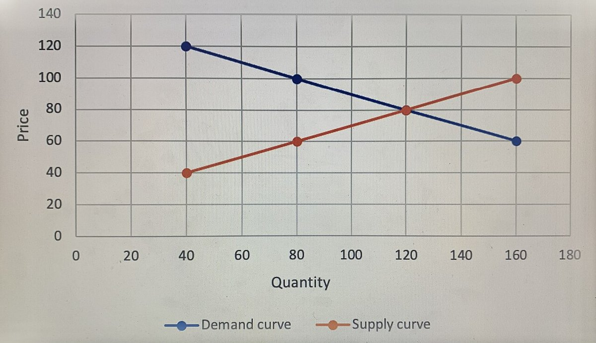
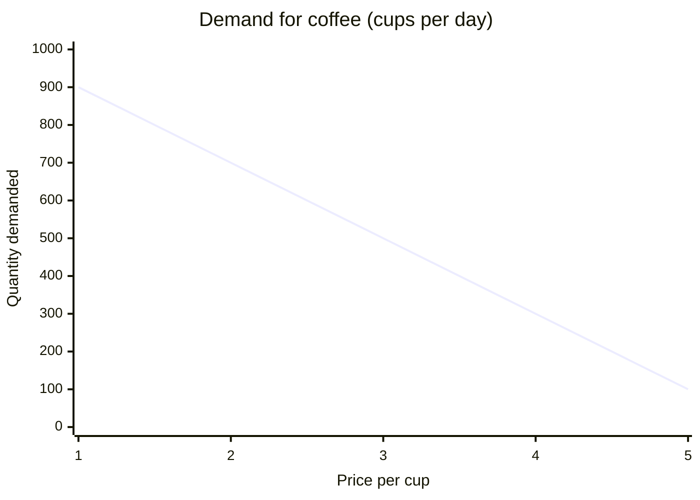

# Demand

**Prerequisites:** [Markets, prices and property rights](../01-foundations/10-markets-prices-and-property-rights.md), [Marginal thinking](../01-foundations/05-marginal-thinking.md).

*A diagram of the law of demand: as price falls, quantity demanded rises. Credit: Daydreamm. License: [CC BY-SA 4.0](https://creativecommons.org/licenses/by-sa/4.0). Source: [File:Law of demand.jpg](https://commons.wikimedia.org/wiki/File:Law_of_demand.jpg).*

Supply and demand is the most widely used model in economics. It explains how prices are set in competitive markets and how they respond to events. This lesson builds the first half: **demand**, the relationship between the price of a good and how much buyers want to purchase.

## Quantity demanded and the demand schedule

The **quantity demanded** of a good is the amount buyers are willing and able to buy at a given price, over a given period. "Willing" means they want it; "able" means they can pay for it. A wish without money behind it is not demand in the economic sense.

A **demand schedule** lists quantities demanded at various prices, holding everything else constant (ceteris paribus). Here is a schedule for coffee in a small town, cups per day:

| Price per cup | Quantity demanded |
|---|---|
| 1.00 | 900 |
| 2.00 | 700 |
| 3.00 | 500 |
| 4.00 | 300 |
| 5.00 | 100 |

## The demand curve

Plotting the schedule, with price on the vertical axis and quantity on the horizontal (a convention dating back to Alfred Marshall), gives the **demand curve**. It slopes downward: as price falls, quantity demanded rises.

*(Mermaid charts put the first variable on the horizontal axis, so this chart shows quantity falling as price rises. The standard textbook picture puts price on the vertical axis; the relationship is the same.)*

This schedule happens to be a straight line: Q = 1,100 − 200P. Real demand curves are rarely straight, but linear examples make the arithmetic easy.

## The law of demand

The **law of demand** says that, other things equal, when the price of a good rises, the quantity demanded falls. It is one of the most reliable empirical regularities in economics. Why does it hold?

1. **Substitution effect.** When coffee gets more expensive relative to tea, some people switch to tea. The good's opportunity cost in terms of other goods has risen.
2. **Income effect.** A higher price makes buyers effectively poorer, since their income buys less. For most goods ("normal goods") buyers then buy less.
3. **Diminishing marginal benefit.** Each additional cup is worth less to a buyer than the last. A buyer purchases cups until the value of the next one falls to the price. A lower price means more cups pass that test.

The consumer-theory section derives these effects precisely in [income and substitution effects](../03-consumer-theory/08-income-and-substitution-effects.md). The rare exceptions, [Giffen goods](../03-consumer-theory/09-inferior-and-giffen-goods.md), are discussed there too.

## Willingness to pay

Another way to read a demand curve is from the quantity axis up. At each quantity, the height of the curve shows the **marginal buyer's willingness to pay**: the most that the buyer of the last unit would pay. On our schedule, the 500th cup is bought by someone willing to pay exactly 3.00 dollars. Earlier buyers would have paid more. This reading is the basis of [consumer surplus](09-consumer-surplus.md).

## Individual and market demand

Each buyer has an individual demand curve. The **market demand curve** is the horizontal sum of all individual curves: at each price, add up the quantities everyone wants. If at 3 dollars Ana wants 2 cups and Ben wants 1, and they are the only buyers, market quantity demanded at 3 dollars is 3. The details are in [from individual to market demand](../03-consumer-theory/10-from-individual-to-market-demand.md).

## Quantity demanded versus demand

Students often confuse two things:

- A change in **quantity demanded** is a movement **along** a demand curve, caused by a change in the good's own price.
- A change in **demand** is a **shift** of the whole curve, caused by something else, such as income, tastes or the prices of related goods.

If coffee's price rises from 2 to 3 dollars and sales fall from 700 to 500, that is a fall in quantity demanded. If a study announcing that coffee is healthy causes people to want 200 more cups at every price, demand has increased. Keeping these straight is essential for the [comparative statics](06-comparative-statics.md) lesson.

## Measuring demand in practice

Firms and economists estimate demand curves from data, surveys and experiments. A difficulty is that observed prices and quantities are the result of both supply and demand, so plotting them does not automatically trace out a demand curve. Disentangling the two, known as the identification problem, was first clearly analysed in the early twentieth century and remains a central topic in econometrics. Online retailers now run randomised price tests to estimate demand directly.

## Key ideas

- Quantity demanded is what buyers are willing and able to buy at a given price.
- The demand curve slopes downward: the law of demand.
- Reasons: substitution, income effects and diminishing marginal benefit.
- The curve's height shows the marginal buyer's willingness to pay.
- Movements along the curve (price changes) differ from shifts of the curve (other changes).

## Where this leads

- Next: [shifts in demand](02-shifts-in-demand.md).
- Related: [price elasticity of demand](07-price-elasticity-of-demand.md) measures how strongly quantity responds.
- Glossary: [demand](../glossary/demand.md), [law of demand](../glossary/law-of-demand.md), [demand curve](../glossary/demand-curve.md), [willingness to pay](../glossary/willingness-to-pay.md).
