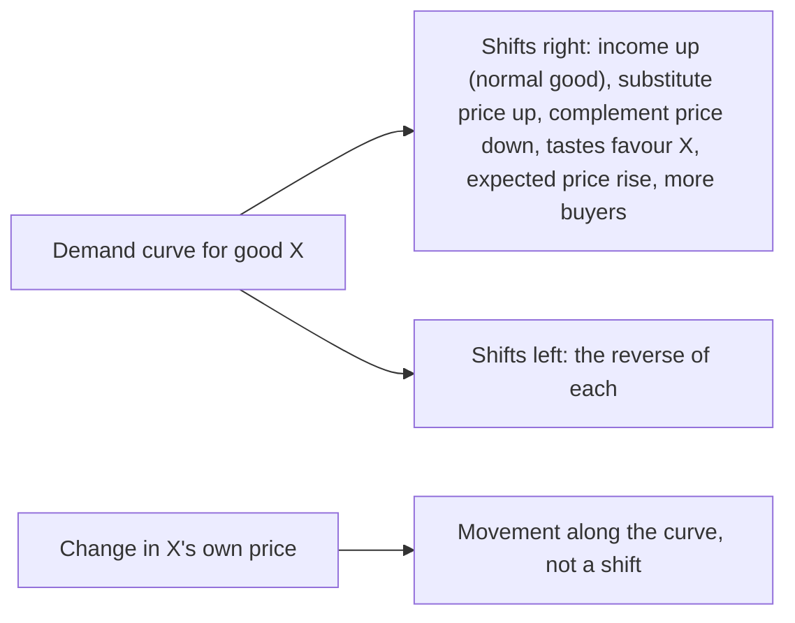

# Shifts in demand

**Prerequisites:** [Demand](01-demand.md).

*Umbrellas hung over a street in Viborg, Denmark, during heavy rain; weather is one of many factors that shift demand. Credit: W.carter. License: Public domain. Source: [File:Les Parapluies de Viborg.jpg](https://commons.wikimedia.org/wiki/File:Les_Parapluies_de_Viborg.jpg).*

The demand curve answers one question: how does quantity demanded change when the good's own price changes, everything else held constant? But "everything else" changes all the time. When it does, the whole curve **shifts**. This lesson lists the factors that shift demand and works through examples.

## The determinants of demand

The main non-price factors that shift a demand curve are:

1. **Income.**
   - For a **normal good**, higher income raises demand. Restaurant meals, travel and most goods are normal.
   - For an **inferior good**, higher income lowers demand, as buyers switch to something better. Instant noodles, intercity bus travel and used clothing are often inferior for many households.
2. **Prices of related goods.**
   - **Substitutes** are goods used in place of each other: coffee and tea, butter and margarine, Uber and taxis. A rise in the price of tea increases demand for coffee.
   - **Complements** are goods used together: printers and ink, cars and gasoline, hot dogs and buns. A rise in the price of gasoline reduces demand for large cars.
3. **Tastes and preferences.** Fashion, health news, advertising and culture all shift demand. Demand for plant-based milk rose substantially in many countries in the 2010s.
4. **Expectations.** If buyers expect prices to rise next month, they buy more now. Expected income matters too: a student expecting a well-paid job may spend more today.
5. **Number of buyers.** Population growth, immigration or a new university in town raises market demand.
6. **Seasons and weather.** Demand for umbrellas rises when it rains; demand for heating oil rises in winter.

## Worked example: a shift in numbers

Using the coffee schedule from the previous lesson, Q = 1,100 − 200P. Suppose the town's largest employer opens a new office, adding 400 workers who each want half a cup a day more at every price. Demand rises by 200 cups at every price:

| Price | Old quantity | New quantity |
|---|---|---|
| 1.00 | 900 | 1,100 |
| 2.00 | 700 | 900 |
| 3.00 | 500 | 700 |
| 4.00 | 300 | 500 |
| 5.00 | 100 | 300 |

The new curve is Q = 1,300 − 200P, a parallel shift to the right. At any given price people want more. Equivalently, at any given quantity they are willing to pay more: the 700th cup used to be worth 2 dollars to its buyer; now it is worth 3.

## Telling a shift from a movement

Consider two news headlines:

- "Coffee prices rise; sales fall." If the cause was a supply problem (say a poor harvest), this is a movement **along** the demand curve: price up, quantity demanded down.
- "Coffee sales rise despite higher prices." This does not contradict the law of demand. It probably means demand **shifted** right (say, more people at work), pushing up both price and quantity.

Careless reasoning mixes these up. A common example: "demand for luxury cars rises when their prices rise, so the law of demand fails." Usually both price and quantity rose because demand shifted out with rising incomes. The law of demand is about what happens when price changes **with other things held equal**.

## Network effects and bandwagons

For some goods, a buyer's demand depends on how many others buy. Telephone networks, social media platforms and payment apps are more valuable when more people use them. These **network effects** mean that a rise in the number of users shifts demand outward for everyone else, which can lead to rapid growth and to a few dominant platforms. A related idea is the **bandwagon effect**, where people want something because it is popular, and the opposite **snob effect**, where people want something because few others have it. Harvey Leibenstein analysed these effects in a 1950 article.

## Veblen goods

Thorstein Veblen's *The Theory of the Leisure Class* (1899) described **conspicuous consumption**: buying expensive goods to display wealth and status. For such goods, a high price can itself be part of the appeal. Economists debate whether genuine "Veblen goods" ever have upward-sloping demand curves in the strict sense; what is clear is that perceived status shifts demand for luxury brands, and that firms in those markets often avoid price cuts that could cheapen the brand.

## Key ideas

- Demand shifts when something other than the good's own price changes.
- Main shifters: income (normal and inferior goods), prices of substitutes and complements, tastes, expectations, number of buyers.
- A rightward shift means more is wanted at every price, or that buyers will pay more for every quantity.
- Rising prices with rising sales usually signal a demand shift, not a failure of the law of demand.
- Network, bandwagon and status effects make one person's demand depend on others'.

## Where this leads

- Next: [supply](03-supply.md).
- Later: [comparative statics](06-comparative-statics.md) combines demand shifts with supply.
- Glossary: [normal good](../glossary/normal-good.md), [inferior good](../glossary/inferior-good.md), [substitute](../glossary/substitute.md), [complement](../glossary/complement.md), [network effect](../glossary/network-effect.md), [Veblen good](../glossary/veblen-good.md).
