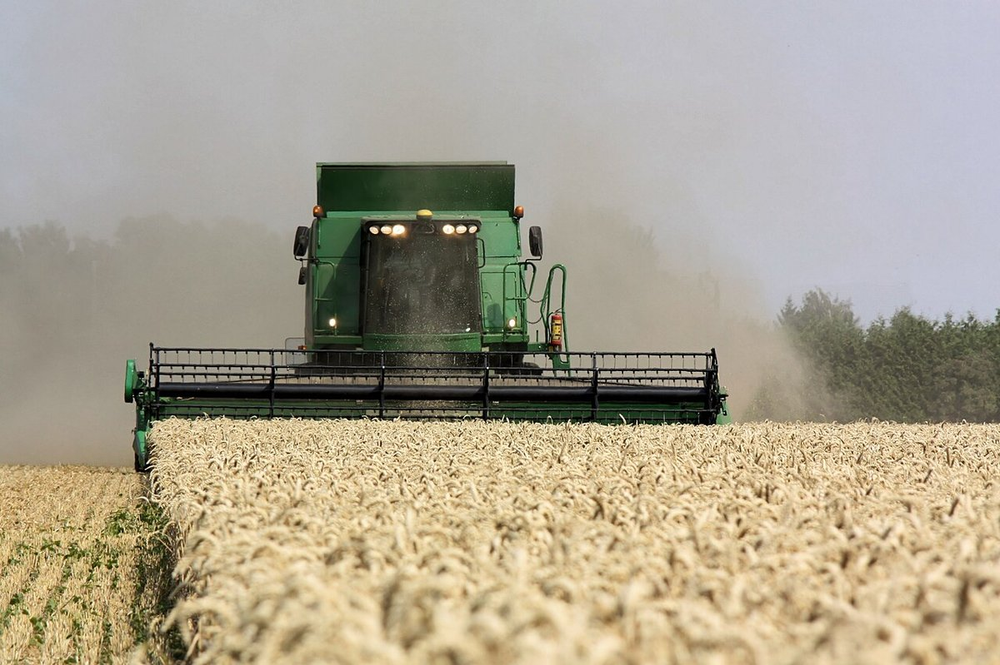
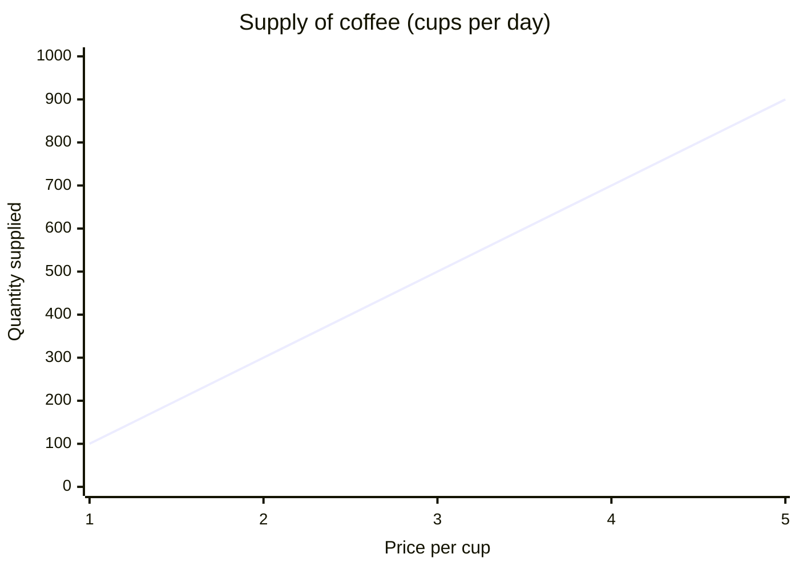

# Supply

**Prerequisites:** [Demand](01-demand.md), [Opportunity cost](../01-foundations/03-opportunity-cost.md).

*A combine harvester in a wheat field; how much farmers plant and harvest depends on the price they expect. Credit: Dan Kollmann. License: [CC BY-SA 3.0](https://creativecommons.org/licenses/by-sa/3.0). Source: [File:Combine in wheat field.jpg](https://commons.wikimedia.org/wiki/File:Combine_in_wheat_field.jpg).*

The other half of the model is **supply**: the relationship between the price of a good and how much sellers want to sell. Where demand reflects buyers' willingness to pay, supply reflects sellers' costs, and in particular their opportunity costs of producing one more unit.

## Quantity supplied and the supply schedule

The **quantity supplied** is the amount sellers are willing and able to sell at a given price over a given period. A **supply schedule** lists those quantities at various prices, other things equal. For coffee in the same town:

| Price per cup | Quantity supplied |
|---|---|
| 1.00 | 100 |
| 2.00 | 300 |
| 3.00 | 500 |
| 4.00 | 700 |
| 5.00 | 900 |

This is the line Q = −100 + 200P. Plotted with price on the vertical axis, the **supply curve** slopes upward.

## The law of supply

The **law of supply** says that, other things equal, a higher price leads to a larger quantity supplied. Why?

1. **Rising marginal cost.** In the short run, a café with one espresso machine and fixed staff can make more coffee only by working harder, paying overtime or hiring less experienced workers. Each extra cup costs more than the last. The café will produce an extra cup only if the price covers its marginal cost, so higher prices make more cups worth producing. The producer-theory lessons explain this through [diminishing marginal returns](../04-producer-theory/03-diminishing-marginal-returns.md).
2. **Entry and exit.** Higher prices attract new sellers into the market and keep marginal sellers from leaving. A coffee cart that would not bother operating at 1 dollar a cup may set up at 3.
3. **Opportunity cost of resources.** Resources used for coffee could make other things. A higher coffee price makes coffee the better use of more resources.

## Reading supply as marginal cost

Read from the quantity axis up, the height of the supply curve shows the **marginal cost** of the last unit, or equivalently the lowest price at which a seller would be willing to supply it. On our schedule, the 500th cup is supplied by a seller whose cost of producing it is 3 dollars. Earlier cups are supplied by sellers with lower costs. This reading underlies [producer surplus](10-producer-surplus-and-total-surplus.md).

In a competitive market, a firm's supply curve is literally the rising part of its marginal cost curve, a result proved in [[the-competitive-firm-in-the-short-run|the competitive firm in the short run]].

## Individual and market supply

Market supply is the horizontal sum of every seller's supply: at each price, add up the quantities all sellers offer. If at 3 dollars one café offers 300 cups and another offers 200, the market quantity supplied at 3 dollars is 500.

## Quantity supplied versus supply

As with demand:

- A change in the good's own price causes a movement **along** the supply curve: a change in **quantity supplied**.
- A change in anything else that affects sellers shifts the whole curve: a change in **supply**. These shifters are the subject of the next lesson.

## Time and supply

How much quantity supplied can respond depends on time:

- In the **very short run** (a day), the stock of a perishable good like fresh fish is fixed; supply is close to vertical.
- In the **short run**, firms can vary labour and materials but not plant size; supply slopes upward.
- In the **long run**, firms can build new plants and new firms can enter, so supply responds much more.

Alfred Marshall introduced this distinction between time periods in his *Principles of Economics* (1890), and it recurs throughout the course. See [elasticity of supply](08-other-elasticities.md) and [[long-run-competitive-equilibrium|long-run competitive equilibrium]].

## Upward-sloping supply is not universal

The law of supply is a good general rule, with some exceptions and subtleties:

- In industries with strong economies of scale, long-run average costs can fall as output grows, so long-run supply can be flat or even slope down over some ranges.
- Some supply is fixed regardless of price: there is only one Mona Lisa, and the land area of downtown Toronto does not grow when rents rise. Such supply is perfectly inelastic, which is central to the theory of [[land-and-rent|land and rent]].
- Labour supply can bend backward at high wages, because people may choose more leisure when they are richer. See [[labour-supply|labour supply]].

## Key ideas

- Quantity supplied is what sellers are willing and able to sell at a given price.
- The supply curve slopes upward: the law of supply.
- Reasons: rising marginal cost, entry of new sellers, and opportunity cost.
- The height of the supply curve shows the marginal cost of the last unit.
- Supply responds more over longer periods.

## Where this leads

- Next: [shifts in supply](04-shifts-in-supply.md).
- Then: [market equilibrium](05-market-equilibrium.md), where supply meets demand.
- Glossary: [[g:supply|supply]], [[g:law-of-supply|law of supply]], [[g:supply-curve|supply curve]], [[g:marginal-cost|marginal cost]].
