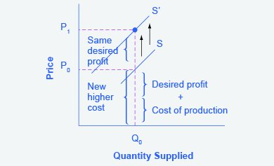
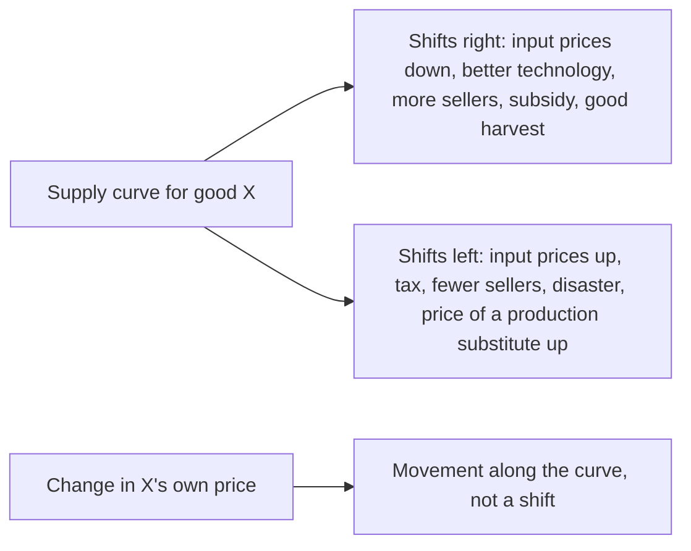

# Shifts in supply

**Prerequisites:** [Supply](03-supply.md).

*When the cost of production rises, the supply curve shifts up to a higher price at every quantity. Credit: OpenStax College. License: [CC BY 4.0](https://creativecommons.org/licenses/by/4.0). Source: [File:Supply Curve Shifts.jpg](https://commons.wikimedia.org/wiki/File:Supply_Curve_Shifts.jpg).*

The supply curve holds everything constant except the good's own price. When something else changes sellers' costs or opportunities, the whole curve shifts. An **increase in supply** shifts the curve to the right: sellers offer more at every price, or equivalently will accept a lower price for each quantity. A **decrease** shifts it left.

## The determinants of supply

1. **Input prices.** If the price of coffee beans, milk, rent or wages rises, producing each cup costs more, so supply decreases. Falling input prices increase supply.
2. **Technology.** Better technology lowers cost per unit. Mechanised harvesting, faster espresso machines or improved logistics all increase supply. Technology is the main reason the supply of many manufactured goods has grown so much over time.
3. **Prices of related goods in production.**
   - **Substitutes in production** use the same resources: a farmer can plant wheat or canola. A rise in the price of canola reduces the supply of wheat, as land shifts to canola.
   - **Complements in production**, or joint products, come out together: beef and leather, crude oil and natural gas from the same well. A rise in the price of beef increases the supply of leather.
4. **Expectations.** If producers expect higher prices later, they may hold back supply now to sell later, as with storable goods like grain or oil.
5. **Number of sellers.** New firms entering a market increase supply; firms leaving reduce it.
6. **Natural conditions.** Weather, disease and disasters affect agriculture and some industries strongly. A frost in Florida reduces the supply of oranges; a hurricane in the Gulf of Mexico can reduce oil refining.
7. **Government policies.** Taxes on producers act like higher costs and reduce supply; subsidies act like lower costs and increase supply. Regulations that raise compliance costs reduce supply. See [taxes and tax incidence](13-taxes-and-tax-incidence.md).

## Worked example: a rise in bean prices

Start from the supply schedule Q = −100 + 200P. Suppose the price of coffee beans rises so that each cup costs cafés 0.50 dollars more to make. Every seller now needs 0.50 more to be willing to supply the same quantity. The supply curve shifts **up** by 0.50, which is the same as shifting **left**:

| Price | Old quantity supplied | New quantity supplied |
|---|---|---|
| 1.00 | 100 | 0 |
| 2.00 | 300 | 200 |
| 3.00 | 500 | 400 |
| 4.00 | 700 | 600 |
| 5.00 | 900 | 800 |

The new curve is Q = −200 + 200P. At every price, sellers offer 100 fewer cups. Thinking of a cost increase as an upward shift by the amount of the cost increase is often the easiest way to analyse taxes, which work the same way.

## Two ways to see a shift

A supply shift can be read horizontally or vertically:

- **Horizontally**: at each price, sellers offer a different quantity.
- **Vertically**: for each quantity, sellers require a different minimum price, because their marginal cost has changed.

Both describe the same event. The vertical reading is especially useful for cost changes and taxes, because a per-unit cost increase shifts the curve up by exactly that amount.

## Historical example: the shale revolution

From the late 2000s, the combination of horizontal drilling and hydraulic fracturing made it profitable to extract oil and gas from shale rock in the United States. This was a technological improvement that shifted the US supply curve for crude oil and natural gas substantially to the right. US crude production roughly doubled between 2008 and 2015, according to the US Energy Information Administration, contributing to the fall in world oil prices in 2014 and 2015 along with other factors such as OPEC's decisions and slowing demand growth. The episode shows how a supply shift can reshape a global market.

## Key ideas

- Supply shifts when anything other than the good's own price changes sellers' costs or opportunities.
- Main shifters: input prices, technology, related goods in production, expectations, number of sellers, nature and government policy.
- A per-unit cost increase shifts supply up by that amount (left).
- Shifts can be read horizontally (quantity at each price) or vertically (minimum price for each quantity).

## Where this leads

- Next: [market equilibrium](05-market-equilibrium.md).
- Later: [comparative statics](06-comparative-statics.md) and [tax incidence](13-taxes-and-tax-incidence.md).
- Glossary: [supply](../glossary/supply.md), [subsidy](../glossary/subsidy.md), [technology](../glossary/technology.md).
