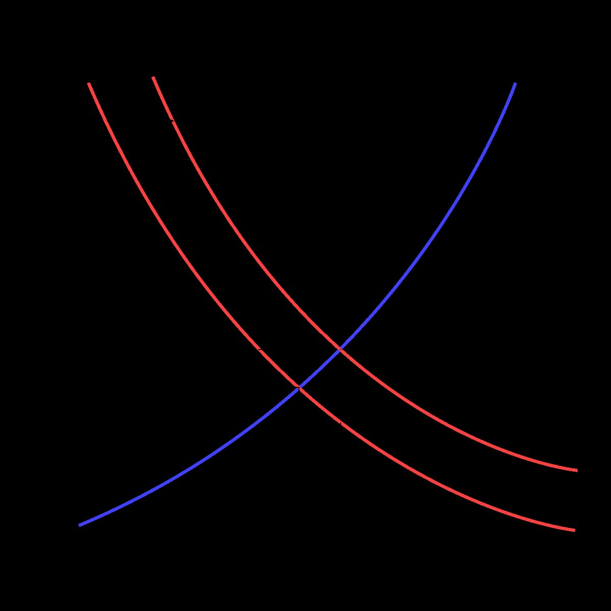
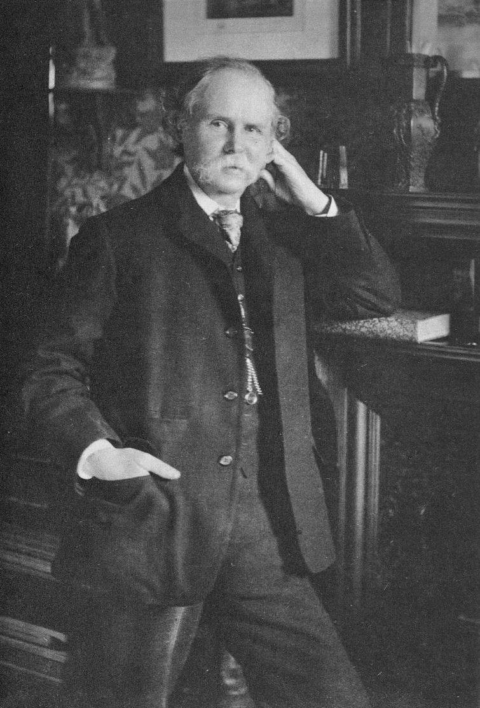
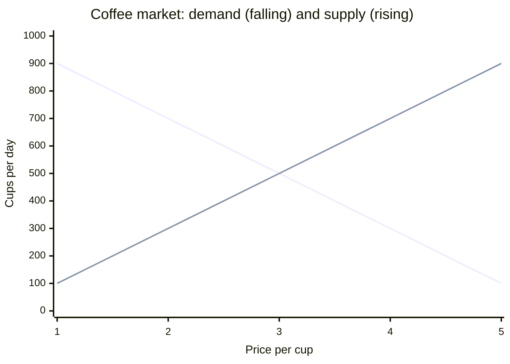
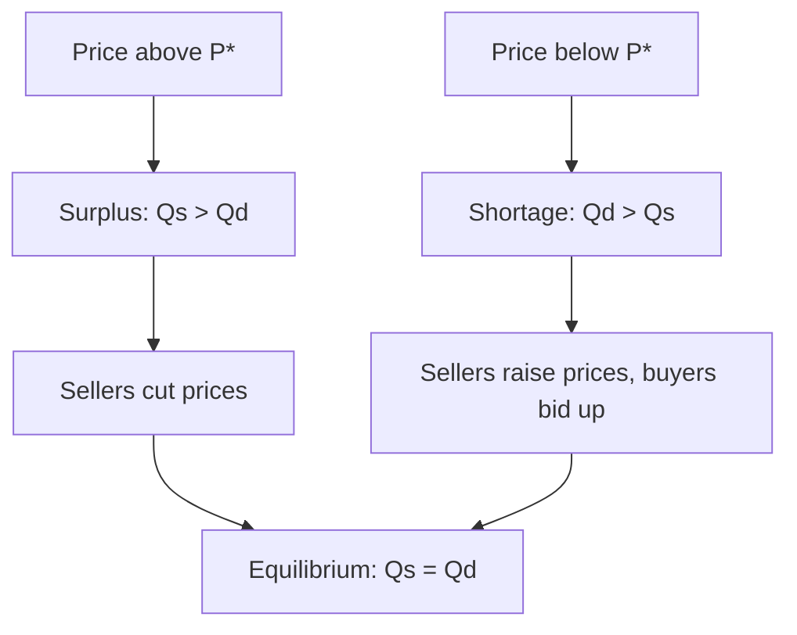

# Market equilibrium

**Prerequisites:** [Demand](01-demand.md), [Supply](03-supply.md).

*A supply and demand diagram: the market price settles where the two curves cross. Credit: Paweł Zdziarski (faxe), Astarot. License: [CC BY-SA 3.0](http://creativecommons.org/licenses/by-sa/3.0/). Source: [File:Supply-and-demand.svg](https://commons.wikimedia.org/wiki/File:Supply-and-demand.svg).*

*Alfred Marshall in about 1891, who compared supply and demand to the two blades of a pair of scissors. Credit: Elliott and Fry (London W., 55 Baker Street). License: Public domain. Source: [File:Alfred Marshall 1891.jpg](https://commons.wikimedia.org/wiki/File:Alfred_Marshall_1891.jpg).*

Put supply and demand on the same graph and they cross. At that crossing, the amount buyers want to buy equals the amount sellers want to sell. This is **market equilibrium**, and the price there is the **equilibrium price** or **market-clearing price**. Alfred Marshall compared supply and demand to the two blades of a pair of scissors: asking which one sets the price is like asking which blade cuts the paper.

## Finding equilibrium

Using the coffee schedules from the previous lessons:

| Price | Quantity demanded | Quantity supplied | Situation |
|---|---|---|---|
| 1.00 | 900 | 100 | Shortage of 800 |
| 2.00 | 700 | 300 | Shortage of 400 |
| 3.00 | 500 | 500 | **Equilibrium** |
| 4.00 | 300 | 700 | Surplus of 400 |
| 5.00 | 100 | 900 | Surplus of 800 |

Algebraically, demand is Qd = 1,100 − 200P and supply is Qs = −100 + 200P. Setting them equal: 1,100 − 200P = −100 + 200P, so 1,200 = 400P and **P\* = 3**. Then **Q\* = 1,100 − 600 = 500** cups.

## How markets move toward equilibrium

What makes the price settle at 3 dollars? Consider what happens elsewhere.

**Above equilibrium: surplus.** At 4 dollars, cafés want to sell 700 cups but buyers want only 300. Unsold coffee piles up (a **surplus** or **excess supply** of 400). Cafés with idle staff and unsold stock cut prices to attract buyers. As price falls, quantity demanded rises and quantity supplied falls, shrinking the surplus until it disappears at 3 dollars.

**Below equilibrium: shortage.** At 2 dollars, buyers want 700 cups but cafés supply only 300 (a **shortage** or **excess demand** of 400). Queues form, coffee sells out, and cafés realise they can charge more. As price rises, quantity supplied rises and quantity demanded falls until the shortage disappears.

Nobody needs to know where the equilibrium is for this to happen. Each seller responds only to their own unsold stock or sold-out shelves. This is the coordinating role of prices from [markets, prices and property rights](../01-foundations/10-markets-prices-and-property-rights.md) in action.

## What equilibrium achieves

At equilibrium:

- Every buyer willing to pay 3 dollars or more gets coffee; no one who values it less buys.
- Every seller whose marginal cost is 3 dollars or less sells; no higher-cost producer does.
- Every trade where the buyer's value exceeds the seller's cost happens, and no trade where cost exceeds value happens.

This last point means a competitive equilibrium maximises the total gains from trade, a result made precise in [producer surplus and total surplus](10-producer-surplus-and-total-surplus.md). It is a statement about efficiency, not fairness: buyers who cannot afford 3 dollars go without.

## How fast and how real?

Real markets do not jump to equilibrium instantly. Prices may be sticky because of contracts, menu costs (the cost of changing posted prices) or concern for customer goodwill. Some markets clear in seconds, such as stock exchanges; others take months, such as housing. Léon Walras imagined an auctioneer calling out prices until supply equalled demand, a process he called *tâtonnement* ("groping"). Experimental economists, starting with Vernon Smith's classroom experiments in the 1950s and 1960s, found that markets with even a handful of buyers and sellers often converge close to the predicted competitive equilibrium surprisingly quickly, especially under auction rules like those of real exchanges.

## Stable and unstable equilibria

The equilibrium above is **stable**: if the price is disturbed, forces push it back. Under unusual conditions, such as strong expectations that prices will keep rising (common in asset bubbles), demand can increase when prices rise, and the price can move away from the equilibrium rather than toward it. The finance course discusses such dynamics in [herding, bubbles and manias](../../finance/07-behavioural-finance/04-herding-bubbles-and-manias.md).

## Key ideas

- Equilibrium is where quantity demanded equals quantity supplied.
- Above the equilibrium price there is a surplus; below it, a shortage.
- Surpluses push prices down and shortages push them up, so competitive markets tend toward equilibrium.
- Equilibrium maximises total gains from trade but does not guarantee a fair distribution.
- Real markets adjust at different speeds; experiments show convergence is often fast.

## Where this leads

- Next: [comparative statics](06-comparative-statics.md), how equilibrium moves when curves shift.
- Related: [[general-equilibrium|general equilibrium]], equilibrium in many markets at once.
- Glossary: [[g:equilibrium|equilibrium]], [[g:shortage|shortage]], [[g:surplus|surplus (excess supply)]].
