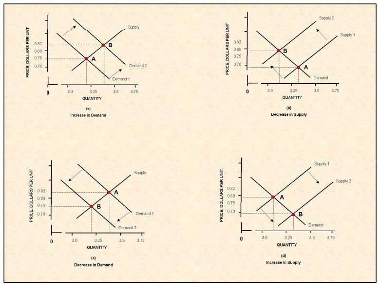
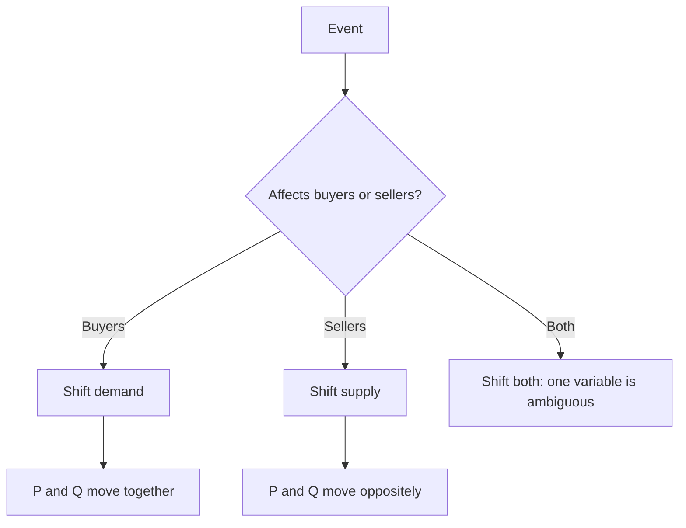

# Comparative statics: when supply and demand shift

**Prerequisites:** [Shifts in demand](02-shifts-in-demand.md), [Shifts in supply](04-shifts-in-supply.md), [Market equilibrium](05-market-equilibrium.md).

*How equilibrium price and quantity change when supply and demand shift. Credit: Lorie A. Wagner, Daniel E. Sullivan, and John L. Sznopek. License: Public domain. Source: [File:Equilibrium price and quantity changes as a result of shifts in supply and demand adapted from Truett and Truett, 1982.jpg](https://commons.wikimedia.org/wiki/File:Equilibrium_price_and_quantity_changes_as_a_result_of_shifts_in_supply_and_demand_adapted_from_Truett_and_Truett,_1982.jpg).*

The real power of supply and demand is in prediction: if something happens, what will happen to price and quantity? The method is called **comparative statics**: compare the equilibrium before and after a change, without worrying about the path in between.

## A three-step method

1. **Which curve shifts?** Does the event affect buyers (demand), sellers (supply), or both?
2. **Which direction?** Right (increase) or left (decrease)?
3. **Compare equilibria.** Find the new intersection and read off the change in price and quantity.

## The four basic cases

| Event | Effect on price | Effect on quantity |
|---|---|---|
| Demand increases | Up | Up |
| Demand decreases | Down | Down |
| Supply increases | Down | Up |
| Supply decreases | Up | Down |

Demand shifts move price and quantity in the **same** direction. Supply shifts move them in **opposite** directions. That pattern is a useful diagnostic: if you see prices and quantities rising together, look for a demand shift; if prices rise while quantities fall, look for a supply shift.

## Worked example 1: demand increases

Start with coffee demand Qd = 1,100 − 200P and supply Qs = −100 + 200P. Equilibrium: P = 3, Q = 500.

A new office opens and demand rises by 200 cups at every price: Qd = 1,300 − 200P. New equilibrium: 1,300 − 200P = −100 + 200P, so 1,400 = 400P, **P = 3.50**, Q = 1,300 − 700 = **600**. Price rises by 0.50 and quantity by 100. Note that quantity rose by only 100, not the full 200, because the higher price discouraged some buyers and encouraged more supply.

## Worked example 2: supply decreases

Back to the original demand. Bean prices rise by 0.50 per cup, so supply becomes Qs = −200 + 200P. New equilibrium: 1,100 − 200P = −200 + 200P, so 1,300 = 400P, **P = 3.25**, Q = 1,100 − 650 = **450**. Price rises by only 0.25 even though costs rose by 0.50. Buyers and sellers share the cost increase, a preview of [tax incidence](13-taxes-and-tax-incidence.md).

## Both curves shift

When both curves shift, one of price or quantity is predictable and the other is ambiguous, depending on which shift is larger.

- **Demand up, supply up**: quantity rises for sure; price could go either way.
- **Demand up, supply down**: price rises for sure; quantity could go either way.
- **Demand down, supply up**: price falls for sure; quantity ambiguous.
- **Demand down, supply down**: quantity falls for sure; price ambiguous.

**Worked example 3.** Demand rises to Qd = 1,300 − 200P and supply falls to Qs = −200 + 200P at the same time. Then 1,300 − 200P = −200 + 200P gives P = 3.75 and Q = 550. Price rose a lot (both shifts push it up). Quantity rose slightly, because the demand increase (200 at each price) outweighed the supply decrease (100 at each price).

## Real-world applications

- **Avocados.** Rising popularity in North America from the 2000s (a demand increase) pushed both consumption and prices up, even as growing areas expanded.
- **Pandemic toilet paper.** In March 2020, panic buying shifted demand sharply right while supply could not respond quickly. Stores held prices roughly steady, partly because many jurisdictions prohibited "price gouging" in emergencies and partly to preserve goodwill, so the result was empty shelves (shortages) instead of higher prices. This is an example of what happens when prices do not adjust, explored in [price ceilings](11-price-ceilings.md).
- **Flat-screen televisions.** Technological improvements greatly increased supply, while demand also rose. Quantity soared and prices fell, showing the supply shift dominated.

## Common mistakes

- **Shifting the wrong curve.** A tax on sellers shifts supply, not demand. A rise in consumer income shifts demand, not supply.
- **Shifting both curves when only one moves.** If the price of coffee rises because of a frost, the demand curve does not shift; quantity demanded falls along the existing curve.
- **Confusing cause and effect.** "Prices rose so demand fell" mixes a movement along the curve with a shift.

## Key ideas

- Comparative statics compares equilibria before and after a change.
- Demand shifts move price and quantity together; supply shifts move them in opposite directions.
- When both shift, one variable's direction is certain and the other depends on the sizes of the shifts.
- Quantities usually change by less than the size of a shift, because price adjusts.

## Where this leads

- Next: [price elasticity of demand](07-price-elasticity-of-demand.md), which governs how big the price and quantity changes are.
- Glossary: [comparative statics](../glossary/comparative-statics.md), [equilibrium](../glossary/equilibrium.md).
