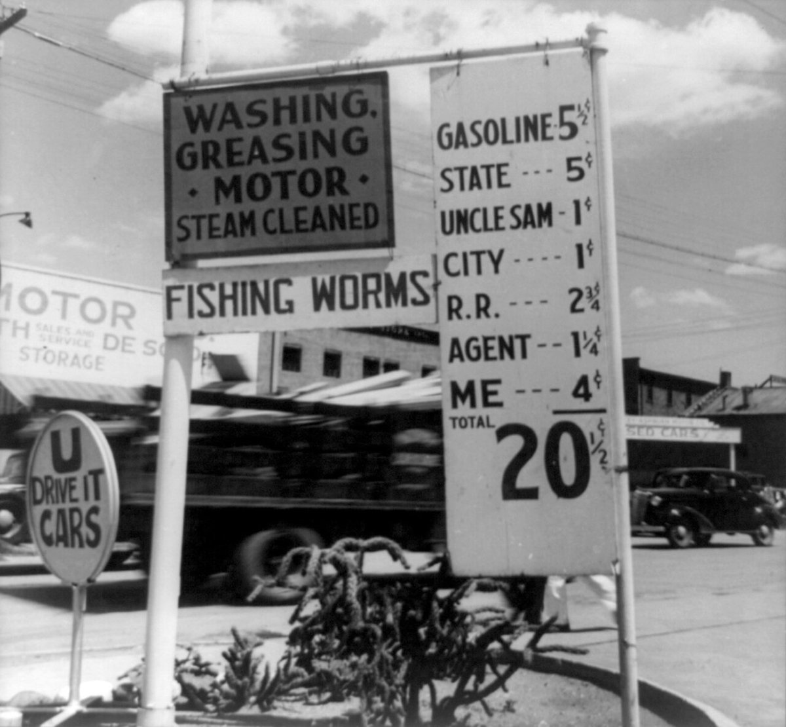
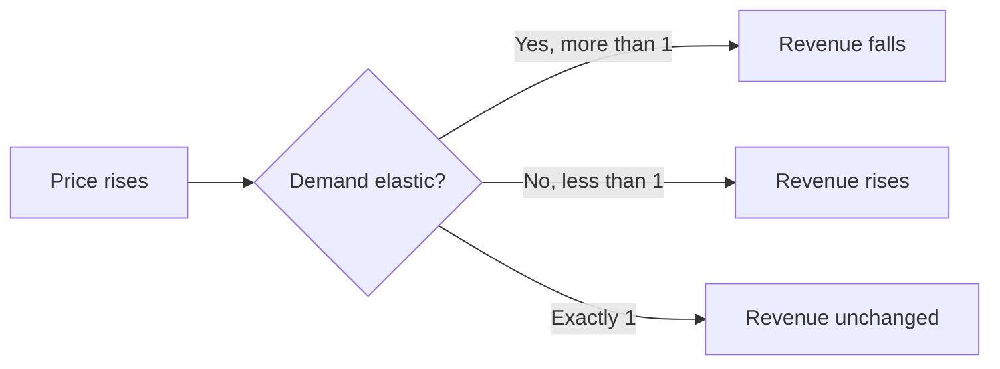

# Price elasticity of demand

**Prerequisites:** [Demand](01-demand.md), [Comparative statics](06-comparative-statics.md).

*Gas station price signs in Santa Fe, New Mexico, photographed by Dorothea Lange in 1938. Credit: Dorothea Lange. License: Public domain. Source: [File:Dorothea Lange, Gas station price analysis, Santa Fe, New Mexico, 1938.jpg](https://commons.wikimedia.org/wiki/File:Dorothea_Lange,_Gas_station_price_analysis,_Santa_Fe,_New_Mexico,_1938.jpg).*

The law of demand says quantity falls when price rises. But by how much? If a gas station raises its price by 10 percent, does it lose 2 percent of its sales or 50 percent? The answer is measured by the **price elasticity of demand**, and it decides whether a price increase raises or lowers revenue, who bears a tax, and how much a supply shock moves prices.

## Definition

Price elasticity of demand is the percentage change in quantity demanded divided by the percentage change in price:

**Ed = (% change in quantity demanded) / (% change in price)**

Because price and quantity move in opposite directions, Ed is negative. By convention economists usually drop the minus sign and talk about its absolute value. Using percentages makes elasticity independent of units: it does not matter whether coffee is measured in cups or litres, or prices in dollars or cents.

## Categories

| Absolute elasticity | Name | Meaning |
|---|---|---|
| greater than 1 | **Elastic** | Quantity responds more than proportionally to price |
| exactly 1 | **Unit elastic** | Quantity changes by the same percentage as price |
| less than 1 | **Inelastic** | Quantity responds less than proportionally |
| 0 | Perfectly inelastic | Quantity does not respond at all (vertical demand) |
| infinite | Perfectly elastic | Any price rise loses all sales (horizontal demand) |

## Calculating with the midpoint method

Percent changes depend on the starting point: going from 2 to 3 is a 50 percent rise, but from 3 to 2 is a 33 percent fall. To avoid this, economists often use the **midpoint (arc) method**, dividing each change by the average of the two values.

**Example.** Coffee demand Qd = 1,100 − 200P. Price rises from 2 to 3; quantity falls from 700 to 500.

- % change in Q = (500 − 700) / ((500 + 700)/2) = −200 / 600 = −33.3%
- % change in P = (3 − 2) / ((3 + 2)/2) = 1 / 2.5 = 40%
- Ed = 33.3 / 40 = **0.83**, inelastic over this range.

Between 4 and 5 dollars (quantity 300 to 100): %ΔQ = −200/200 = −100%; %ΔP = 1/4.5 = 22.2%; Ed = **4.5**, elastic. Along a straight-line demand curve, elasticity is **not constant**: demand is elastic at high prices and inelastic at low prices, with unit elasticity at the midpoint (here P = 2.75).

## What makes demand elastic or inelastic

1. **Availability of substitutes.** The more close substitutes, the more elastic. Demand for one brand of gasoline is very elastic (drive to the next station); demand for gasoline overall is inelastic in the short run.
2. **Necessity versus luxury.** Necessities such as basic food, insulin and heating tend to be inelastic; luxuries tend to be elastic.
3. **Share of budget.** Goods that take a large share of income (rent, cars) tend to be more elastic than small purchases (salt, matches).
4. **Definition of the market.** "Food" is inelastic; "strawberries" is more elastic; "strawberries from one stall" is very elastic.
5. **Time horizon.** Demand is usually more elastic in the long run. When gasoline prices rise, people cannot immediately change cars or commutes, but over years they do.

Empirical surveys of gasoline demand typically find short-run elasticities well below 1 (often around 0.1 to 0.3) and larger long-run elasticities, though estimates vary by country and period.

## Elasticity and total revenue

**Total revenue** = price × quantity. Elasticity tells you what happens to total revenue (what buyers spend, what sellers receive) when price changes:

- **Elastic demand**: a price rise **lowers** revenue (quantity falls by a larger percentage).
- **Inelastic demand**: a price rise **raises** revenue.
- **Unit elastic**: revenue unchanged.

Check with the coffee example: at P = 2, revenue = 2 × 700 = 1,400. At P = 3, revenue = 3 × 500 = 1,500 (up, inelastic range). At P = 4, revenue = 4 × 300 = 1,200; at P = 5, revenue = 5 × 100 = 500 (down, elastic range).

This explains a farming paradox: a bumper harvest can **reduce** farmers' total income. Food demand is inelastic, so a large supply increase drives prices down by a larger percentage than quantity rises.

## Uses of elasticity

- **Pricing.** A firm with inelastic demand can raise prices profitably; with elastic demand it cannot. A monopolist always operates on the elastic part of its demand curve, as shown in [[monopoly|monopoly]].
- **Taxes.** Taxes on inelastic goods (tobacco, alcohol, fuel) raise a lot of revenue with relatively small changes in quantity. See [tax incidence](13-taxes-and-tax-incidence.md).
- **Policy.** Elasticity estimates tell regulators how much a drug policy, a congestion charge or a carbon price will change behaviour.

## Key ideas

- Price elasticity of demand = % change in quantity / % change in price.
- Elastic (more than 1), unit elastic (1), inelastic (less than 1).
- Determinants: substitutes, necessity, budget share, market definition, time.
- Elasticity varies along a straight-line demand curve.
- Inelastic demand: price up means revenue up; elastic demand: price up means revenue down.

## Where this leads

- Next: [income, cross-price and supply elasticities](08-other-elasticities.md).
- Related: [[price-discrimination|price discrimination]] relies on different elasticities across buyers.
- Glossary: [[g:price-elasticity-of-demand|price elasticity of demand]], [[g:elastic|elastic]], [[g:inelastic|inelastic]], [[g:total-revenue|total revenue]].
