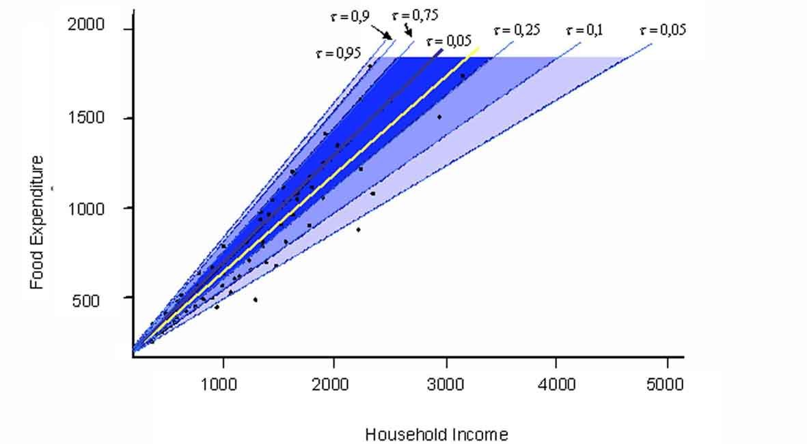
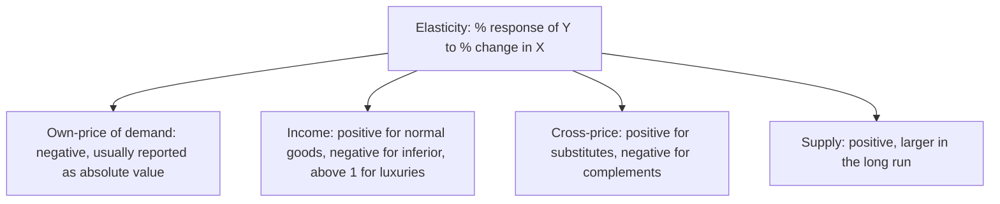

# Income, cross-price and supply elasticities

**Prerequisites:** [Price elasticity of demand](07-price-elasticity-of-demand.md), [Shifts in demand](02-shifts-in-demand.md).

*Engel curves: how the quantity demanded of a good changes as income rises, for normal and inferior goods. Credit: The original uploader was Artinger at English Wikibooks. License: [CC BY-SA 2.5](https://creativecommons.org/licenses/by-sa/2.5). Source: [File:Engel Curve.jpg](https://commons.wikimedia.org/wiki/File:Engel_Curve.jpg).*

Elasticity is a general tool: the percentage response of one variable to a percentage change in another. The price elasticity of demand is the most famous, but three others are used constantly.

## Income elasticity of demand

**Income elasticity = (% change in quantity demanded) / (% change in income)**

The sign matters here:

- **Positive**: a **normal good**. Demand rises with income.
  - Between 0 and 1: a **necessity**. Demand rises, but less than proportionally. Food as a whole is the classic case.
  - Greater than 1: a **luxury**. Demand rises more than proportionally. International travel, fine dining and many services tend to be luxuries.
- **Negative**: an **inferior good**. Demand falls as income rises.

**Example.** A household's income rises 10 percent and its spending on restaurant meals rises 20 percent while its purchases of instant noodles fall 5 percent. Income elasticity of restaurant meals = 20/10 = 2 (luxury); of instant noodles = −5/10 = −0.5 (inferior).

The idea that food takes a falling share of the budget as income rises is called **Engel's law**, after the German statistician Ernst Engel, who documented it in Belgian household budget data in 1857. It holds widely across countries and time, and it explains why agriculture's share of the economy shrinks as countries grow richer. See [income changes and Engel curves](../03-consumer-theory/07-income-changes-and-engel-curves.md).

## Cross-price elasticity of demand

**Cross-price elasticity = (% change in quantity demanded of good X) / (% change in price of good Y)**

- **Positive**: X and Y are **substitutes**. If tea's price rises 10% and coffee sales rise 3%, the cross-price elasticity is 0.3.
- **Negative**: X and Y are **complements**. If printer prices rise 10% and ink cartridge sales fall 4%, the cross-elasticity is −0.4.
- **Near zero**: unrelated goods.

Competition authorities use cross-price elasticities to define markets. If a rise in the price of one product would send many customers to another, the two may be in the same market for antitrust purposes. A standard approach asks whether a hypothetical monopolist of a product could profitably impose a "small but significant and non-transitory increase in price" (the SSNIP test, typically 5 to 10 percent). See [[competition-policy|competition policy]].

## Price elasticity of supply

**Price elasticity of supply = (% change in quantity supplied) / (% change in price)**

It is positive, because supply curves slope upward.

- **Elastic supply** (above 1): producers can expand output easily, for example when spare capacity is available or inputs are easy to obtain.
- **Inelastic supply** (below 1): output is hard to expand, because of fixed capacity, long production times or scarce inputs.
- **Perfectly inelastic**: supply is fixed. Original paintings and land in a given location are examples.

**Example.** Using supply Qs = −100 + 200P, a price rise from 3 to 4 raises quantity from 500 to 700. Midpoint method: %ΔQ = 200/600 = 33.3%; %ΔP = 1/3.5 = 28.6%; elasticity = **1.17**, slightly elastic.

**Time is the main determinant.** In the short run, a vineyard cannot plant more vines and get grapes this year; in the long run it can, and new vineyards can open. So supply is usually much more elastic in the long run than in the short run. Housing is a striking example: in cities where land is scarce and zoning restricts new building, housing supply is inelastic, so increases in demand show up mainly as higher prices rather than more homes.

## Why elasticities matter for prices

When a shock hits a market, elasticities decide how much of the adjustment comes through price and how much through quantity:

- If supply is inelastic, a demand increase mostly raises price.
- If supply is elastic, a demand increase mostly raises quantity.
- If demand is inelastic, a supply cut mostly raises price.

This is why oil price spikes can be so large: both short-run demand and short-run supply of crude oil are inelastic, so modest disruptions to supply produce large price changes.

## Key ideas

- Income elasticity distinguishes necessities (0 to 1), luxuries (above 1) and inferior goods (negative).
- Engel's law: food's share of spending falls as income rises.
- Cross-price elasticity is positive for substitutes and negative for complements; it helps define markets.
- Supply elasticity measures how readily output responds and grows with time.
- Elasticities determine how shocks split between price and quantity changes.

## Where this leads

- Next: [consumer surplus](09-consumer-surplus.md).
- Related: [taxes and tax incidence](13-taxes-and-tax-incidence.md), where elasticities decide who pays.
- Glossary: [[g:income-elasticity-of-demand|income elasticity of demand]], [[g:cross-price-elasticity|cross-price elasticity]], [[g:price-elasticity-of-supply|price elasticity of supply]], [[g:engels-law|Engel's law]].
