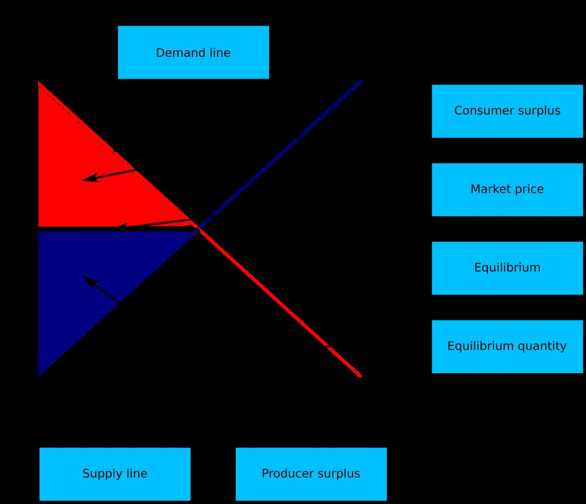
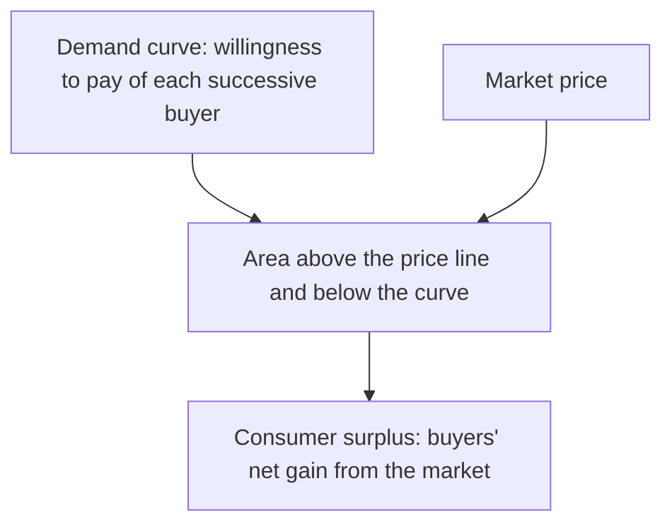

# Consumer surplus

**Prerequisites:** [Demand](01-demand.md), [Market equilibrium](05-market-equilibrium.md).

*Consumer surplus (above the price, below demand) and producer surplus (below the price, above supply). Credit: Original Finnish PNG version made by Lendu at fi.wikipediaTranslated by BkwillwmSVG version created by Antti Palsola (Apalsola). License: [CC BY-SA 3.0](http://creativecommons.org/licenses/by-sa/3.0/). Source: [File:Consumer producer surplus en.svg](https://commons.wikimedia.org/wiki/File:Consumer_producer_surplus_en.svg).*

When you buy something for less than the most you would have paid, you gain. Economists measure that gain as **consumer surplus**: the difference between what buyers are willing to pay and what they actually pay. Adding it up across all buyers gives a money measure of how much a market benefits consumers, which is the basis for judging policies such as taxes and price controls.

## Willingness to pay

Each buyer has a **willingness to pay** (WTP): the maximum price they would pay for a unit. Suppose four people are interested in a concert ticket:

| Buyer | Willingness to pay |
|---|---|
| Ali | 100 |
| Bea | 80 |
| Cy | 70 |
| Dee | 50 |

If the ticket price is 75, Ali and Bea buy; Cy and Dee do not. Ali's consumer surplus is 100 − 75 = 25; Bea's is 80 − 75 = 5. Total consumer surplus is 30.

If the price falls to 60, Cy also buys. Ali's surplus rises to 40, Bea's to 20, Cy gets 10. Total: 70. A lower price raises consumer surplus in two ways: existing buyers pay less, and new buyers enter.

## Consumer surplus as an area

Line up the buyers from highest WTP to lowest and you get a staircase that is the demand curve. With many buyers, the staircase smooths into a line. **Consumer surplus is the area below the demand curve and above the price**, out to the quantity bought.

**Worked example.** Coffee demand Qd = 1,100 − 200P; equilibrium price 3, quantity 500. The demand curve hits the price axis where Q = 0, at P = 5.50 (the **choke price**, the highest anyone would pay). Consumer surplus is the triangle with height 5.50 − 3 = 2.50 and base 500:

CS = ½ × 500 × 2.50 = **625 dollars per day**.

If the price fell to 2, quantity would be 700 and CS = ½ × 700 × 3.50 = 1,225. The increase of 600 comes from the 500 existing buyers each saving 1 dollar (500) plus the surplus of 200 new buyers (½ × 200 × 1 = 100).

## Origins of the idea

The French engineer-economist Jules Dupuit introduced the idea in 1844 in a paper on measuring the utility of public works such as bridges and canals. He argued that the benefit of a bridge is not the tolls collected but the total value users place on crossing, much of which they do not pay for. Alfred Marshall later named and popularised the concept as "consumer's surplus" in his *Principles of Economics* (1890).

## What consumer surplus measures, and its limits

Consumer surplus measures benefit in dollars, using buyers' willingness to pay. This has two consequences worth knowing:

1. **It weights by ability to pay.** A rich person's willingness to pay is higher partly because they have more money. A dollar of surplus to a billionaire counts the same as a dollar to a student. Economists use consumer surplus mainly to measure *efficiency*, and treat distribution as a separate question. See [efficiency versus equity](../08-welfare-economics/04-efficiency-versus-equity.md).
2. **It assumes demand reflects true benefit.** If buyers are misinformed or, as behavioural economics suggests, make predictable errors, willingness to pay may not match the benefit they actually get. See [heuristics and biases](../09-behavioural-economics/03-heuristics-and-biases.md).

There is also a technical subtlety: when a price change significantly affects buyers' real income, the area under an ordinary demand curve is only an approximation of the welfare change. More precise measures, called **compensating** and **equivalent variation**, were developed by John Hicks in the 1940s. For most goods that take a small share of the budget, the approximation is good.

## Surplus from new goods

Some of the largest consumer surplus comes from goods that are cheap or free. Search engines, maps, and online encyclopedias charge users nothing, so measured spending on them is zero, yet surveys and experiments suggest people would require substantial payments to give them up. Economists such as Erik Brynjolfsson have used such experiments to argue that GDP understates the welfare gains from digital goods. The point is the same as Dupuit's: what people pay is not what a good is worth to them.

## Key ideas

- Consumer surplus = willingness to pay − price paid, summed over buyers.
- Graphically, it is the area below demand and above price.
- Lower prices increase consumer surplus for existing and new buyers.
- Dupuit introduced it in 1844; Marshall named it.
- It measures efficiency in money terms but weights by ability to pay.

## Where this leads

- Next: [producer surplus and total surplus](10-producer-surplus-and-total-surplus.md).
- Applied: [deadweight loss](14-deadweight-loss.md) measures surplus destroyed by taxes and controls.
- Glossary: [consumer surplus](../glossary/consumer-surplus.md), [willingness to pay](../glossary/willingness-to-pay.md), [choke price](../glossary/choke-price.md).
