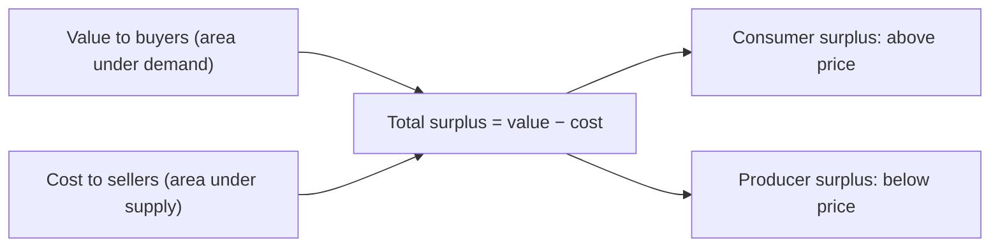

# Producer surplus and total surplus

**Prerequisites:** [Supply](03-supply.md), [Consumer surplus](09-consumer-surplus.md).

*A stall at Chiswick Farmers' Market, London: every sale at a price above the seller's cost adds to producer surplus. Credit: Ian Alexander. License: [CC BY-SA 4.0](https://creativecommons.org/licenses/by-sa/4.0). Source: [File:Leicestershire Meat stall Chiswick Farmers' Market.jpg](https://commons.wikimedia.org/wiki/File:Leicestershire_Meat_stall_Chiswick_Farmers'_Market.jpg).*

Sellers gain from trade too. **Producer surplus** measures that gain: the amount sellers receive minus the minimum they would have accepted. Add it to consumer surplus and you get **total surplus**, the total net benefit a market creates. Total surplus is the yardstick economists use to judge whether a market outcome is efficient.

## Producer surplus

Each seller has a **cost**, or minimum acceptable price: the lowest price at which they would be willing to sell a unit. For a producer, that is the marginal cost of making it; for someone selling a used item, it is the value they place on keeping it.

Suppose four painters bid on a house-painting job:

| Painter | Cost |
|---|---|
| Erin | 300 |
| Finn | 400 |
| Gia | 500 |
| Hal | 600 |

If the price of a job is 550, Erin, Finn and Gia are willing to work. Their producer surpluses are 250, 150 and 50, totalling 450. Hal stays out.

**Producer surplus is the area above the supply curve and below the price**, out to the quantity sold.

**Worked example.** Coffee supply Qs = −100 + 200P; equilibrium P = 3, Q = 500. Supply hits the price axis at Q = 0 when P = 0.50 (no café supplies below that). Producer surplus is the triangle with height 3 − 0.50 = 2.50 and base 500:

PS = ½ × 500 × 2.50 = **625 dollars per day**.

Note that producer surplus is not the same as profit. Profit subtracts fixed costs too; producer surplus subtracts only the costs that vary with output. In the short run, producer surplus equals revenue minus variable costs.

## Total surplus

**Total surplus = consumer surplus + producer surplus**
= (value to buyers − amount paid) + (amount received − cost to sellers)
= value to buyers − cost to sellers.

The price cancels out. A price is a transfer from buyers to sellers; it divides the surplus but does not create it. Surplus is created by moving goods from people who value them less (or can make them cheaply) to people who value them more.

In the coffee market, total surplus = 625 + 625 = **1,250 dollars per day**. Graphically it is the whole triangle between the demand and supply curves, to the left of the equilibrium quantity.

## Equilibrium maximises total surplus

At the competitive equilibrium, total surplus is as large as it can be. Three facts together guarantee this:

1. **Goods go to the buyers who value them most.** Everyone with WTP above the price buys; everyone below does not.
2. **Goods are produced by the sellers with the lowest costs.** Every seller with cost below the price sells; every seller above does not.
3. **The quantity is right.** Producing less than 500 cups would leave out trades where the buyer's value exceeds the seller's cost. Producing more than 500 would include trades where cost exceeds value, subtracting from surplus.

Try producing 600 cups: the 600th cup costs 3.50 to make (from supply) but is worth only 2.50 to its buyer (from demand). Each cup beyond 500 destroys surplus. Producing 400: the 400th cup is worth 3.50 to a buyer and costs only 2.50 to make, so a trade worth 1 dollar of surplus is missed.

This result is a simple version of the [[the-welfare-theorems|first welfare theorem]]. It depends on assumptions: competitive markets, no [[externalities|externalities]], good information, and no [[public-goods|public goods]] problems. When they fail, the market quantity can be too high or too low.

## Efficiency is not everything

A market that maximises total surplus is **efficient** in the economist's sense. It is not necessarily **fair**. The surplus could be divided very unequally, and people who cannot afford the price get nothing. Many policies deliberately trade some efficiency for other goals, such as equity or security. The point of the surplus framework is not to declare that efficiency always wins but to make the costs of each choice visible. See [[efficiency-versus-equity|efficiency versus equity]].

## Key ideas

- Producer surplus = price received − seller's cost, summed over sellers; it is the area above supply and below price.
- Total surplus = consumer surplus + producer surplus = value to buyers − cost to sellers.
- Prices transfer surplus; they do not create it.
- Competitive equilibrium maximises total surplus under standard assumptions.
- Efficiency and fairness are distinct goals.

## Where this leads

- Next: [price ceilings](11-price-ceilings.md), the first of several interventions measured with surplus.
- Glossary: [[g:producer-surplus|producer surplus]], [[g:total-surplus|total surplus]], [[g:efficiency|efficiency]].
