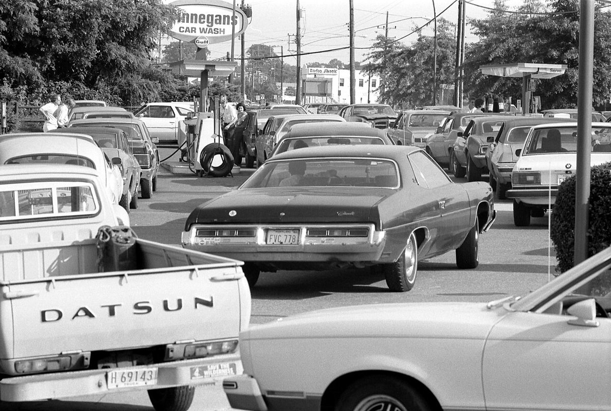
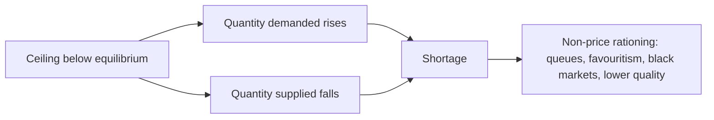

# Price ceilings

**Prerequisites:** [Market equilibrium](05-market-equilibrium.md), [Producer surplus and total surplus](10-producer-surplus-and-total-surplus.md).

*A line of cars at a gas station on 15 June 1979, during a period of US fuel price controls. Credit: Warren K. Leffler. License: Public domain. Source: [File:Line at a gas station, June 15, 1979.jpg](https://commons.wikimedia.org/wiki/File:Line_at_a_gas_station,_June_15,_1979.jpg).*

Governments sometimes decide that a market price is too high and cap it by law. A **price ceiling** is a legal maximum price. Rent control, caps on gasoline prices, limits on interest rates and anti-"price gouging" laws during emergencies are all examples. Supply and demand predict what happens, and the predictions are among the most reliable in economics.

## Binding and non-binding ceilings

A ceiling set **above** the equilibrium price has no effect: the market price is already below it. A ceiling set **below** equilibrium is **binding**: it prevents the price from rising to the level where quantity demanded equals quantity supplied.

## The result: a shortage

Using the coffee market (Qd = 1,100 − 200P, Qs = −100 + 200P, equilibrium P = 3, Q = 500), suppose the town caps coffee at 2 dollars.

- Quantity demanded at 2: 700 cups.
- Quantity supplied at 2: 300 cups.
- **Shortage: 400 cups.**

Only 300 cups are actually sold, because buyers cannot force sellers to supply more. The ceiling lowers the price for those who get coffee, but fewer people get it.

## Surplus effects

At the ceiling of 2 with 300 cups sold:

- **Consumer surplus**, if the 300 cups go to the buyers who value them most: the area between the demand curve and the price of 2 for the first 300 cups. Demand at Q = 300 has WTP = (1,100 − 300)/200 = 4. So CS = 300 × (4 − 2) + ½ × 300 × (5.50 − 4) = 600 + 225 = **825** (up from 625).
- **Producer surplus**: ½ × 300 × (2 − 0.50) = **225** (down from 625).
- **Total surplus**: 1,050, down from 1,250. The lost 200 is the **deadweight loss**: trades between 300 and 500 cups that would have benefited both sides no longer happen. (Triangle: ½ × 200 × (4 − 2) = 200.)

So the ceiling transfers surplus from sellers to the buyers lucky enough to get coffee, and destroys some surplus entirely. And the consumer surplus figure is an upper bound: if coffee is allocated by queuing or chance rather than to the highest-value buyers, consumers gain less.

## How shortages get rationed

When price cannot ration, something else does:

- **Queues.** People pay in time. The 1973 to 1974 oil crisis in the United States, when federal price controls were in place, produced long lines at gas stations.
- **First-come, first-served or lotteries.**
- **Favouritism and discrimination.** Landlords with many applicants can choose tenants on grounds unrelated to willingness to pay.
- **Black markets.** Goods are resold illegally above the ceiling.
- **Lower quality.** Sellers cut costs in ways the law does not cover: smaller portions, less maintenance.
- **Side payments.** "Key money" for apartments, or tied purchases.

## Rent control

Rent control is the most studied price ceiling. Economists distinguish between strict, "first-generation" controls that freeze rents, and softer "second-generation" or rent-stabilisation systems that limit increases for sitting tenants while allowing rents to reset between tenancies or to rise with inflation.

Surveys of economists show broad agreement that strict rent controls reduce the quantity and quality of rental housing over time. A frequently cited study by Rebecca Diamond, Tim McQuade and Franklin Qian (2019) on San Francisco's 1994 expansion of rent control found that it helped covered tenants stay in their homes, but that landlords of covered buildings reduced the supply of rental housing by about 15 percent, for example by converting to condominiums, which tended to push up rents elsewhere in the city.

Supporters of rent regulation argue that it provides stability and protects tenants from displacement and sudden increases, especially where housing supply is slow to respond and moving is costly. Critics argue that the better remedy is to increase supply by easing zoning and permitting rules, and to help low-income tenants directly with housing allowances. Both sides often agree that the underlying problem in high-rent cities is inelastic housing supply.

## Price controls in emergencies

Many jurisdictions forbid large price increases on essentials after disasters. Economists who emphasise efficiency point out that high prices would ration scarce goods and draw in supply from elsewhere (trucks of generators and water from other regions). Defenders of such laws, and research on perceived fairness by Daniel Kahneman, Jack Knetsch and Richard Thaler (1986), point out that most people judge sharp price rises in emergencies to be unfair, and that firms that raise prices can lose customer trust. This tension between efficiency and fairness is explored in [social preferences and fairness](../09-behavioural-economics/06-social-preferences-and-fairness.md).

## Key ideas

- A binding price ceiling is set below equilibrium and creates a shortage.
- Fewer units are traded; some surplus moves from sellers to buyers, and some is lost as deadweight loss.
- Non-price rationing replaces price: queues, favouritism, black markets, lower quality.
- Strict rent control helps sitting tenants but tends to reduce rental supply and quality over time.
- Emergency price caps pit efficiency against widely held views of fairness.

## Where this leads

- Next: [price floors](12-price-floors.md).
- Related: [deadweight loss](14-deadweight-loss.md).
- Glossary: [price ceiling](../glossary/price-ceiling.md), [rent control](../glossary/rent-control.md), [shortage](../glossary/shortage.md), [black market](../glossary/black-market.md).
