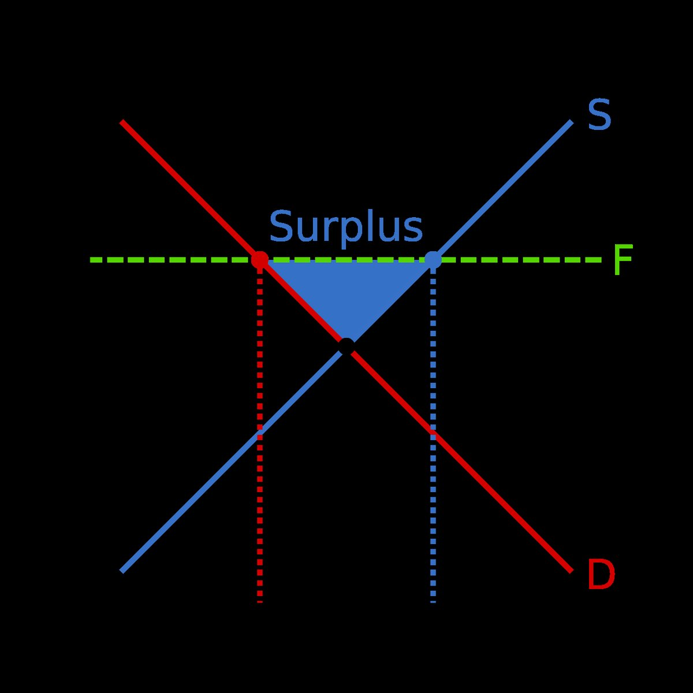
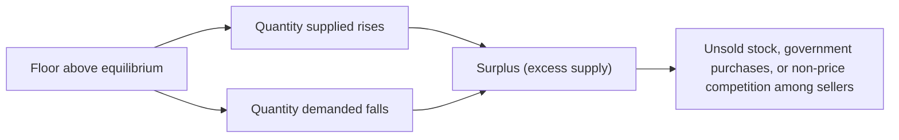

# Price floors

**Prerequisites:** [Price ceilings](11-price-ceilings.md).

*A binding price floor: at the minimum price, quantity supplied exceeds quantity demanded, leaving a surplus. Credit: Kbolino. License: Public domain. Source: [File:Surplus from Price Floor.svg](https://commons.wikimedia.org/wiki/File:Surplus_from_Price_Floor.svg).*

A **price floor** is a legal minimum price. Minimum wages, agricultural price supports and minimum prices for alcohol are the main examples. Floors are the mirror image of ceilings: a floor set **above** the equilibrium price is binding and creates a **surplus** rather than a shortage.

## The basic analysis

Return to the coffee market (Qd = 1,100 − 200P, Qs = −100 + 200P, equilibrium P = 3, Q = 500). Suppose a law requires coffee to sell for at least 4 dollars.

- Quantity demanded at 4: 300 cups.
- Quantity supplied at 4: 700 cups.
- **Surplus: 400 cups** that sellers want to sell but no one buys at that price.

Only 300 cups are traded. Sellers who make a sale get a higher price, but many units go unsold.

**Surplus effects** (assuming the lowest-cost sellers make the 300 sales):

- Consumer surplus: ½ × 300 × (5.50 − 4) = **225** (down from 625).
- Producer surplus: the cost of the 300th cup is (300 + 100)/200 = 2. PS = 300 × (4 − 2) + ½ × 300 × (2 − 0.50) = 600 + 225 = **825** (up from 625).
- Total surplus: 1,050. Deadweight loss: **200**, the lost trades between 300 and 500 cups.

If sellers do not know in advance who will make the sales, they may produce the full 700 cups, wasting resources on 400 cups nobody buys. That makes the loss even larger.

## Agricultural price supports

Many governments have supported farm prices above market levels. To keep the price from falling, the government usually has to buy the surplus. In the 1970s and 1980s, the European Economic Community's Common Agricultural Policy accumulated so much surplus produce that the press coined the terms "butter mountains" and "wine lakes". Reforms from the 1990s onward moved the EU toward direct payments to farmers that are less tied to production. Canada's supply management system for dairy, poultry and eggs takes a different approach: it combines production quotas with import tariffs to hold prices up while preventing surpluses. Supporters credit it with stable farm incomes; critics argue it raises consumer prices. See [subsidies, quotas and tariffs](15-subsidies-quotas-and-tariffs.md).

## The minimum wage

The minimum wage is a price floor in the labour market, where workers are the sellers and employers the buyers. The simple competitive model predicts that a binding minimum wage raises pay for those who keep their jobs but reduces the number of jobs, creating unemployment (a surplus of labour) among low-wage workers.

The evidence is more mixed than the simple model suggests, and this is one of the most debated questions in economics:

- The 1994 study by David Card and Alan Krueger of fast-food restaurants in New Jersey and Pennsylvania found no reduction in employment after New Jersey's increase. David Neumark and William Wascher, using different data, disputed the finding.
- Many later studies of moderate increases find small or statistically undetectable effects on employment, while some find larger effects, especially for teenagers or for large increases.
- Explanations for small effects include **monopsony** power (employers with wage-setting power, in which case a minimum wage can raise both pay and employment; see [[monopsony-and-unions|monopsony and unions]]), reduced turnover, higher prices, and adjustment through hours or benefits rather than jobs.

A reasonable summary is that the employment effect depends on how high the minimum wage is relative to local wages: modest increases appear to have small employment effects, while very high minimums relative to the local median wage carry more risk. Economists still disagree about where the line lies.

## Other floors

- **Minimum unit pricing for alcohol**, introduced in Scotland in 2018, sets a floor price per unit of alcohol to discourage heavy drinking. Here reducing quantity is the goal, not a side effect.
- **Price floors in trade**, such as minimum import prices, protect domestic producers.

## Key ideas

- A binding price floor is set above equilibrium and creates a surplus.
- Fewer units trade; surplus shifts from buyers to sellers who make sales, and deadweight loss appears.
- Agricultural supports often require governments to buy surpluses or limit production.
- The minimum wage is a price floor whose employment effects are debated; monopsony can reverse the simple prediction.

## Where this leads

- Next: [taxes and tax incidence](13-taxes-and-tax-incidence.md).
- Related: [[wage-determination|wage determination]], [[monopsony-and-unions|monopsony and unions]].
- Glossary: [[g:price-floor|price floor]], [[g:minimum-wage|minimum wage]], [[g:surplus|surplus (excess supply)]].
