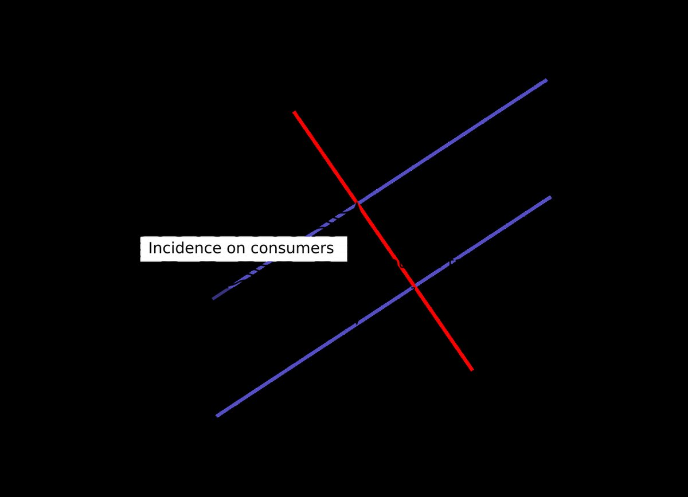
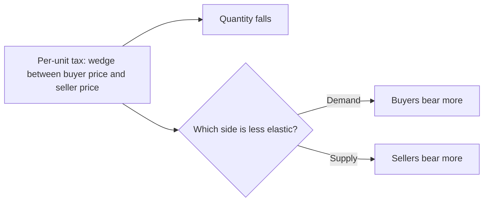

# Taxes and tax incidence

**Prerequisites:** [Shifts in supply](04-shifts-in-supply.md), [Price elasticity of demand](07-price-elasticity-of-demand.md), [Other elasticities](08-other-elasticities.md).

*Tax incidence: a tax drives a wedge between the price buyers pay and the price sellers receive, and the burden is shared. Credit: Tax-inelasticdemand-elasticsupply.gif: Original uploader was Mgunn at en.wikipedia derivative work: Jarry1250. License: Public domain. Source: [File:Tax incidence (mixed).svg](https://commons.wikimedia.org/wiki/File:Tax_incidence_(mixed).svg).*

Who really pays a tax? The answer is often not the person who hands the money to the government. Economists distinguish the **statutory incidence** of a tax (who is legally required to pay it) from its **economic incidence** (whose real income falls because of it). Supply and demand show that the economic incidence depends on elasticities, not on the law.

## A per-unit tax on sellers

Suppose the town imposes a tax of 1 dollar per cup of coffee, collected from cafés. To supply any given quantity, cafés now need 1 dollar more than before, so the supply curve shifts **up by 1**:

- Old supply: Qs = −100 + 200P, or P = 0.50 + Q/200.
- New supply (in terms of the price buyers pay): P = 1.50 + Q/200, or Qs = −300 + 200P.

New equilibrium with demand Qd = 1,100 − 200P: 1,100 − 200P = −300 + 200P, so 1,400 = 400P, **P = 3.50** paid by buyers, and Q = 1,100 − 700 = **400**.

Sellers receive 3.50 − 1 = **2.50** after tax.

| | Before tax | After tax | Change |
|---|---|---|---|
| Price buyers pay | 3.00 | 3.50 | +0.50 |
| Price sellers keep | 3.00 | 2.50 | −0.50 |
| Quantity | 500 | 400 | −100 |

The tax burden is split equally: buyers pay 0.50 more and sellers receive 0.50 less. **Tax revenue** = 1 × 400 = **400 dollars per day**: 200 borne by buyers and 200 by sellers.

## It does not matter who sends the cheque

Now suppose instead the tax is collected from **buyers**: each buyer must pay the government 1 dollar per cup on top of the price. Buyers' willingness to pay the café falls by 1 at every quantity, so the demand curve shifts **down by 1**: Qd = 1,100 − 200(P + 1) = 900 − 200P. Equilibrium: 900 − 200P = −100 + 200P, so P = 2.50 to sellers, and buyers pay 2.50 + 1 = 3.50 in total. Quantity: 400.

The outcome is identical. The law decides who writes the cheque, not who bears the burden. This is one of the most important and least intuitive results in public economics. It applies to payroll taxes too: whether a payroll tax is formally split between employer and employee or levied on one side, economists expect the long-run burden to depend on the elasticities of labour supply and demand.

## Elasticity decides incidence

In the example both curves had the same slope, so the burden split evenly. In general:

**The side of the market that is less elastic bears more of the tax.**

The intuition: the tax drives a wedge between the price buyers pay and the price sellers receive. Whoever finds it harder to walk away, because they have fewer alternatives, ends up absorbing more of the wedge.

- **Inelastic demand, elastic supply** (cigarettes): buyers bear most of the tax. Smokers keep buying; sellers can move to other products.
- **Elastic demand, inelastic supply** (land, or a beachfront hotel's rooms in the short run): sellers bear most of it.

A useful approximation for small taxes: the share borne by buyers ≈ Es / (Es + Ed), and the share borne by sellers ≈ Ed / (Es + Ed), where Es and Ed are the absolute supply and demand elasticities.

## The luxury tax example

In 1990 the US Congress introduced a 10 percent tax on luxury goods including yachts, intended to fall on the wealthy buyers. Demand for yachts proved fairly elastic (wealthy buyers could buy abroad, buy used, or spend on other things), while the supply of yacht-building labour was less elastic in the short run. Reports from the industry pointed to layoffs among yacht builders, and much of the tax was repealed in 1993. Economists often cite the episode, though they note the industry was also hit by a recession at the time, as a lesson that the burden of a tax can fall far from its intended target.

## Ad valorem taxes

Many taxes are a percentage of price (**ad valorem**), like Canada's GST/HST. The logic is the same: the tax drives a wedge between buyer and seller prices, and incidence depends on elasticities. The only difference is that the wedge grows with the price.

## Key ideas

- Statutory incidence is who legally pays; economic incidence is who actually bears the burden.
- A tax drives a wedge between the price buyers pay and the price sellers keep, and reduces quantity.
- The outcome is the same whether the tax is levied on buyers or sellers.
- The less elastic side of the market bears more of the burden.
- Revenue = tax per unit × quantity after tax.

## Where this leads

- Next: [deadweight loss](14-deadweight-loss.md), the cost of taxes beyond the revenue they raise.
- Related: [[pigouvian-taxes-and-subsidies|Pigouvian taxes]], which use taxes to correct externalities.
- Related branch: [taxes on investments](../../finance/09-personal-investing-canada/06-taxes-on-investments.md).
- Glossary: [[g:tax-incidence|tax incidence]], [[g:excise-tax|excise tax]], [[g:tax-wedge|tax wedge]].
