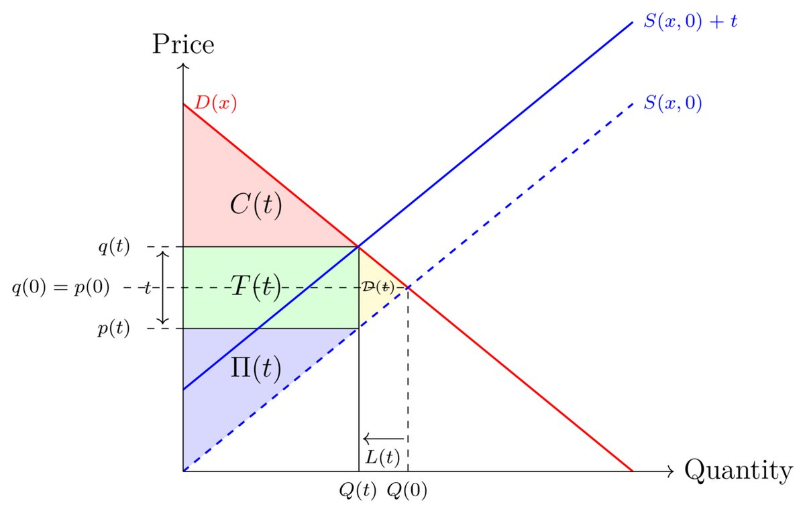
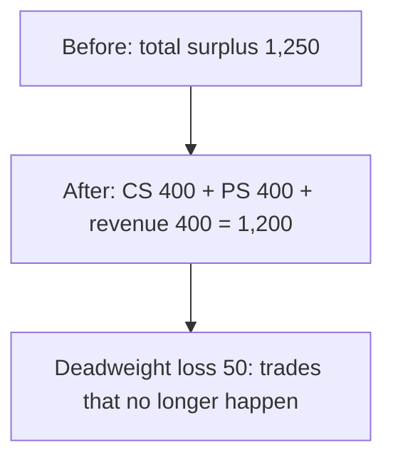

# Deadweight loss

**Prerequisites:** [Producer surplus and total surplus](10-producer-surplus-and-total-surplus.md), [Taxes and tax incidence](13-taxes-and-tax-incidence.md).

*A taxed market: consumer surplus, producer surplus, tax revenue and the deadweight loss triangle. Credit: Viespe1. License: [CC0](http://creativecommons.org/publicdomain/zero/1.0/deed.en). Source: [File:Supply and demand diagram with taxation and economic surplus.png](https://commons.wikimedia.org/wiki/File:Supply_and_demand_diagram_with_taxation_and_economic_surplus.png).*

A tax takes money from buyers and sellers and gives it to the government. If that were all, a tax would be a pure transfer: what the private sector loses, the public sector gains. But taxes also change behaviour. Some trades that would have happened no longer do, and the surplus those trades would have created simply disappears. That lost surplus is the **deadweight loss**, or **excess burden**, of the tax.

## Measuring it

Use the coffee tax from the previous lesson: a 1 dollar tax per cup, buyers pay 3.50, sellers keep 2.50, quantity falls from 500 to 400.

**Before the tax:**
- Consumer surplus: ½ × 500 × (5.50 − 3) = 625
- Producer surplus: ½ × 500 × (3 − 0.50) = 625
- Total: 1,250

**After the tax:**
- Consumer surplus: ½ × 400 × (5.50 − 3.50) = 400
- Producer surplus: ½ × 400 × (2.50 − 0.50) = 400
- Tax revenue: 1 × 400 = 400
- Total: 1,200

**Deadweight loss: 1,250 − 1,200 = 50 dollars per day.**

Graphically it is the triangle between the demand and supply curves, from 400 to 500 cups: ½ × (500 − 400) × 1 = 50. Those 100 cups were each worth more to a buyer than they cost to make, but less than cost plus the 1 dollar tax, so they are no longer traded.

## What makes deadweight loss large

**1. Elasticity.** The more buyers and sellers respond to the tax, the more trades disappear, and the larger the loss. A tax on a good with very inelastic demand and supply barely changes quantity and causes little deadweight loss. This is one argument for taxing goods like land, whose supply is fixed: the 19th-century writer Henry George argued that a tax on land rents would raise revenue with no deadweight loss. See [land and rent](../06-factor-markets/08-land-and-rent.md).

**2. The size of the tax.** Deadweight loss grows roughly with the **square** of the tax. Doubling the tax roughly quadruples the loss. In the coffee example:

| Tax per cup | Quantity | Revenue | Deadweight loss |
|---|---|---|---|
| 0 | 500 | 0 | 0 |
| 1 | 400 | 400 | 50 |
| 2 | 300 | 600 | 200 |
| 3 | 200 | 600 | 450 |
| 4 | 100 | 400 | 800 |
| 5 | 0 | 0 | 1,250 |

(With these curves, each extra dollar of tax cuts quantity by 100.) Moving from 1 to 2 dollars doubles the tax but quadruples the deadweight loss. This is why economists generally prefer broad taxes at low rates to narrow taxes at high rates: spreading a tax over many goods keeps each distortion small.

## The Laffer curve

The table also shows that **revenue first rises and then falls** as the tax grows: from 400 at a 1-dollar tax to 600 at 2 or 3 dollars, then down to 0 when the tax is so high that nobody trades. The relationship between tax rates and revenue is often called the **Laffer curve**, after the economist Arthur Laffer, who popularised it in the 1970s; the idea itself is much older. The existence of such a peak is uncontroversial. Where real-world tax systems sit relative to the peak is hotly debated, and most estimates for broad taxes like income taxes put current rates in most countries below the revenue-maximising level.

## Deadweight loss beyond taxes

The same triangle appears whenever a market produces the wrong quantity:

- [Price ceilings](11-price-ceilings.md) and [price floors](12-price-floors.md) reduce quantity below equilibrium.
- [Monopoly](../05-market-structures/05-monopoly-pricing-and-deadweight-loss.md) restricts output to raise prices.
- [Externalities](../07-market-failure/02-externalities.md) cause markets to produce too much or too little relative to the efficient level, and there the "triangle" is the loss from the market's own outcome.

Arnold Harberger did much to develop deadweight loss triangles as practical tools of policy analysis in the 1950s and 1960s, which is why they are sometimes called **Harberger triangles**.

## Is the deadweight loss worth paying?

Deadweight loss is a cost of raising revenue, not a reason never to tax. Governments use revenue to provide roads, schools, defence, courts and transfers, and many of these generate benefits far exceeding the excess burden. The question for tax design is how to raise a given amount of revenue with the smallest deadweight loss and the fairest distribution. And some taxes, like Pigouvian taxes on pollution, are designed to change behaviour, so a fall in quantity is the goal rather than a loss.

## Key ideas

- Deadweight loss is the surplus lost because a tax (or other distortion) prevents mutually beneficial trades.
- It is the triangle between demand and supply over the lost quantity.
- It is larger when demand and supply are more elastic.
- It grows roughly with the square of the tax rate, which favours broad bases and low rates.
- Revenue can rise and then fall as the tax rate rises (the Laffer curve).

## Where this leads

- Next: [subsidies, quotas and tariffs](15-subsidies-quotas-and-tariffs.md).
- Related: [cost-benefit analysis](../08-welfare-economics/06-cost-benefit-analysis.md).
- Glossary: [deadweight loss](../glossary/deadweight-loss.md), [Laffer curve](../glossary/laffer-curve.md).
