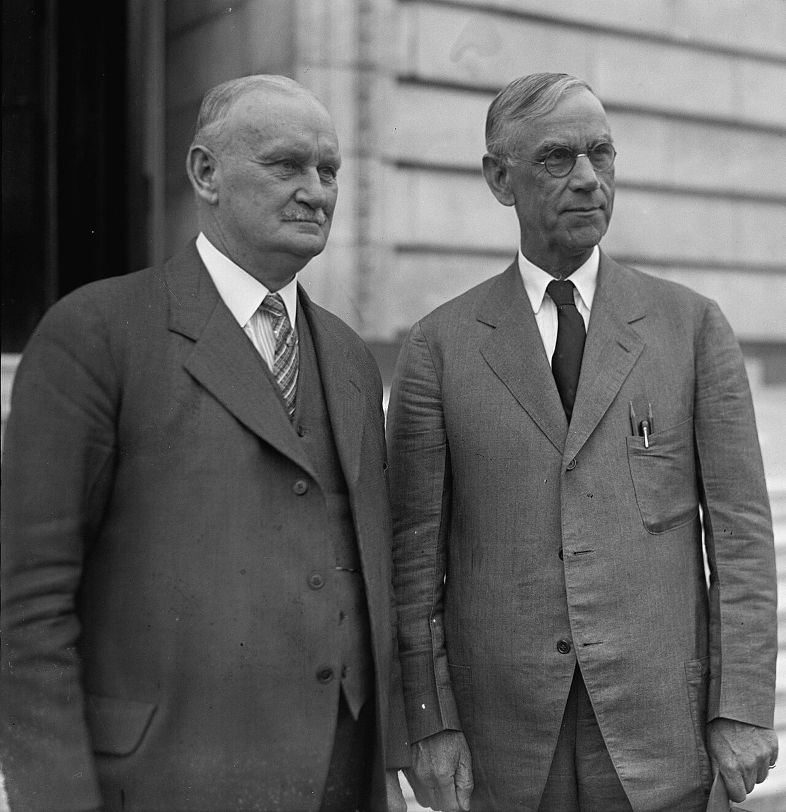
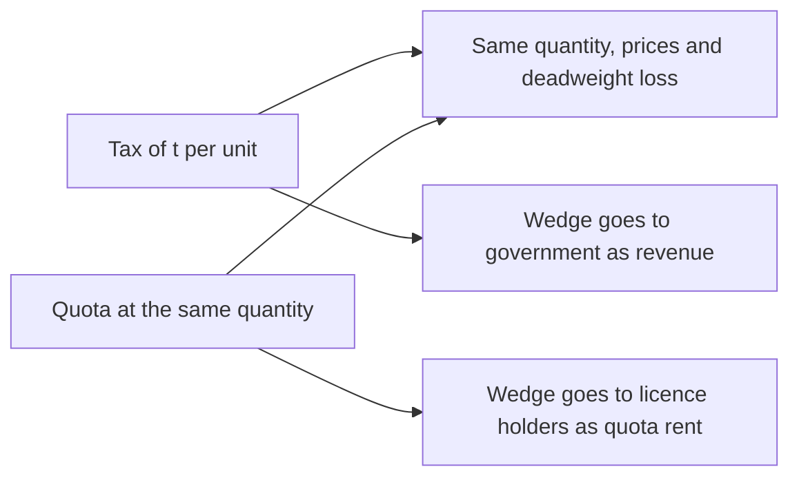

# Subsidies, quotas and tariffs

**Prerequisites:** [Taxes and tax incidence](13-taxes-and-tax-incidence.md), [Deadweight loss](14-deadweight-loss.md), [Gains from trade](../01-foundations/08-gains-from-trade.md).

*Senator Reed Smoot and Representative Willis Hawley, sponsors of the 1930 US tariff act, on 11 April 1929. Credit: National Photo Company. License: Public domain. Source: [File:Smoot and Hawley standing together, April 11, 1929.jpg](https://commons.wikimedia.org/wiki/File:Smoot_and_Hawley_standing_together,_April_11,_1929.jpg).*

Taxes are only one way governments intervene in markets. This lesson applies the same supply-and-demand tools to three more: **subsidies**, which pay people to produce or consume; **quotas**, which cap quantities; and **tariffs**, which tax imports.

## Subsidies

A **subsidy** is a negative tax: the government pays a fixed amount per unit traded. Suppose the town pays cafés 1 dollar per cup. Supply shifts **down** by 1: from P = 0.50 + Q/200 to P = −0.50 + Q/200, or Qs = 100 + 200P.

New equilibrium with demand Qd = 1,100 − 200P: 1,100 − 200P = 100 + 200P, so **P = 2.50** paid by buyers, and Q = **600**. Sellers receive 2.50 + 1 = **3.50**.

- Buyers gain: they pay 0.50 less. Sellers gain: they receive 0.50 more. Like a tax, the benefit is split according to elasticities.
- **Cost to government**: 1 × 600 = **600**.
- Consumer surplus rises from 625 to ½ × 600 × 3 = 900 (+275). Producer surplus rises from 625 to ½ × 600 × 3 = 900 (+275). Gains total 550.
- **Deadweight loss**: 600 − 550 = **50**. The extra 100 cups cost more to produce than buyers value them.

So a subsidy, in a market without externalities, also creates a deadweight loss: it encourages trades whose cost exceeds their value. Subsidies make economic sense when the good has **positive externalities** (vaccinations, basic research) that the market undervalues; then the subsidy can move quantity toward the efficient level. See [[positive-externalities|positive externalities]].

## Quotas

A **quota** is a legal limit on the quantity that can be produced, sold or imported. Suppose the town allows only 400 cups a day, issuing licences to cafés.

- At Q = 400, buyers are willing to pay P = (1,100 − 400)/200 = **3.50**.
- At Q = 400, the marginal cost of the last cup is (400 + 100)/200 = **2.50**.
- The gap of 1 dollar per cup is a **quota rent**: 1 × 400 = 400 per day, which goes to whoever holds the licences.

The quantity, prices and deadweight loss (50) are exactly the same as with the 1-dollar tax. The difference is who gets the 400: with a tax, the government; with a quota, the licence holders. That is why quota licences become valuable assets. New York City taxi medallions, which limited the number of yellow cabs, traded for over a million dollars at their peak in the early 2010s before ride-hailing apps eroded their value. Canada's dairy, poultry and egg quotas under supply management also carry substantial market values.

## Tariffs

A **tariff** is a tax on imports. To analyse it, consider a small country that can buy as much of a good as it wants on the world market at the world price, Pw.

Suppose domestic demand for steel is Qd = 1,000 − 10P and domestic supply is Qs = −200 + 10P (in thousands of tonnes, with price in dollars per tonne; the numbers are illustrative). Without trade, equilibrium is at P = 60, Q = 400.

**Free trade.** The world price is Pw = 40. Domestic buyers pay 40 and want 1,000 − 400 = 600. Domestic producers supply −200 + 400 = 200. **Imports fill the gap: 400.** Compared with no trade, consumers gain a lot and domestic producers lose, but total surplus rises.

**A tariff of 10.** The domestic price rises to 50.
- Domestic demand: 1,000 − 500 = 500.
- Domestic supply: −200 + 500 = 300.
- Imports: 200.
- Tariff revenue: 10 × 200 = **2,000**.
- Consumer surplus falls by the area between 40 and 50 out to the quantity: 10 × (600 + 500)/2 = **5,500**.
- Producer surplus rises by 10 × (200 + 300)/2 = **2,500**.
- **Deadweight loss** = 5,500 − 2,500 − 2,000 = **1,000**, made of two triangles: ½ × 10 × 100 = 500 from excess domestic production (steel made at home that costs more than importing) and ½ × 10 × 100 = 500 from lost consumption.

A tariff therefore helps domestic producers, raises revenue, and hurts domestic consumers by more than those gains combined. Because consumers are many and each loses a little, while producers are few and each gains a lot, producers are often better organised to lobby for tariffs. This pattern, analysed by Mancur Olson in *The Logic of Collective Action* (1965), helps explain why tariffs persist. See [[government-failure|government failure]].

## A historical episode

The US Smoot-Hawley Tariff Act of 1930 raised tariffs on thousands of imported goods. Other countries, including Canada, retaliated, and world trade shrank sharply in the early 1930s. Most economists believe the tariff worsened the Great Depression, though they debate how much, since the collapse of trade also reflected falling incomes and monetary contraction. The episode influenced the post-war push toward lower tariffs through the General Agreement on Tariffs and Trade (1947) and later the World Trade Organization (1995).

## Key ideas

- A subsidy lowers buyer prices and raises seller prices, increases quantity, costs the government more than the surplus it creates (absent externalities).
- A quota has the same quantity effects as an equivalent tax, but the wedge becomes quota rent for licence holders.
- A tariff raises domestic prices, helps domestic producers, raises revenue, and costs consumers more than these gains.
- Concentrated benefits and dispersed costs help explain why such policies persist.

## Where this leads

- Next section: [consumer theory](../03-consumer-theory/01-preferences-and-utility.md), which looks beneath the demand curve.
- Related: [gains from trade](../01-foundations/08-gains-from-trade.md), [[government-failure|government failure]].
- Glossary: [[g:subsidy|subsidy]], [[g:quota|quota]], [[g:tariff|tariff]], [[g:quota-rent|quota rent]].
