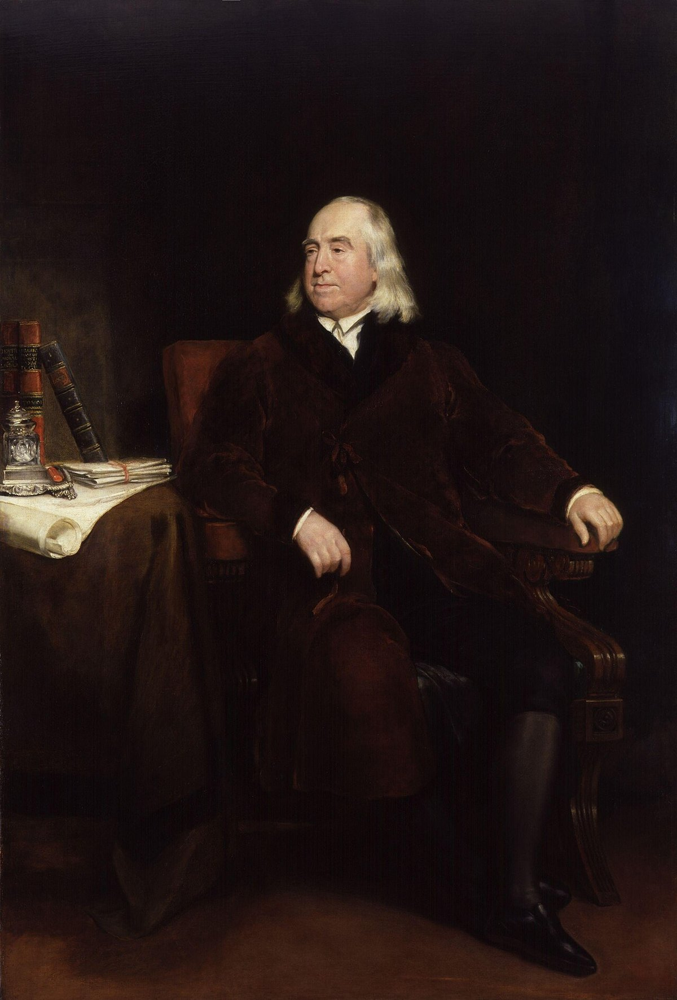
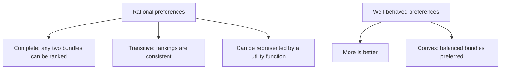

# Preferences and utility

**Prerequisites:** [Choice and trade-offs](../01-foundations/02-choice-and-trade-offs.md), [Demand](../02-supply-and-demand/01-demand.md).

*Jeremy Bentham (1748–1832), portrait by Henry William Pickersgill; Bentham's utilitarianism gave economics the word "utility". Credit: Henry William Pickersgill. License: Public domain. Source: [File:Jeremy Bentham by Henry William Pickersgill.jpg](https://commons.wikimedia.org/wiki/File:Jeremy_Bentham_by_Henry_William_Pickersgill.jpg).*

The demand curve summarises how buyers respond to prices. Consumer theory looks underneath it: why do people choose what they choose? The answer economists give has two parts: **preferences**, which describe what a person likes, and **constraints**, which describe what they can afford. This lesson introduces preferences and the idea of **utility** used to represent them.

## From pleasure to preference

The word "utility" comes from the utilitarian philosophers. Jeremy Bentham, in *An Introduction to the Principles of Morals and Legislation* (1789), argued that human beings are governed by pleasure and pain, and that the right action is the one that produces the greatest happiness. He imagined utility as a measurable quantity of pleasure. John Stuart Mill refined the doctrine in *Utilitarianism* (1861), distinguishing higher and lower pleasures. Early economists, including Jevons, borrowed the idea and treated utility as something that could, in principle, be measured, added up and compared across people. This is called **cardinal utility**.

During the late nineteenth and early twentieth centuries, economists such as Vilfredo Pareto, and later John Hicks and Roy Allen (1934), realised that predicting choices does not require measuring pleasure at all. All you need to know is how a person **ranks** the options. This is **ordinal utility**: numbers that preserve the ranking but have no meaning beyond it. Paul Samuelson's **revealed preference** theory (1938) went further, building consumer theory from observed choices alone.

For ethical questions, such as whether a policy makes society better off, the philosophical debate about measuring and comparing well-being still matters, and is taken up in [[social-choice-and-arrows-theorem|social choice and Arrow's theorem]]. For predicting behaviour, ordinal utility is enough.

## Bundles and preferences

Consumer theory works with **bundles**: combinations of goods, such as (3 coffees, 2 muffins). A consumer's preferences let them compare any two bundles A and B and say one of three things:

- A is preferred to B (written A ≻ B),
- B is preferred to A, or
- they are indifferent between A and B (A ~ B).

## The standard assumptions

Economists usually assume preferences satisfy a few properties:

1. **Completeness.** The consumer can compare any two bundles. They are never simply unable to rank them.
2. **Transitivity.** If A is preferred to B and B to C, then A is preferred to C. This rules out circular preferences, which would let someone be exploited by a sequence of trades (a "money pump").
3. **More is better (monotonicity).** Other things equal, more of a good is preferred to less. This holds for "goods"; for "bads" like pollution, less is better.
4. **Diminishing marginal rate of substitution (convexity).** People generally prefer balanced bundles to extreme ones. If you are indifferent between (10 coffees, 0 muffins) and (0 coffees, 10 muffins), you probably prefer (5, 5). This assumption gives indifference curves their bowed shape in [indifference curves](03-indifference-curves.md).

Completeness and transitivity together are what economists mean by **rational** preferences. They say nothing about whether preferences are selfish, sensible or moral: someone who prefers giving to charity over buying a car has perfectly rational preferences in this sense.

## Utility functions

If preferences are complete, transitive and continuous, they can be represented by a **utility function**: a rule that assigns a number to each bundle so that higher numbers mean more preferred bundles. For example, a consumer whose preferences over coffees (x) and muffins (y) are represented by

**U(x, y) = x × y**

prefers (4, 3), with utility 12, to (2, 5), with utility 10, and is indifferent between (6, 2) and (3, 4), both 12.

Because utility is ordinal, any transformation that preserves the ranking represents the same preferences. U = x × y, U = 10xy and U = log x + log y all rank bundles identically. The numbers 12 and 10 have no meaning on their own; you cannot say the consumer is "20 percent happier".

## Do people really have such preferences?

Experiments show that real preferences sometimes violate the assumptions. People can reverse their choices depending on how options are described (**framing**), and their rankings can depend on irrelevant options added to the choice set. Behavioural economists document these patterns in [[heuristics-and-biases|heuristics and biases]]. Defenders of the standard model reply that it remains a good approximation in many market settings, especially where people make repeated choices with feedback. The course presents both views.

## Key ideas

- Consumer theory explains demand through preferences and constraints.
- Utility began as measurable pleasure (Bentham) and became an ordinal ranking (Pareto, Hicks, Samuelson).
- Standard assumptions: completeness, transitivity, more is better, convexity.
- A utility function assigns higher numbers to preferred bundles; only the ranking matters.
- Real choices sometimes violate the assumptions, which behavioural economics studies.

## Where this leads

- Next: [marginal utility](02-marginal-utility.md).
- Related branch: philosophy's [eudaimonia](../../../philosophy/concepts/ethics/eudaimonia.md) offers an older, different account of well-being.
- Glossary: [[g:utility|utility]], [[g:ordinal-utility|ordinal utility]], [[g:cardinal-utility|cardinal utility]], [[g:revealed-preference|revealed preference]], [[g:utilitarianism|utilitarianism]].
