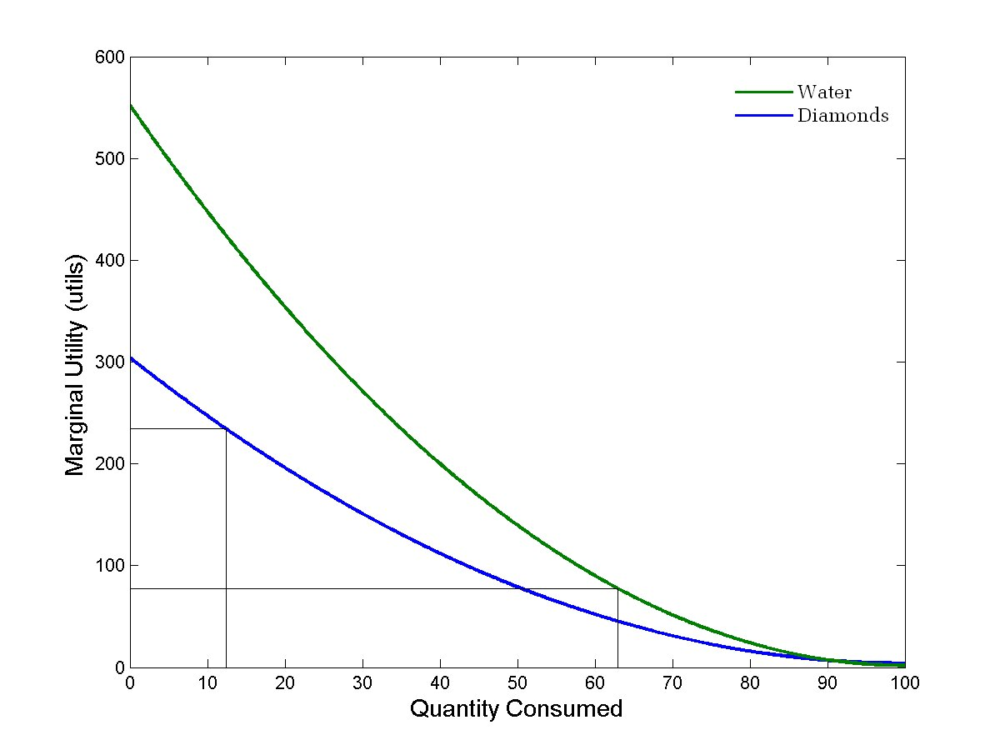
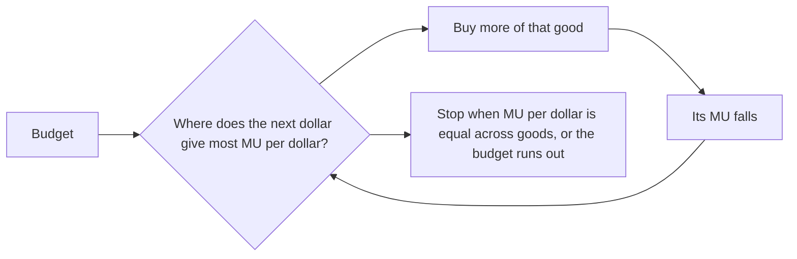

# Marginal utility

**Prerequisites:** [Preferences and utility](01-preferences-and-utility.md), [Marginal thinking](../01-foundations/05-marginal-thinking.md).

*Marginal utility of diamonds and water as more of each is consumed: water's marginal utility falls to low levels because it is abundant. Credit: User Renaissance Man on en.wikipedia. License: [CC BY-SA 3.0](http://creativecommons.org/licenses/by-sa/3.0/). Source: [File:Diamond-Water paradox.png](https://commons.wikimedia.org/wiki/File:Diamond-Water_paradox.png).*

**Marginal utility** is the extra utility from consuming one more unit of a good. It was the central idea of the "marginal revolution" of the 1870s and remains the most intuitive route into consumer choice. Even though modern theory treats utility as ordinal, marginal utility is a helpful way to think, and the conclusions survive when the numbers are reinterpreted.

## Diminishing marginal utility

Think about slices of pizza at dinner. The first slice is wonderful. The second is very good. By the fourth you are full, and a fifth might make you feel worse. Each additional slice adds less satisfaction than the one before. This pattern is called **diminishing marginal utility**.

| Slices | Total utility | Marginal utility |
|---|---|---|
| 0 | 0 | – |
| 1 | 20 | 20 |
| 2 | 36 | 16 |
| 3 | 46 | 10 |
| 4 | 50 | 4 |
| 5 | 48 | −2 |

Total utility rises as long as marginal utility is positive and peaks where it reaches zero. The German economist Hermann Heinrich Gossen stated this principle in 1854, in a book that was almost entirely ignored until Jevons and others rediscovered it in the 1870s. It is sometimes called **Gossen's first law**.

## The equal-marginal principle

How should a consumer divide a budget among goods? Gossen's second law, and the core of the marginalist theory, is the **equal-marginal principle**: spend so that the last dollar spent on each good yields the same marginal utility.

In symbols, for goods X and Y with prices Px and Py:

**MUx / Px = MUy / Py**

If the last dollar on pizza gave more utility than the last dollar on books, you could make yourself better off by moving a dollar from books to pizza. You keep shifting until the marginal utility per dollar is equal across goods.

## Worked example

Sam has 10 dollars to spend on sandwiches (4 dollars each) and drinks (2 dollars each). His marginal utilities:

| Unit | MU sandwich | MU per $ | MU drink | MU per $ |
|---|---|---|---|---|
| 1st | 40 | 10 | 24 | 12 |
| 2nd | 32 | 8 | 16 | 8 |
| 3rd | 20 | 5 | 10 | 5 |

Sam spends each dollar where it does the most good. The first drink gives 12 utility per dollar and the first sandwich 10, so he buys both, spending 6 dollars. The next candidates, a second sandwich and a second drink, both give 8 per dollar. With 4 dollars left, he can buy either the second sandwich (adding 32) or the second and third drinks (adding 16 + 10 = 26). The sandwich wins.

So the best bundle is **2 sandwiches and 1 drink**, with total utility 40 + 32 + 24 = 96, compared with 90 for 1 sandwich and 3 drinks. At this bundle the last sandwich gives 8 utility per dollar and the drink 12. They are not exactly equal because goods come in whole units. With divisible goods the equal-marginal rule holds exactly; with lumpy goods it holds as nearly as possible.

## Why demand curves slope down

The equal-marginal principle explains the law of demand. Suppose the price of sandwiches falls. Then MU per dollar for sandwiches rises, so the consumer shifts spending toward sandwiches until diminishing marginal utility brings MU per dollar back into line. Lower price, more sandwiches: a downward-sloping demand curve.

## Value in use and value in exchange

Marginal utility also resolves the [diamond-water paradox](../01-foundations/05-marginal-thinking.md). Water's total utility is enormous, but because we consume so much of it, its marginal utility is low, and so is its price. Diamonds' total utility is small, but their marginal utility, and price, are high because they are scarce.

## Cardinal and ordinal readings

The table above uses utility numbers as if they were measurable. Modern theory does not need them to be. What matters is the ratio MUx/MUy, the rate at which the consumer is willing to trade one good for another. That ratio survives any rescaling of utility and is called the **marginal rate of substitution**, the subject of [its own lesson](04-marginal-rate-of-substitution.md). So the marginal-utility reasoning is a convenient way to think, and its conclusions carry over to the more general indifference-curve approach.

## Key ideas

- Marginal utility is the extra utility from one more unit; it usually diminishes (Gossen's first law).
- Optimal spending equalises marginal utility per dollar across goods.
- A price fall raises MU per dollar, so consumers buy more: the law of demand.
- Marginal utility resolves the diamond-water paradox.
- Only ratios of marginal utilities matter, which survives an ordinal view of utility.

## Where this leads

- Next: [indifference curves](03-indifference-curves.md).
- History: [the marginal revolution](../10-history-of-thought/03-the-marginal-revolution.md), [William Stanley Jevons](../10-history-of-thought/thinkers/05-william-stanley-jevons.md), [Carl Menger](../10-history-of-thought/thinkers/06-carl-menger.md).
- Glossary: [marginal utility](../glossary/marginal-utility.md), [diminishing marginal utility](../glossary/diminishing-marginal-utility.md), [equal-marginal principle](../glossary/equal-marginal-principle.md).
