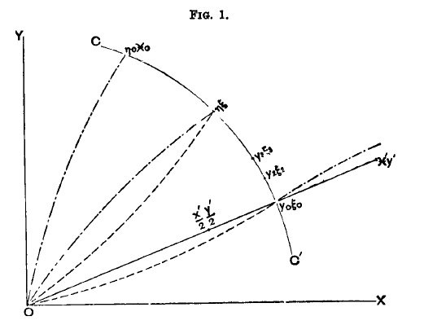
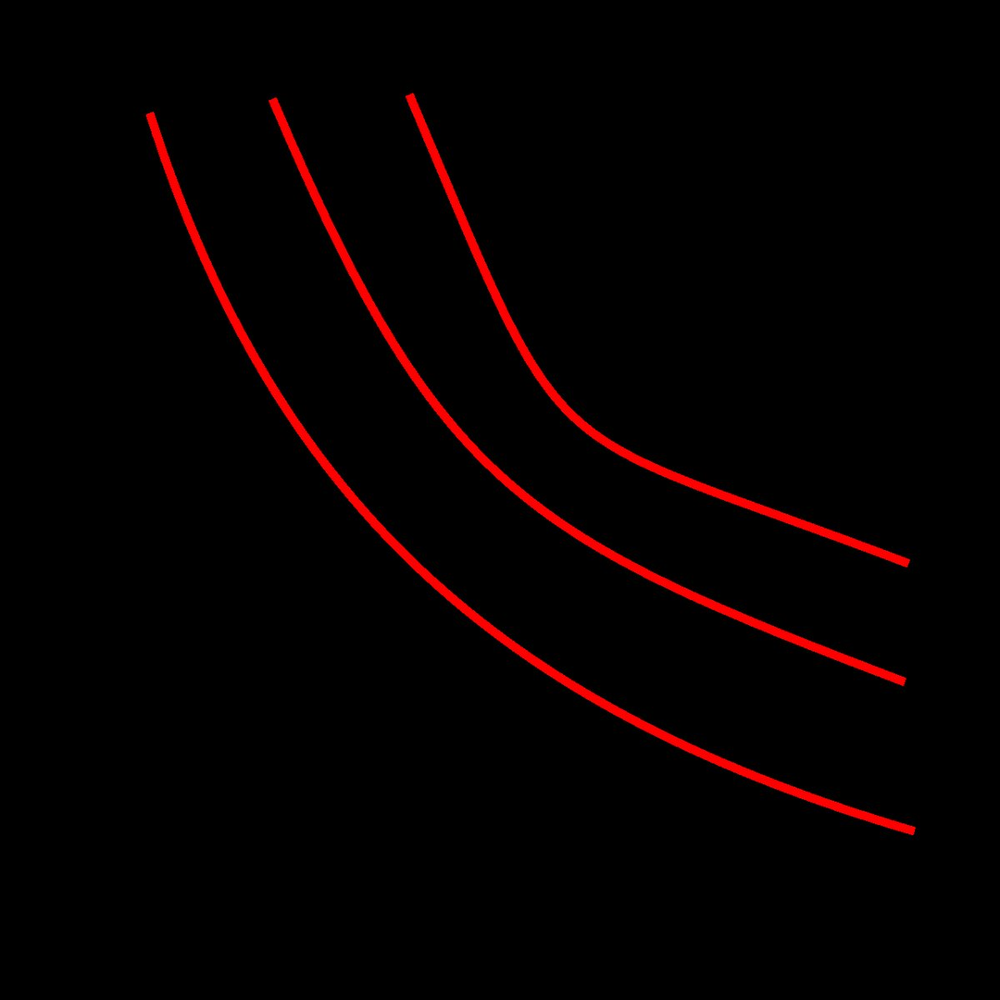
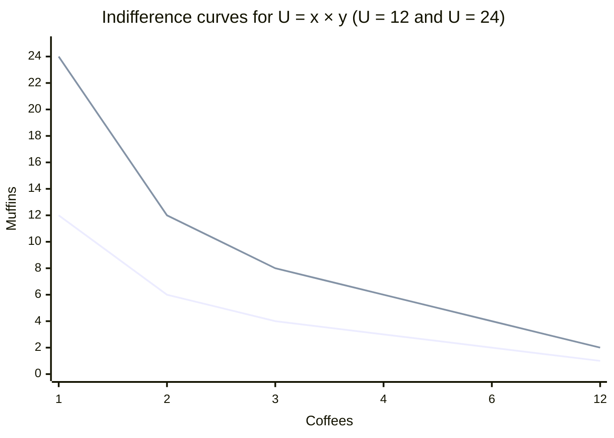
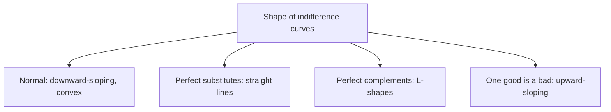

# Indifference curves

**Prerequisites:** [Preferences and utility](01-preferences-and-utility.md).

*Figure 1 of Francis Ysidro Edgeworth's Mathematical Psychics (1881), where indifference curves first appeared. Credit: Francis Ysidro Edgeworth. License: Public domain. Source: [File:Edgeworth MathPsych Fig01.jpg](https://commons.wikimedia.org/wiki/File:Edgeworth_MathPsych_Fig01.jpg).*

*Three indifference curves: I3 represents the highest utility and I1 the lowest. Credit: SilverStar at English Wikipedia. License: [CC BY 2.5](https://creativecommons.org/licenses/by/2.5). Source: [File:Simple-indifference-curves.svg](https://commons.wikimedia.org/wiki/File:Simple-indifference-curves.svg).*

An **indifference curve** joins all the bundles a consumer likes equally well. It is a contour line on a map of preferences, just as a line on a topographic map joins points of equal height. Indifference curves let economists analyse choice without measuring utility at all, which is why they became the standard tool of consumer theory after the 1930s.

## Drawing one

Take a consumer with preferences represented by U(x, y) = x × y, where x is coffees and y is muffins per week. Every bundle with x × y = 12 gives the same satisfaction:

| Coffees (x) | Muffins (y) |
|---|---|
| 1 | 12 |
| 2 | 6 |
| 3 | 4 |
| 4 | 3 |
| 6 | 2 |
| 12 | 1 |

Plotted with coffees on the horizontal axis and muffins on the vertical, these points trace a curve that slopes down and bows in toward the origin.

The second curve joins bundles where x × y = 24. Every bundle on it is preferred to every bundle on the first.

## The indifference map

A consumer has an indifference curve through every possible bundle. The whole family is called the **indifference map**. The British economist Francis Ysidro Edgeworth introduced indifference curves in *Mathematical Psychics* (1881), and Vilfredo Pareto developed them further. In 1934, John Hicks and Roy Allen showed how to build demand theory entirely on indifference curves, without cardinal utility.

## Four properties

If preferences satisfy the standard assumptions, indifference curves have four properties:

1. **Higher curves are preferred.** Because more is better, a curve further from the origin represents more of both goods, or more of one without less of the other.
2. **They slope downward.** To stay equally happy with fewer muffins, you need more coffee. If a curve sloped up, one bundle on it would have more of both goods than another, contradicting "more is better".
3. **They do not cross.** If two curves crossed, the crossing bundle would be equally good as bundles on both curves, implying, by transitivity, that a bundle with more of everything is no better than one with less. That contradicts the assumptions.
4. **They bow toward the origin (convex).** This reflects a **diminishing marginal rate of substitution**: the more coffee you already have, the less muffin you will give up for another coffee. Going from 1 to 2 coffees, the consumer gives up 6 muffins; going from 3 to 4, only 1 muffin. People value balance.

## Special cases

Not all preferences give smooth, bowed curves:

- **Perfect substitutes.** If you do not care whether your pen is blue or black, your indifference curves are straight lines: you will always trade one for one. Utility might be U = x + y.
- **Perfect complements.** Left shoes and right shoes are useful only in pairs. An extra left shoe adds nothing. Indifference curves are L-shaped, with the corner where the goods are in the right proportion. Utility is U = min(x, y).
- **A bad.** If one good is something you dislike, such as noise or pollution, you need more of the other good to compensate for more of it, so the indifference curves slope **upward**.
- **A neutral good.** If you are indifferent to one good, the curves are vertical or horizontal lines.

## What indifference curves capture

The beauty of indifference curves is that they show **trade-offs a consumer is willing to make** without assigning numbers to happiness. The slope of an indifference curve at any point tells you how many muffins the consumer would give up for one more coffee and remain equally well off. That slope is the **marginal rate of substitution**, the subject of the next lesson. Combine it with the market's trade-off, given by prices in the [budget constraint](05-budget-constraint.md), and you get [optimal choice](06-optimal-choice.md).

## Key ideas

- An indifference curve joins bundles the consumer finds equally satisfying.
- Higher curves are preferred; curves slope down, do not cross, and bow toward the origin.
- Convexity reflects a diminishing marginal rate of substitution: people value balanced bundles.
- Special cases include perfect substitutes (straight lines) and perfect complements (L-shapes).
- Edgeworth introduced indifference curves; Hicks and Allen built demand theory on them.

## Where this leads

- Next: [the marginal rate of substitution](04-marginal-rate-of-substitution.md).
- Later: [[general-equilibrium|general equilibrium]] uses indifference curves in the Edgeworth box.
- Glossary: [[g:indifference-curve|indifference curve]], [[g:perfect-substitutes|perfect substitutes]], [[g:perfect-complements|perfect complements]].
