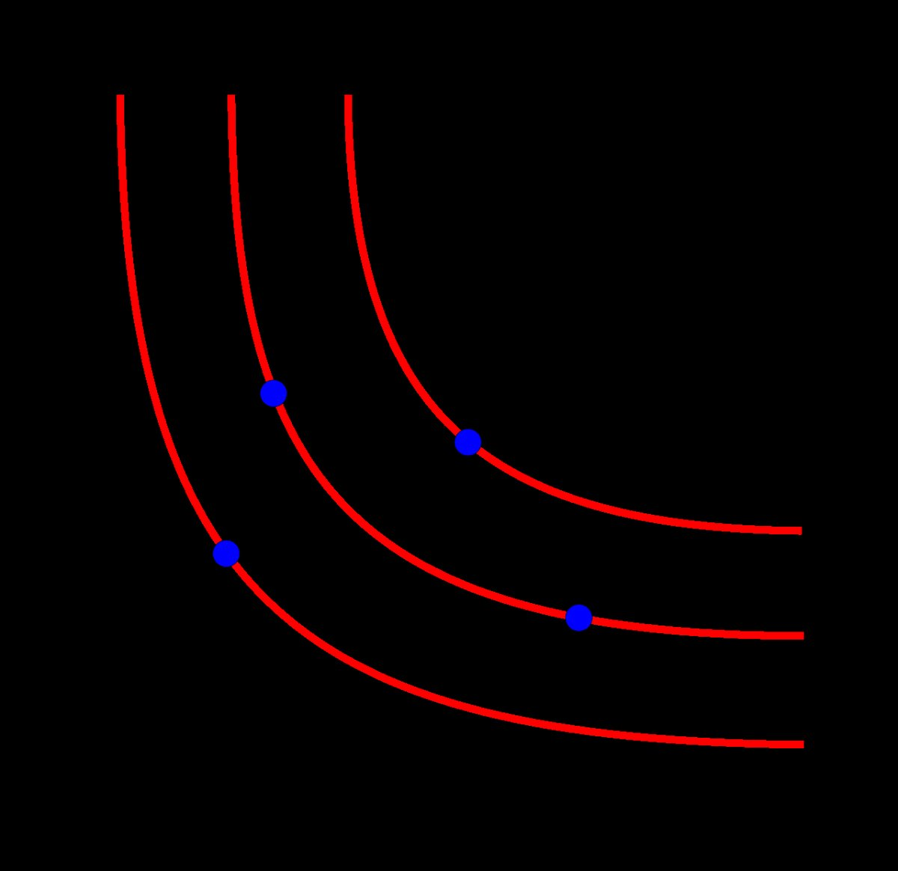

# The marginal rate of substitution

**Prerequisites:** [Indifference curves](03-indifference-curves.md), [Marginal utility](02-marginal-utility.md).

*Three indifference curves; the slope of each curve at a point is the marginal rate of substitution. Credit: Saibo base file: SilverStar. License: [CC BY 2.5](https://creativecommons.org/licenses/by/2.5). Source: [File:Indifference-curves-de.svg](https://commons.wikimedia.org/wiki/File:Indifference-curves-de.svg).*

The **marginal rate of substitution** (MRS) is the rate at which a consumer is willing to give up one good to get one more unit of another, while staying equally well off. Geometrically, it is the slope of an indifference curve, ignoring the minus sign. It is the personal "exchange rate" between two goods, and comparing it with the market's exchange rate (the price ratio) is how consumers decide what to buy.

## Definition and computation

If a consumer is willing to give up 3 muffins for one more coffee, the MRS of coffee for muffins is 3. Using the indifference curve U = x × y = 12 from the last lesson:

| Move | Muffins given up | MRS (approx.) |
|---|---|---|
| 1 → 2 coffees | 12 → 6 | 6 |
| 2 → 3 coffees | 6 → 4 | 2 |
| 3 → 4 coffees | 4 → 3 | 1 |
| 4 → 6 coffees | 3 → 2 | 0.5 per coffee |

The MRS falls as the consumer moves down the curve. With lots of muffins and little coffee, coffee is precious and muffins plentiful, so they give up many muffins for a coffee. With lots of coffee, they give up few. This **diminishing MRS** is what makes indifference curves bow toward the origin.

## MRS and marginal utility

Along an indifference curve, utility does not change. If the consumer gains Δx coffees and loses Δy muffins, the gain in utility (MUx × Δx) must equal the loss (MUy × Δy). Rearranging:

**MRS = Δy / Δx = MUx / MUy**

The MRS is the ratio of marginal utilities. This matters because ratios survive any rescaling of utility, so the MRS has a real meaning even under the ordinal view: it is the observable trade-off a person is willing to make.

For U = x × y, MUx = y and MUy = x, so **MRS = y / x**. At (2, 6), the MRS is 3; at (4, 3), it is 0.75; at (3, 4), it is 1.33. These are the exact slopes at those points, which the table above approximated over discrete steps.

## The MRS as willingness to pay

If one good is "money for everything else", the MRS has a direct meaning: it is the consumer's **marginal willingness to pay** for one more unit of the other good. A consumer whose MRS between concert tickets and money is 80 dollars would pay up to 80 dollars for one more ticket. That is the height of their demand curve at that quantity, which ties consumer theory back to [consumer surplus](../02-supply-and-demand/09-consumer-surplus.md).

## Why MRS differs across people, and why that creates trade

Two people with different tastes or different holdings will usually have different MRSs. Suppose Jo has lots of coffee and few muffins, so her MRS (muffins per coffee) is 0.5. Kai has the opposite, with MRS of 3. Jo would give up a coffee for anything over half a muffin; Kai would pay up to 3 muffins for a coffee. If Jo gives Kai a coffee in exchange for 1 muffin, both are better off. They should keep trading until their MRSs are equal. That condition, equal MRSs across people, is the definition of an efficient allocation in exchange, developed in [[general-equilibrium|general equilibrium]] with the Edgeworth box. When both face the same market prices and each sets MRS equal to the price ratio, their MRSs automatically equalise, which is one reason competitive markets can be efficient.

## Special cases revisited

- **Perfect substitutes** (U = x + y): MRS is constant, equal to 1 everywhere.
- **Perfect complements** (U = min(x, y)): MRS is infinite on the vertical part of the L, zero on the horizontal part, and undefined at the corner.
- **Cobb-Douglas preferences** (U = x^a × y^b): MRS = (a/b) × (y/x). This family is widely used in examples because it is simple and well-behaved. It is named after the mathematician Charles Cobb and economist Paul Douglas, who used the same functional form for production in 1928.

## Key ideas

- The MRS is the amount of one good a consumer will give up for one more unit of another, holding utility constant.
- It is the slope of the indifference curve and equals MUx / MUy.
- It usually diminishes along an indifference curve.
- With money as the other good, the MRS is marginal willingness to pay.
- Different MRSs across people create gains from trade; efficiency requires equal MRSs.

## Where this leads

- Next: [the budget constraint](05-budget-constraint.md), the market's trade-off.
- Then: [optimal choice](06-optimal-choice.md), where the two meet.
- Glossary: [[g:marginal-rate-of-substitution|marginal rate of substitution]], [[g:cobb-douglas|Cobb-Douglas function]].
