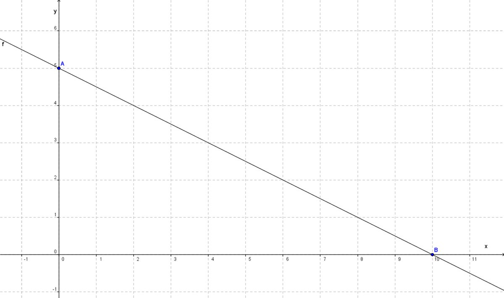

# The budget constraint

**Prerequisites:** [Choice and trade-offs](../01-foundations/02-choice-and-trade-offs.md), [Indifference curves](03-indifference-curves.md).



*A budget constraint: the line marks the bundles that spend all income, and everything on or below it is affordable. Credit: Michele-sama. License: Public domain. Source: [File:Budget constraint.png](https://commons.wikimedia.org/wiki/File:Budget_constraint.png).*

Preferences describe what a consumer wants. The **budget constraint** describes what they can afford. Together they determine choice. The budget constraint is the consumer's version of the [production possibilities frontier](../01-foundations/09-production-possibilities-frontier.md): it marks the boundary between what is attainable and what is not.

## The budget line

Suppose a consumer has income **M** to spend on two goods, X and Y, with prices **Px** and **Py**. Every affordable bundle satisfies:

**Px × x + Py × y ≤ M**

The bundles that spend exactly all the income, Px × x + Py × y = M, form the **budget line**. The bundles on or below it form the **budget set**.

**Example.** Lena has 60 dollars a week for coffees (3 dollars each) and muffins (2 dollars each). Her budget line is 3x + 2y = 60.

- If she buys only muffins: y = 30.
- If she buys only coffees: x = 20.
- Other bundles on the line: (10, 15), (4, 24), (16, 6).

## Slope: the market's trade-off

Rearranging the budget line: y = M/Py − (Px/Py) × x. The slope is **−Px/Py**. For Lena, −3/2: each extra coffee costs 1.5 muffins. This is the **opportunity cost** of coffee in terms of muffins, set by the market, and it is the same for every buyer facing these prices.

```mermaid
xychart-beta
  title "Lena's budget line: 3x + 2y = 60"
  x-axis "Coffees (x)" [0, 4, 8, 12, 16, 20]
  y-axis "Muffins (y)" 0 --> 32
  line [30, 24, 18, 12, 6, 0]
```

## How the budget line moves

**A change in income** shifts the line parallel. If Lena's budget rises to 90, she can buy up to 30 coffees or 45 muffins. The slope, which depends only on prices, is unchanged. A fall in income shifts the line inward.

**A change in one price** rotates the line around the intercept of the other good. If coffee falls to 2 dollars, the coffee intercept moves from 20 to 30, while the muffin intercept stays at 30. The line becomes flatter (slope −1): coffee is now cheaper relative to muffins. Lena's budget set has grown, even though her income has not; her **real income** or purchasing power has risen.

**All prices and income change in the same proportion**: nothing changes. If prices and income all double, the budget line is exactly the same. Consumers respond to **relative prices** and **real income**, not to nominal amounts. This is why economists distinguish real from nominal values, a theme the finance course develops in [inflation and real returns](../../finance/01-foundations/07-inflation-and-real-returns.md).

## Beyond the simple line

Real budget constraints often have kinks and complications:

- **Quantity discounts** ("buy two, get the third half-price") create kinked budget lines.
- **Rationing or limits** ("maximum two per customer") cut off part of the budget set.
- **Taxes and benefits** that depend on income create kinks in the budget line between work and income, which matter for [labour supply](../06-factor-markets/03-labour-supply.md).
- **Borrowing and saving** let consumers spend more or less than current income, adding a time dimension, covered in [intertemporal choice](12-intertemporal-choice.md).
- **Time budgets** constrain choices that require time as well as money: a cheap holiday still takes a week.

## Composite goods

Real consumers buy thousands of goods, not two. A standard trick is to let one axis be the good of interest (say, housing) and the other be "all other goods", measured in dollars, called a **composite good**. Because the price of a dollar of other goods is 1, the budget line's slope is simply minus the price of housing. This lets the two-good picture handle real policy questions, such as the effect of a housing subsidy.

## Key ideas

- The budget line shows bundles that spend all income: Px·x + Py·y = M.
- Its slope, −Px/Py, is the market's trade-off between goods.
- Income changes shift the line in parallel; price changes rotate it.
- Only relative prices and real income matter for choices.
- Real budgets have kinks from discounts, taxes, benefits and rationing.

## Where this leads

- Next: [optimal choice](06-optimal-choice.md), where the budget line meets the indifference map.
- Glossary: [budget constraint](../glossary/budget-constraint.md), [relative price](../glossary/relative-price.md), [real income](../glossary/real-income.md).
