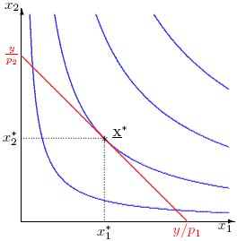
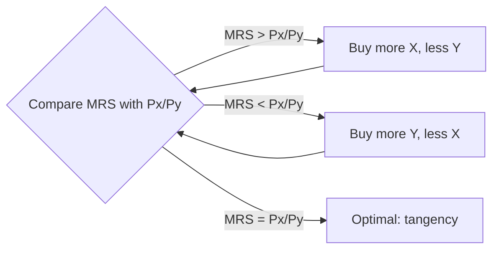

# Optimal choice

**Prerequisites:** [The marginal rate of substitution](04-marginal-rate-of-substitution.md), [The budget constraint](05-budget-constraint.md).

*Indifference curves and budget lines: the consumer's optimum is where the highest attainable indifference curve touches the budget line. Credit: Bonifazius. License: Public domain. Source: [File:ConsumersOptimum.png](https://commons.wikimedia.org/wiki/File:ConsumersOptimum.png).*

The consumer wants to reach the highest indifference curve possible, but must stay within the budget. Combining the indifference map with the budget line gives the **optimal choice**, also called **consumer equilibrium**. The result is one of the central conditions in all of economics.

## The tangency condition

Picture the budget line laid over the indifference map. Bundles on low indifference curves cross the budget line; bundles on high curves lie entirely beyond it. The best affordable bundle is on the highest curve that just **touches** the budget line. At that point, the curve and the line are **tangent**: they have the same slope.

Since the slope of the indifference curve is the MRS and the slope of the budget line is the price ratio:

**MRS = MUx / MUy = Px / Py**

The rate at which the consumer is **willing** to trade the goods equals the rate at which the market **lets** them trade. Rearranged, MUx/Px = MUy/Py: the [equal-marginal principle](02-marginal-utility.md) again. Two routes, one destination.

## Why tangency is optimal

Suppose the consumer is at a bundle where MRS = 3 (she would give up 3 muffins for one more coffee) but the price ratio Px/Py = 1.5 (the market charges only 1.5 muffins per coffee). She can buy another coffee by giving up 1.5 muffins, which she values at less than the 3 she would be willing to give. She gains by buying more coffee and fewer muffins. As she does, her MRS falls. She stops when MRS = 1.5. If the MRS were below the price ratio, she would gain by moving the other way.

## Worked example

Lena's preferences are U = x × y; her budget is 3x + 2y = 60.

- MRS = y/x (from the previous lesson).
- Tangency: y/x = 3/2, so y = 1.5x.
- Substitute into the budget: 3x + 2(1.5x) = 60, so 6x = 60, **x = 10**, **y = 15**.

Lena buys 10 coffees (30 dollars) and 15 muffins (30 dollars). Her utility is 150. Check another affordable bundle, say (14, 9): utility 126, lower. Or (6, 21): utility 126, also lower.

A neat feature of U = x × y (and Cobb-Douglas preferences generally) is that the consumer spends a fixed share of income on each good, here half on each. So her demand functions are x = M / (2Px) and y = M / (2Py). If the price of coffee falls to 2, she buys 60/4 = 15 coffees: a downward-sloping demand curve derived from preferences.

## Corner solutions

Sometimes the best bundle contains **none** of one good. If you have little taste for muffins, the highest indifference curve may touch the budget line at the axis, where you spend everything on coffee. At such a **corner solution**, the tangency condition does not hold; instead, MRS is greater than or equal to the price ratio at the corner. Corner solutions are common in real life: most people buy zero of most products available.

With perfect substitutes, the consumer buys only the cheaper good (or is indifferent if prices are equal). With perfect complements, the consumer buys the goods in fixed proportions at the corner of the L.

## What the model claims

The model does not claim people consciously compute tangencies. It claims that people behave **as if** they balanced the value of goods against their cost at the margin. It predicts how choices change when prices or income change, and those predictions, such as the law of demand, are broadly confirmed. Where behaviour departs from the model, for example because of inattention to prices or poor self-control, behavioural economics offers refinements. See [[bounded-rationality|bounded rationality]].

## Key ideas

- The optimal bundle is on the highest indifference curve that touches the budget line.
- At an interior optimum, MRS = Px/Py, equivalently MUx/Px = MUy/Py.
- If MRS exceeds the price ratio, buy more of X; if below, buy less.
- Corner solutions occur when the consumer buys none of a good.
- From the optimum, demand curves can be derived by varying prices.

## Where this leads

- Next: [income changes and Engel curves](07-income-changes-and-engel-curves.md).
- Then: [income and substitution effects](08-income-and-substitution-effects.md).
- Glossary: [[g:consumer-optimum|consumer optimum]], [[g:corner-solution|corner solution]].
