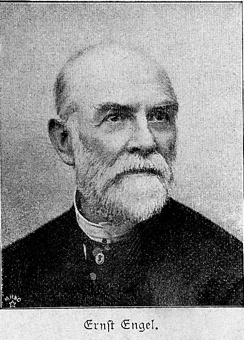
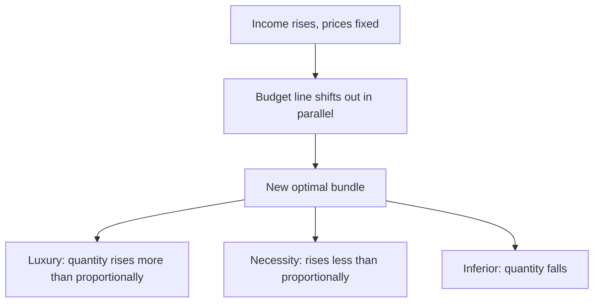

# Income changes and Engel curves

**Prerequisites:** [Optimal choice](06-optimal-choice.md), [Income, cross-price and supply elasticities](../02-supply-and-demand/08-other-elasticities.md).

*Ernst Engel (1821–1896), the statistician who found that the share of income spent on food falls as income rises. Credit: The original uploader was Goerdten at German Wikipedia. License: Public domain. Source: [File:Ernst Engel.jpg](https://commons.wikimedia.org/wiki/File:Ernst_Engel.jpg).*

What happens to a consumer's choices when income rises but prices stay the same? The budget line shifts outward in parallel, and the optimal bundle moves. Tracing those moves gives two useful curves: the **income-consumption curve** and the **Engel curve**.

## The income-consumption curve

Start with Lena: U = x × y, prices Px = 3 and Py = 2. Her optimal bundle at different incomes (she always spends half on each good):

| Income | Coffees x = M/6 | Muffins y = M/4 |
|---|---|---|
| 30 | 5 | 7.5 |
| 60 | 10 | 15 |
| 90 | 15 | 22.5 |
| 120 | 20 | 30 |

Joining these optimal points on the indifference-curve diagram gives the **income-consumption curve** (or income expansion path). For Lena it is a straight line from the origin, because her spending shares never change. For most real consumers it bends, because the shares change as income grows.

## The Engel curve

The **Engel curve** plots the quantity of one good against income, holding prices constant. For Lena's coffee: x = M/6, a straight line through the origin with slope 1/6.

Engel curves come in three broad shapes:

- **Upward sloping, steepening**: a **luxury** (income elasticity above 1). Spending rises faster than income.
- **Upward sloping, flattening**: a **necessity** (income elasticity between 0 and 1). Spending rises, but more slowly than income.
- **Downward sloping**: an **inferior good** (income elasticity negative).

A single good can change category as income rises. Bus travel may be normal for very poor households (they can afford to travel more) and inferior for middle-income households (who switch to cars).

## Engel's law

The curve is named after Ernst Engel (1821–1896), a German statistician who headed the statistical bureau of Saxony and later of Prussia. Analysing household budget surveys from Belgium collected by Édouard Ducpétiaux, Engel found in 1857 that the poorer a family, the larger the share of its income spent on food. This regularity, **Engel's law**, has held up remarkably well across countries and over time.

Its consequences are large:

- **Measuring poverty.** The US official poverty line, devised by Mollie Orshansky in the 1960s, was based on the cost of a minimal food budget multiplied by three, because surveys then showed families spending about a third of income on food.
- **Structural change.** As countries grow richer, the share of spending on food falls, so the share of workers in agriculture falls too. In 1900 a large share of Canadian workers were in farming; today it is a small percentage. Spending shifts toward services such as health, education and entertainment, which tend to be luxuries in Engel's sense.
- **Inflation and inequality.** Because poorer households spend more of their budget on food and energy, rises in those prices hit them harder. Statistical agencies sometimes compute separate price indexes for different income groups.

## Estimating Engel curves

Economists estimate Engel curves from household surveys, which record income and spending for thousands of families. A commonly used shape, the **Working-Leser** form, relates each good's budget share to the logarithm of total spending; it was proposed by Holbrook Working in 1943 and extended by Conrad Leser. In such data, the food budget share typically falls steadily as total spending rises, while shares for recreation and transport rise.

## Why this matters for demand

Engel curves describe the **income effect** on demand. When the price of a good changes, part of the response comes from the fact that the consumer's real income has changed. Knowing whether a good is normal or inferior, and how strongly, tells you the direction and size of that income effect, which is the subject of the next lesson.

## Key ideas

- The income-consumption curve traces optimal bundles as income changes, prices fixed.
- The Engel curve plots quantity of one good against income.
- Luxuries, necessities and inferior goods have characteristic Engel curve shapes.
- Engel's law: the food share of spending falls as income rises.
- Engel curves underpin poverty measurement and explain structural change.

## Where this leads

- Next: [income and substitution effects](08-income-and-substitution-effects.md).
- Glossary: [[g:engel-curve|Engel curve]], [[g:engels-law|Engel's law]], [[g:normal-good|normal good]], [[g:luxury-good|luxury good]].
