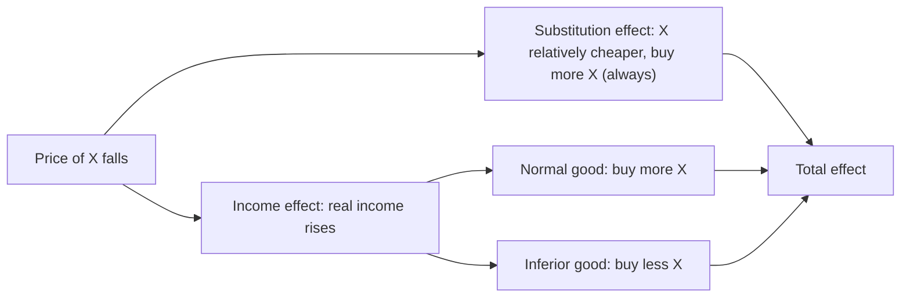

# Income and substitution effects

**Prerequisites:** [Optimal choice](06-optimal-choice.md), [Income changes and Engel curves](07-income-changes-and-engel-curves.md).

*John Hicks and his wife Ursula in 1972, on learning he had won the Nobel memorial prize; Hicks developed the modern income-substitution decomposition. Credit: Unknown (Associated Press). License: Public domain. Source: [File:John Hicks 1972.jpg](https://commons.wikimedia.org/wiki/File:John_Hicks_1972.jpg).*

When the price of a good falls, two things happen at once. The good becomes cheaper **relative to other goods**, and the consumer becomes **richer**, because the same income now buys more. Economists separate the total response into a **substitution effect** and an **income effect**. The decomposition explains why demand curves almost always slope down, and when they might not.

## The two effects

- **Substitution effect**: the change in quantity caused by the change in relative prices, holding the consumer's level of well-being (or purchasing power) constant. It always works against the price change: when a good becomes relatively cheaper, the consumer substitutes toward it.
- **Income effect**: the change in quantity caused by the change in real income. For a **normal good**, a price fall raises real income and so raises quantity demanded. For an **inferior good**, it lowers quantity demanded.

**Total effect = substitution effect + income effect.**

## Worked example

Lena: U = x × y, income 60, Py = 2. Coffee falls from Px = 3 to Px = 1.5.

**Before:** x = 60 / (2 × 3) = 10, y = 15. Utility = 150.

**After:** x = 60 / (2 × 1.5) = 20, y = 15. Coffee consumption doubles: **total effect = +10**.

**Isolating the substitution effect** (the Hicks method): what is the cheapest way to reach her old utility of 150 at the new prices? At the new prices the tangency condition is y/x = 1.5/2 = 0.75, so y = 0.75x. Setting x × 0.75x = 150 gives x² = 200, so x ≈ 14.14 and y ≈ 10.61. This bundle costs 1.5 × 14.14 + 2 × 10.61 ≈ 42.43.

- **Substitution effect**: from 10 to 14.14 coffees, **+4.14**. Coffee is relatively cheaper, so she substitutes toward it, staying on the same indifference curve.
- **Income effect**: from 14.14 to 20 coffees, **+5.86**. Going from a compensated budget of 42.43 back to her actual 60 is like a rise in income of about 17.57, and coffee is a normal good.

## Hicks and Slutsky

There are two standard ways to define "holding real income constant":

- **Hicks** (John Hicks, *Value and Capital*, 1939): keep the consumer on the **same indifference curve**. That is the method used above.
- **Slutsky** (Eugen Slutsky, 1915): give the consumer just enough income to **afford the original bundle** at the new prices. For Lena, that is 1.5 × 10 + 2 × 15 = 45 dollars.

For small price changes the two methods give nearly identical answers. The Slutsky version is easier to compute from data because it uses observable bundles rather than unobservable utility. Slutsky's paper, written in Italian and published in 1915, was largely overlooked until Hicks and Allen drew attention to it in the 1930s. The resulting formula, the **Slutsky equation**, is a cornerstone of demand theory:

**change in demand from a price change = substitution effect − (quantity bought) × (effect of income on demand)**

The second term shows why the income effect is larger for goods that take a big share of the budget: a price change on rent or gasoline changes real income much more than a price change on salt.

## Why demand curves slope down

For a **normal good**, both effects push the same way: a price fall increases quantity. Demand slopes down without question.

For an **inferior good**, the effects push in opposite directions. The substitution effect says buy more; the income effect says buy less. Usually the substitution effect wins, because inferior goods rarely take a large share of the budget, so the income effect is small. Demand still slopes down.

Only if the good is inferior **and** the income effect is large enough to outweigh the substitution effect will a price fall reduce quantity demanded. Such a good is a **Giffen good**, the subject of the next lesson.

## Applications

The same decomposition illuminates many problems:

- **Labour supply.** A wage rise makes leisure more expensive (substitution effect toward work) but also makes the worker richer (income effect toward more leisure, which is a normal good). The net effect can go either way. See [[labour-supply|labour supply]].
- **Saving.** A rise in interest rates makes current consumption more expensive relative to future consumption (substitution toward saving), but makes savers richer (income effect toward more consumption now). See [intertemporal choice](12-intertemporal-choice.md).
- **Taxes and rebates.** A tax on gasoline combined with a lump-sum rebate leaves the consumer with roughly the same real income but higher relative fuel prices: a pure substitution effect. Some carbon-pricing schemes, including Canada's federal fuel charge with its rebate from 2019 until the consumer charge was removed in 2025, were designed on this logic.

## Key ideas

- A price change has a substitution effect (relative prices) and an income effect (real income).
- The substitution effect always moves quantity opposite to price.
- The income effect depends on whether the good is normal or inferior.
- Hicks holds utility constant; Slutsky holds purchasing power constant.
- Demand slopes down unless a good is strongly inferior with a large income effect.

## Where this leads

- Next: [inferior and Giffen goods](09-inferior-and-giffen-goods.md).
- Applied: [[labour-supply|labour supply]], [intertemporal choice](12-intertemporal-choice.md).
- Glossary: [[g:income-effect|income effect]], [[g:substitution-effect|substitution effect]], [[g:slutsky-equation|Slutsky equation]].
