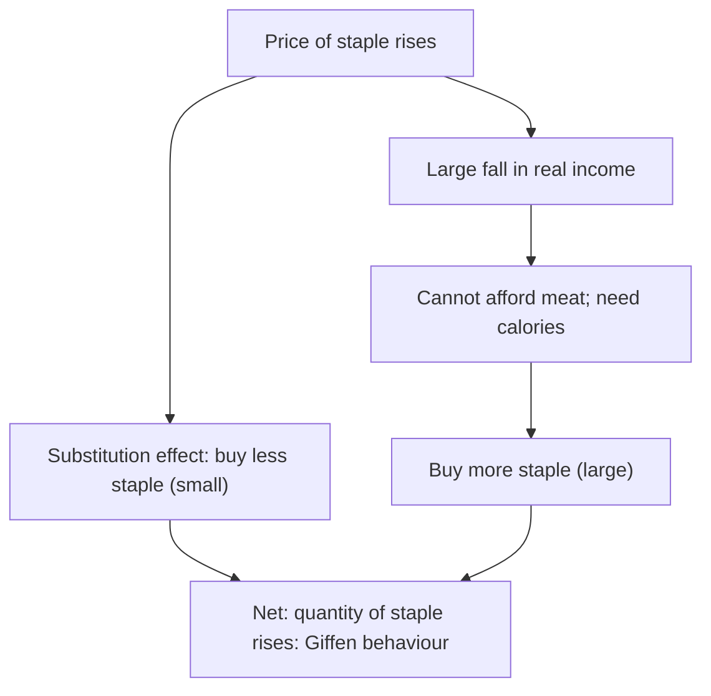

# Inferior and Giffen goods

**Prerequisites:** [Income and substitution effects](08-income-and-substitution-effects.md).

*Sir Robert Giffen (1837–1910), the statistician whose name Alfred Marshall attached to goods with upward-sloping demand. Credit: Original: The Graphic (retouched by Historian 1875). License: Public domain. Source: [File:Robert Giffen (engraved portrait).png](https://commons.wikimedia.org/wiki/File:Robert_Giffen_(engraved_portrait).png).*

The law of demand is one of the most reliable regularities in economics, but theory allows for an exception: a good whose quantity demanded **rises** when its price rises. Such a good is called a **Giffen good**. This lesson explains what it would take for one to exist, why it is so rare, and the evidence.

## Inferior goods

Recall that an **inferior good** is one people buy less of as their income rises. Examples depend on context, but often include:

- cheap staple foods (as income grows, people diversify into meat, fruit and vegetables);
- public transit in car-dependent places;
- store-brand products, when people switch to name brands as they get richer.

Being inferior is common and unremarkable. It does **not** mean demand slopes upward. For most inferior goods, a price fall still increases quantity demanded, because the substitution effect outweighs the negative income effect.

## The conditions for a Giffen good

A Giffen good needs three things together:

1. **It is inferior**, so the income effect works against the substitution effect.
2. **It takes a large share of the budget**, so a price change has a big effect on real income.
3. **Few close substitutes are affordable**, so the substitution effect is small.

Picture a very poor household that spends most of its income on a staple grain and a little on meat. If the grain's price rises, the household is effectively much poorer. It can no longer afford as much meat, and to get enough calories it buys **more** grain, the cheapest source of calories, even though grain is now more expensive. The income effect overwhelms the substitution effect, and quantity demanded rises with price.

## The name and the potato story

Alfred Marshall mentioned the possibility in the third edition of his *Principles of Economics* (1895), attributing the observation to Sir Robert Giffen, a Scottish statistician. Marshall wrote that a rise in the price of bread could make such a large drain on the resources of poorer labouring families that they would be forced to give up some meat and other more expensive foods and consume more bread. Historians have searched Giffen's writings without finding a clear statement of the idea.

Textbooks often cite potatoes during the Irish famine of the 1840s as a Giffen good. Economic historians have questioned this. During the famine, the potato crop itself was destroyed by blight, so the supply collapsed; people could not have bought more potatoes even if they wanted to. Studies such as Gerald Dwyer and Cotton Lindsay's 1984 paper concluded that the famine does not provide good evidence of Giffen behaviour.

## Modern evidence

The best evidence comes from a field experiment by Robert Jensen and Nolan Miller, published in the *American Economic Review* in 2008. They gave randomly selected very poor households in two Chinese provinces vouchers that lowered the price of their main staple: rice in Hunan and wheat flour (for noodles and buns) in Gansu. In Hunan, they found that households receiving the subsidy, which lowered the price of rice, consumed **less** rice: the mirror image of Giffen behaviour (a price fall reduces quantity). The effect was strongest among households that were poor, but not the very poorest. The very poorest could not substitute away from rice at all, and the better-off had enough income that rice was not dominating their budgets. The evidence for wheat in Gansu was weaker.

This fits theory well: Giffen behaviour should appear only in a narrow band of circumstances, among households poor enough that a staple dominates their spending but not so poor that they cannot afford any alternative.

## Not to be confused with

- **Veblen goods**: luxury goods whose appeal partly comes from a high price, discussed in [shifts in demand](../02-supply-and-demand/02-shifts-in-demand.md). Any apparent upward slope there comes from status signalling, not from income effects, and the good is typically a luxury, the opposite of inferior.
- **Expectations-driven demand**: when prices rise and people expect them to keep rising, as in a speculative bubble, demand may increase. This is a shift in demand caused by expectations, not a movement along a stable upward-sloping curve.
- **Quality signals**: buyers who use price as a sign of quality (wine, for some) may prefer pricier options. This is about information, not income effects.

## Why the exception matters

Giffen goods are a curiosity in practice, but they teach two things. First, the law of demand is not a logical necessity; it is an empirical regularity that depends on the substitution effect usually dominating. Second, the income-substitution decomposition is not just abstract: it makes precise predictions about **where** exceptions should appear, and careful experiments confirm them.

## Key ideas

- Inferior goods are common; their demand still usually slopes down.
- A Giffen good requires an inferior good, a large budget share, and few affordable substitutes.
- The Irish potato example is doubtful; the famine was a supply collapse.
- Jensen and Miller (2008) found Giffen behaviour for rice among poor households in Hunan.
- Veblen goods, bubbles and quality signals are different phenomena.

## Where this leads

- Next: [from individual to market demand](10-from-individual-to-market-demand.md).
- Glossary: [Giffen good](../glossary/giffen-good.md), [inferior good](../glossary/inferior-good.md), [Veblen good](../glossary/veblen-good.md).
