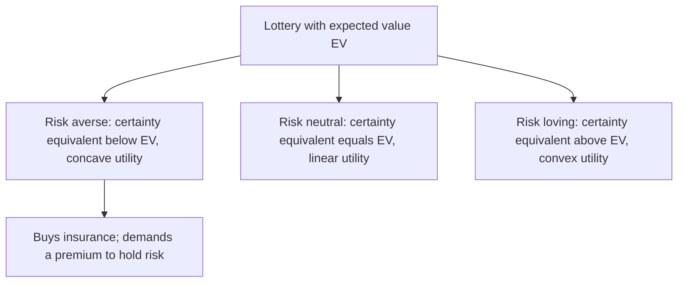

# Choice under uncertainty

**Prerequisites:** [Preferences and utility](01-preferences-and-utility.md), [Marginal utility](02-marginal-utility.md). Helpful: [probability and expected value](../../finance/01-foundations/08-probability-and-expected-value.md) in the finance course.

*Daniel Bernoulli (1700–1782), who proposed expected utility with diminishing marginal utility of wealth to resolve the St. Petersburg paradox. Credit: Johann Jakob Haid / Johann Rudolf Huber. License: Public domain. Source: [File:Daniel Bernoulli 001.jpg](https://commons.wikimedia.org/wiki/File:Daniel_Bernoulli_001.jpg).*

So far, consumers have known exactly what they would get. Real choices often involve risk: buying insurance, choosing a career, investing savings, deciding whether to carry an umbrella. **Expected utility theory** extends consumer theory to such choices, and introduces one of the most useful ideas in economics and finance: **risk aversion**.

## Lotteries and expected value

Economists describe a risky prospect as a **lottery**: a list of possible outcomes with their probabilities. For example, a lottery L might pay 100 dollars with probability 0.5 and 0 with probability 0.5.

The **expected value** of a lottery is the probability-weighted average of its outcomes: EV(L) = 0.5 × 100 + 0.5 × 0 = 50.

A natural first guess is that people should choose whatever has the highest expected value. But that guess fails in a famous case.

## The St. Petersburg paradox

A fair coin is tossed until it lands heads. If heads appears on the first toss you win 2 dollars; on the second, 4; on the third, 8; and so on, doubling each time. The expected value is (1/2 × 2) + (1/4 × 4) + (1/8 × 8) + ... = 1 + 1 + 1 + ... = infinite. Yet few people would pay more than a modest sum to play.

The puzzle was posed by Nicolas Bernoulli in 1713. His cousin Daniel Bernoulli proposed a solution in a paper published in 1738 by the St. Petersburg Academy (hence the name). He argued that people value not money itself but the **utility** of money, and that the utility of each extra ducat falls as wealth grows. With diminishing marginal utility of wealth (Bernoulli suggested a logarithmic function), the expected **utility** of the game is finite and small.

## Expected utility

**Expected utility** is the probability-weighted average of the utility of each outcome:

EU(L) = p1 × u(x1) + p2 × u(x2) + ...

In 1944, John von Neumann and Oskar Morgenstern, in *Theory of Games and Economic Behavior*, showed that if a person's preferences over lotteries satisfy a few reasonable axioms (including completeness, transitivity, continuity and independence), their choices can be represented as maximising expected utility for some utility function u. The independence axiom says that if you prefer lottery A to B, you should still prefer a mix of A with some third lottery C to the same mix of B with C.

## Risk aversion

Suppose u(w) = √w, and a person with wealth of 100 faces a lottery: wealth becomes 196 or 36 with equal probability.

- Expected value: 0.5 × 196 + 0.5 × 36 = **116**.
- Expected utility: 0.5 × 14 + 0.5 × 6 = **10**.
- The sure amount that gives utility 10 is 10² = **100**.

So the person is indifferent between the risky lottery (expected value 116) and a sure 100. The sure amount, 100, is the **certainty equivalent**. The difference, 116 − 100 = 16, is the **risk premium**: what they would give up to avoid the risk.

A person is:

- **Risk averse** if they prefer a sure amount to a lottery with the same expected value. Their utility function is concave (diminishing marginal utility of wealth).
- **Risk neutral** if they care only about expected value. Linear utility.
- **Risk loving** if they prefer the gamble. Convex utility.

## Why insurance exists

Risk aversion explains insurance. Suppose a person with wealth 100 faces a 10 percent chance of losing 64 (say, a car accident). Their expected wealth is 0.9 × 100 + 0.1 × 36 = 93.6. With u = √w, expected utility is 0.9 × 10 + 0.1 × 6 = 9.6, whose certainty equivalent is 9.6² = 92.16. They would pay up to 100 − 92.16 = **7.84** for full insurance, even though the expected loss is only 6.4. An insurer pooling many such independent risks can charge, say, 7 and expect to profit, and both sides gain. The same logic underlies why investors demand higher expected returns on riskier assets, the subject of [risk and return](../../finance/01-foundations/10-risk-and-return.md) in the finance course.

Insurance markets face their own problems when insurers and customers know different things: see [[adverse-selection|adverse selection]] and [[moral-hazard|moral hazard]].

## Challenges to expected utility

Experiments show systematic departures from expected utility. In the **Allais paradox** (Maurice Allais, 1953), many people make pairs of choices that violate the independence axiom, overweighting certainty. Kahneman and Tversky's **prospect theory** (1979) describes such patterns using reference points, loss aversion and probability weighting. These are discussed in [[prospect-theory-in-economics|prospect theory in economics]]. Expected utility remains the standard benchmark, both as a model of rational choice and as a starting point for richer descriptive models.

## Key ideas

- Risky choices can be modelled as lotteries over outcomes.
- Expected value alone fails to explain behaviour (the St. Petersburg paradox).
- Expected utility weights the utility of outcomes by probabilities; von Neumann and Morgenstern axiomatised it.
- Concave utility means risk aversion; the risk premium is EV minus the certainty equivalent.
- Risk aversion explains insurance and the risk-return trade-off; experiments reveal departures.

## Where this leads

- Next: [intertemporal choice](12-intertemporal-choice.md).
- Related: [[prospect-theory-in-economics|prospect theory in economics]], [[asymmetric-information|asymmetric information]].
- Glossary: [[g:expected-utility|expected utility]], [[g:risk-aversion|risk aversion]], [[g:certainty-equivalent|certainty equivalent]], [[g:st-petersburg-paradox|St. Petersburg paradox]].
