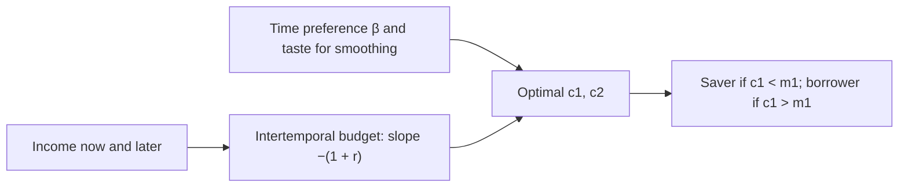

# Intertemporal choice

**Prerequisites:** [Optimal choice](06-optimal-choice.md), [Income and substitution effects](08-income-and-substitution-effects.md). Helpful: [present value and discounting](../../finance/01-foundations/05-present-value-and-discounting.md).

*Irving Fisher (1867–1947), whose The Theory of Interest (1930) analysed choice between present and future consumption. Credit: Wide World Photos/ Archival by La Presse. License: Public domain. Source: [File:Irving Fisher, 1867-1947 (cropped).jpg](https://commons.wikimedia.org/wiki/File:Irving_Fisher,_1867-1947_(cropped).jpg).*

Many decisions trade off the present against the future: saving for retirement, taking out a student loan, buying a house, investing in education. **Intertemporal choice** applies consumer theory to these decisions by treating consumption today and consumption tomorrow as two different goods. The approach was developed most fully by the American economist Irving Fisher in *The Theory of Interest* (1930).

## Two periods, two goods

Consider a consumer who lives for two periods, "now" (period 1) and "later" (period 2). They earn income m1 now and m2 later, and can borrow or lend at interest rate r. Let c1 and c2 be consumption in each period.

If they save s = m1 − c1 now, they will have m2 + (1 + r)s later. Their **intertemporal budget constraint** is:

**c1 + c2 / (1 + r) = m1 + m2 / (1 + r)**

The left side is the **present value** of consumption; the right side is the present value of income. The constraint says you cannot spend more than the present value of your lifetime resources.

The slope of this budget line is −(1 + r): giving up one dollar of consumption now buys 1 + r dollars of consumption later. The **interest rate is the relative price** of present consumption in terms of future consumption.

## Worked example

Noor earns 50,000 now and 55,000 next period. The interest rate is 10 percent.

- Present value of income: 50,000 + 55,000 / 1.1 = 50,000 + 50,000 = **100,000**.
- Maximum consumption now (borrowing against all future income): 100,000.
- Maximum consumption later (saving all current income): 50,000 × 1.1 + 55,000 = **110,000**.

If her preferences make her want equal consumption in both periods (c1 = c2 = c), then c + c/1.1 = 100,000, so c × 2.1/1.1 = 100,000, and **c ≈ 52,381**. She **borrows** about 2,381 now and repays 2,619 next period.

## Time preference

People generally prefer consumption sooner rather than later, other things equal. Economists capture this with a **discount factor** β (beta), between 0 and 1, applied to future utility:

**U = u(c1) + β × u(c2)**

A lower β means more impatience. Eugen von Böhm-Bawerk, the Austrian economist, argued in the 1880s that this preference for present goods, together with the productivity of roundabout production, explains why interest exists. Fisher combined **impatience** (time preference) and **investment opportunity** (the productivity of capital) as the twin determinants of interest rates.

## Responses to interest rates

When the interest rate rises, future consumption becomes cheaper relative to present consumption:

- **Substitution effect**: consume less now, save more.
- **Income effect**: for a **saver**, a higher rate means more future income from savings, so they feel richer and may consume more now. For a **borrower**, a higher rate makes them poorer, reinforcing the cut in consumption.

So for savers the effect of interest rates on saving is theoretically ambiguous. Empirical estimates of the responsiveness of saving to interest rates vary widely, and economists continue to debate the size. See [income and substitution effects](08-income-and-substitution-effects.md).

## Consumption smoothing

Because marginal utility diminishes, most people prefer a smooth path of consumption to a feast-and-famine one. This idea underlies two influential theories: Franco Modigliani's **life-cycle hypothesis** (developed with Richard Brumberg in the 1950s), in which people borrow when young, save in middle age and spend down savings in retirement; and Milton Friedman's **permanent income hypothesis** (1957), in which consumption depends on long-run expected income rather than current income. Both underpin how economists think about saving, pensions and the effects of temporary versus permanent tax changes.

## When people are not consistent

The standard model assumes **exponential discounting**: the trade-off between today and tomorrow is the same as between day 100 and day 101. Experiments suggest many people are much more impatient about the immediate present than about the distant future, a pattern called **present bias** or **hyperbolic discounting**. It helps explain procrastination and undersaving and is the subject of [time inconsistency and self-control](../09-behavioural-economics/05-time-inconsistency-and-self-control.md).

## Key ideas

- Intertemporal choice treats present and future consumption as two goods.
- The budget constraint equates present values of consumption and income; the interest rate is the relative price.
- Time preference (β) and the productivity of capital together determine interest (Fisher).
- Higher interest rates have substitution and income effects; for savers the net effect on saving is ambiguous.
- People smooth consumption; present bias is a common departure.

## Where this leads

- Next section: [producer theory](../04-producer-theory/01-the-firm.md), starting with the firm.
- Related: [capital and interest](../06-factor-markets/07-capital-and-interest.md), [time inconsistency](../09-behavioural-economics/05-time-inconsistency-and-self-control.md).
- Related branch: [the time value of money](../../finance/01-foundations/04-time-value-of-money.md).
- Glossary: [time preference](../glossary/time-preference.md), [discount factor](../glossary/discount-factor.md), [consumption smoothing](../glossary/consumption-smoothing.md), [present value](../glossary/present-value.md).
