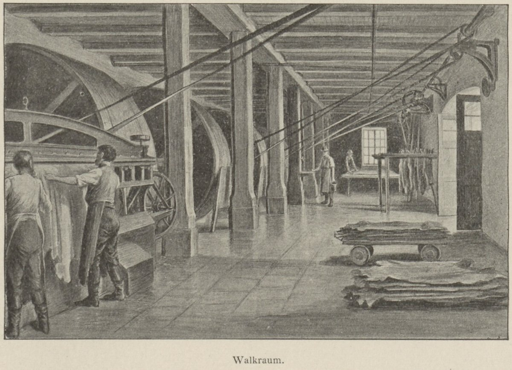
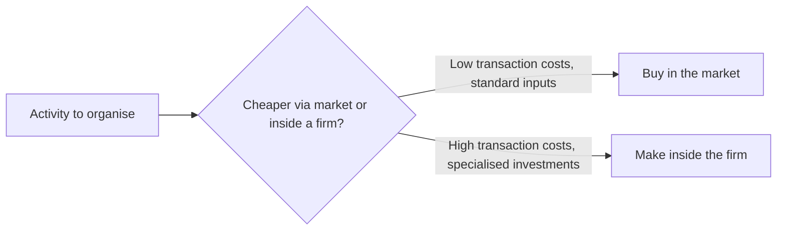

# The firm

**Prerequisites:** [Supply](../02-supply-and-demand/03-supply.md), [Opportunity cost](../01-foundations/03-opportunity-cost.md). Helpful: [what a company is](../../finance/02-firms-and-capital/01-what-is-a-company.md) in the finance course.

*The machinery room of a leather factory in Schönstein, about 1898: a firm brings labour and capital together under one management. Credit: ?C. Damian. License: Public domain. Source: [File:Franz Woschagg & Sons Leather Factory - machinery room, Schönstein (c. 1898).png](https://commons.wikimedia.org/wiki/File:Franz_Woschagg_&_Sons_Leather_Factory_-_machinery_room,_Schönstein_(c._1898).png).*

Supply curves come from the decisions of firms. Before deriving them, it helps to ask what a firm is, why firms exist at all, and what they are trying to do. This lesson introduces the economist's view of the firm and the distinction between accounting and economic profit.

## What a firm is

A **firm** is an organisation that combines inputs (labour, capital, materials, land) to produce goods or services for sale. Firms range from a self-employed plumber to multinational corporations with hundreds of thousands of employees. Legally they take forms such as sole proprietorships, partnerships, cooperatives and corporations; the finance course covers the legal side, including [limited liability](../../finance/02-firms-and-capital/02-limited-liability-and-the-corporation.md).

## Why firms exist: Coase

If markets coordinate activity so well through prices, why is so much economic activity organised inside firms by command, where a manager tells employees what to do? Ronald Coase asked this question in "The Nature of the Firm" (1937), written when he was in his twenties. His answer: using the market has costs. Finding trading partners, negotiating prices, writing and enforcing contracts all take time and money. Coase called these the costs of using the price mechanism; later economists call them **transaction costs**. Firms exist because, for some activities, organising them internally is cheaper than contracting for each task in the market. A firm grows until the cost of organising one more transaction internally equals the cost of doing it through the market.

Oliver Williamson extended this work, arguing that firms are especially useful when transactions involve specialised investments that would leave one party exposed to being "held up" by the other. Williamson shared the 2009 Nobel memorial prize with Elinor Ostrom for this research.

## The goal: profit maximisation

Standard theory assumes firms aim to **maximise profit**. Profit is total revenue minus total cost:

**Profit = Total revenue − Total cost**

This is a simplification. Managers may pursue growth, prestige or a quiet life; owners may care about the community or the environment; nonprofits and cooperatives have different goals. When managers' interests differ from owners', the [principal-agent problem](../07-market-failure/13-principal-agent-problem.md) arises. Still, the profit-maximisation assumption predicts a great deal about how firms respond to prices and costs, and competition tends to weed out firms that stray far from it.

## Accounting profit and economic profit

The difference between accountants and economists lies in what counts as a cost.

- **Accounting profit** = revenue − explicit costs (wages, rent, materials, interest paid).
- **Economic profit** = revenue − explicit costs − **implicit costs**.

Implicit costs are opportunity costs that involve no payment: the salary the owner could have earned elsewhere, the return the owner's own money could have earned if invested elsewhere, the rent the owner could get for a building they use themselves.

**Worked example.** Rosa leaves a job paying 70,000 a year to open a bakery. She invests 100,000 of her savings, which could have earned 5 percent elsewhere. In the first year:

- Revenue: 250,000
- Explicit costs (ingredients, staff, rent, utilities): 160,000
- Accounting profit: **90,000**
- Implicit costs: forgone salary 70,000 + forgone interest 5,000 = 75,000
- Economic profit: **15,000**

Rosa's bakery is doing better than her next-best alternative by 15,000. If her accounting profit had been 60,000, her economic profit would be −15,000: the bakery would be a worse use of her time and money than her old job, even though the accounts show a "profit".

## Normal profit

When economic profit is exactly zero, the firm earns **normal profit**: enough to cover all opportunity costs, including a market return on the owner's capital and time. Normal profit is the minimum needed to keep the owner in the business. Zero economic profit is not a disaster; it means the owner is doing as well as they could elsewhere. This concept is central to [long-run competitive equilibrium](../05-market-structures/03-long-run-competitive-equilibrium.md), where entry drives economic profit to zero.

## Short run and long run

Economists distinguish two time horizons for firms:

- The **short run**: at least one input, typically the size of the plant or the amount of capital, is fixed.
- The **long run**: all inputs can be varied, and firms can enter or leave the industry.

These are not fixed calendar periods. For a food truck, the long run might be a few weeks; for a steel mill or a nuclear power station, many years.

## Key ideas

- Firms combine inputs to produce output for sale.
- Coase: firms exist because using markets has transaction costs.
- Standard theory assumes firms maximise profit, a useful simplification.
- Economic profit subtracts implicit opportunity costs; accounting profit does not.
- Normal profit means zero economic profit; the short run has fixed inputs, the long run does not.

## Where this leads

- Next: [production functions](02-production-functions.md).
- Related: [Ronald Coase](../10-history-of-thought/thinkers/12-ronald-coase.md), [the principal-agent problem](../07-market-failure/13-principal-agent-problem.md).
- Glossary: [firm](../glossary/firm.md), [economic profit](../glossary/economic-profit.md), [accounting profit](../glossary/accounting-profit.md), [normal profit](../glossary/normal-profit.md), [transaction costs](../glossary/transaction-costs.md).
