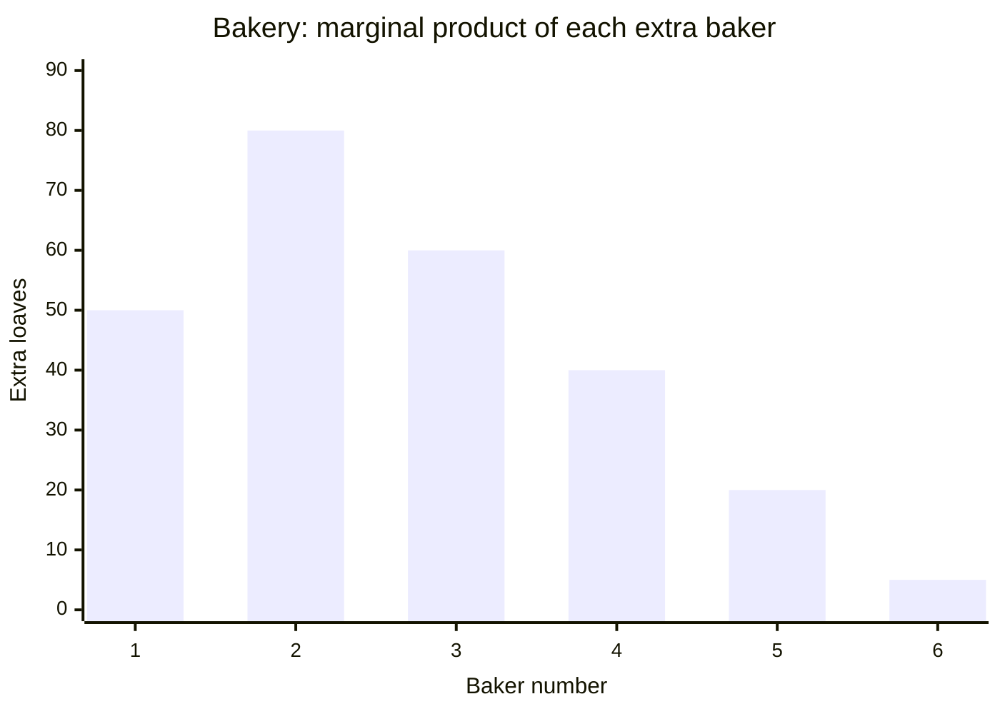

# Production functions

**Prerequisites:** [The firm](01-the-firm.md).

*A Cobb-Douglas production function plotted in three dimensions: output rises with both labour and capital. Credit: 百楽兎. License: [CC BY-SA 3.0](https://creativecommons.org/licenses/by-sa/3.0). Source: [File:Cobb–Douglas Function.svg](https://commons.wikimedia.org/wiki/File:Cobb–Douglas_Function.svg).*

A firm's technology, the set of methods it knows for turning inputs into outputs, is summarised by a **production function**. It tells you the maximum output a firm can produce from any combination of inputs. It is the producer's counterpart to the consumer's utility function, and it is the starting point for deriving costs and supply.

## Definition

A production function is written:

**Q = f(L, K)**

where Q is output, L is labour (worker-hours) and K is capital (machine-hours, or the stock of equipment). Real production uses many inputs, including materials, energy and land, but two are enough to show the logic.

"Maximum" matters: the production function assumes the firm uses its inputs efficiently. A firm that wastes inputs produces inside its production function, just as an economy can produce inside its [production possibilities frontier](../01-foundations/09-production-possibilities-frontier.md).

## Short-run production: one variable input

In the short run, capital is fixed. Suppose a bakery has one oven (K = 1) and can vary the number of bakers.

| Bakers (L) | Loaves per day (Q) | Marginal product (MPL) | Average product (APL) |
|---|---|---|---|
| 0 | 0 | – | – |
| 1 | 50 | 50 | 50 |
| 2 | 130 | 80 | 65 |
| 3 | 190 | 60 | 63.3 |
| 4 | 230 | 40 | 57.5 |
| 5 | 250 | 20 | 50 |
| 6 | 255 | 5 | 42.5 |

- The **total product** is the output at each level of labour.
- The **marginal product of labour** (MPL) is the extra output from one more worker: ΔQ / ΔL.
- The **average product of labour** (APL) is output per worker: Q / L.

## The shape of total product

Output rises quickly at first. The second baker adds more than the first (80 versus 50), because two people can divide tasks: one mixes and shapes while the other runs the oven. This is **increasing marginal returns**, a small-scale version of the [division of labour](../01-foundations/06-specialization-and-division-of-labour.md).

After the second baker, each extra worker adds less: 60, then 40, 20, 5. The oven, the counter space and the kitchen are fixed, so new workers increasingly get in each other's way. This is **diminishing marginal returns**, the subject of the next lesson.

## Marginal and average product

The relationship between marginal and average product follows a simple rule that applies to any average: **when the marginal is above the average, the average rises; when the marginal is below the average, the average falls.** Think of a class average: adding a student who scores above the average raises it. In the table, APL rises while MPL exceeds it (up to 2 workers), and falls once MPL drops below it. So MPL crosses APL at APL's maximum. The same rule will reappear for cost curves in [cost curves](06-cost-curves.md).

## Long-run production: two variable inputs

In the long run, the bakery can vary both labour and the number of ovens. The production function then describes output for every combination, and there are usually many ways to produce the same output: more workers with fewer ovens, or more ovens with fewer workers. The combinations that produce the same output are shown by **isoquants**, discussed in [isoquants and input choice](04-isoquants-and-input-choice.md).

## The Cobb-Douglas production function

A widely used example is the **Cobb-Douglas** form:

**Q = A × L^α × K^β**

where A measures overall productivity (technology) and α and β measure how output responds to each input. In 1928, the economist Paul Douglas and the mathematician Charles Cobb fitted this function to US manufacturing data from 1899 to 1922, finding that labour's exponent was about 0.75 and capital's about 0.25. The form remains popular because it is simple and has convenient properties: if α + β = 1, doubling both inputs exactly doubles output (constant returns to scale), a concept explored in [economies of scale](08-economies-of-scale.md).

## Technology and productivity growth

An improvement in technology shifts the production function up: the same inputs produce more output. In the Cobb-Douglas form, it raises A. Over the long run, such improvements have been the main source of rising living standards. Robert Solow's work in the 1950s showed that a large part of the growth in US output per worker could not be explained by more capital and was due to technical progress, which he measured as a residual. This lies on the border between micro and macroeconomics.

## Key ideas

- A production function gives maximum output from each combination of inputs.
- Marginal product is the extra output from one more unit of an input; average product is output per unit.
- Marginal product often rises at first, then falls (diminishing returns).
- When marginal product exceeds average, average rises; when below, average falls.
- The Cobb-Douglas form, Q = A·L^α·K^β, is a common example.

## Where this leads

- Next: [diminishing marginal returns](03-diminishing-marginal-returns.md).
- Glossary: [production function](../glossary/production-function.md), [marginal product](../glossary/marginal-product.md), [average product](../glossary/average-product.md), [Cobb-Douglas function](../glossary/cobb-douglas.md).
