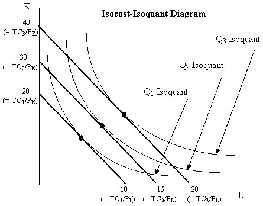
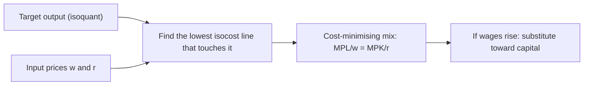

# Isoquants and input choice

**Prerequisites:** [Production functions](02-production-functions.md), [Optimal choice](../03-consumer-theory/06-optimal-choice.md) (the parallel with consumer theory helps).

*Isoquants and isocost lines: the cheapest way to produce a given output is where an isoquant touches the lowest isocost line. Credit: FrozenMan at English Wikipedia. License: Public domain. Source: [File:Isoquant isocost graph.png](https://commons.wikimedia.org/wiki/File:Isoquant_isocost_graph.png).*

In the long run a firm can vary all its inputs. It can produce the same output with many workers and few machines, or few workers and many machines. Which mix should it choose? The answer uses tools that mirror consumer theory: **isoquants** (like indifference curves) and **isocost lines** (like budget lines).

## Isoquants

An **isoquant** ("equal quantity") shows all combinations of inputs that produce the same output. Suppose a car-wash's production function is Q = √(L × K), where L is worker-hours and K is machine-hours. To wash 10 cars an hour, it needs L × K = 100:

| Workers (L) | Machines (K) |
|---|---|
| 1 | 100 |
| 2 | 50 |
| 4 | 25 |
| 5 | 20 |
| 10 | 10 |
| 20 | 5 |
| 50 | 2 |

Isoquants have properties like indifference curves: higher isoquants represent more output, they slope downward (to use less of one input you need more of the other), they do not cross, and they usually bow toward the origin.

## The marginal rate of technical substitution

The slope of an isoquant is the **marginal rate of technical substitution** (MRTS): how much capital can be replaced by one more unit of labour while keeping output constant. Just as the MRS equals the ratio of marginal utilities, the MRTS equals the ratio of marginal products:

**MRTS = MPL / MPK**

The MRTS usually diminishes along an isoquant: when labour is plentiful and capital scarce, it takes a lot of labour to replace a machine. For Q = √(LK), MRTS = K / L.

At the extremes, inputs can be **perfect substitutes** (straight-line isoquants: say, two brands of identical fuel) or **perfect complements** (L-shaped isoquants: one driver per truck, no matter how many extra drivers you hire).

## Isocost lines

An **isocost line** shows all input combinations with the same total cost. If the wage is w and the rental rate of capital is r:

**Total cost C = w × L + r × K**

Its slope is −w/r, the market rate at which labour trades for capital. For the car wash, with w = 20 per hour and r = 5 per machine-hour, the isocost line for C = 400 is 20L + 5K = 400.

## Cost minimisation

To produce a given output at the lowest cost, the firm chooses the point on its isoquant that touches the lowest isocost line. At that point the isoquant and the isocost line are tangent:

**MRTS = w / r**, or equivalently **MPL / w = MPK / r**

The last dollar spent on each input yields the same extra output. If a dollar spent on labour produced more than a dollar spent on capital, the firm could cut cost by switching toward labour.

**Worked example.** For the car wash to produce 10 washes: MRTS = K/L = w/r = 20/5 = 4, so K = 4L. Then L × 4L = 100, L² = 25, **L = 5**, **K = 20**. Cost = 20 × 5 + 5 × 20 = **200**. Check another point on the isoquant, (10, 10): cost 20 × 10 + 5 × 10 = 250. Or (2, 50): 40 + 250 = 290. The tangency point is cheapest.

## When input prices change

If wages rise relative to the price of capital, the isocost line becomes steeper, and the cost-minimising point slides along the isoquant toward **more capital and less labour**. This is the **factor substitution** effect. It explains why automated checkouts and ordering kiosks spread fastest where labour is expensive, and why agriculture in labour-scarce countries is more mechanised. The ease of substitution is measured by the **elasticity of substitution**, a concept John Hicks introduced in *The Theory of Wages* (1932).

Factor substitution matters for policy too: a large rise in the minimum wage gives firms an incentive to substitute machines for low-wage workers over time, one channel through which minimum wages could affect employment (see [price floors](../02-supply-and-demand/12-price-floors.md)).

## From cost minimisation to cost curves

Solving the cost-minimisation problem for every output level gives the firm's **long-run total cost** curve: the lowest cost of producing each quantity when all inputs can vary. This is the basis of [long-run costs](07-long-run-costs.md) and [economies of scale](08-economies-of-scale.md). The **expansion path**, the line joining cost-minimising points as output grows, is the producer's equivalent of the consumer's income-consumption curve.

## Key ideas

- An isoquant shows all input combinations producing the same output.
- Its slope is the MRTS = MPL / MPK, which usually diminishes.
- An isocost line shows combinations with the same cost; its slope is −w/r.
- Cost minimisation: MRTS = w/r, so MPL/w = MPK/r.
- When an input becomes more expensive, firms substitute away from it.

## Where this leads

- Next: [short-run costs](05-short-run-costs.md).
- Glossary: [isoquant](../glossary/isoquant.md), [isocost line](../glossary/isocost-line.md), [marginal rate of technical substitution](../glossary/marginal-rate-of-technical-substitution.md), [elasticity of substitution](../glossary/elasticity-of-substitution.md).
