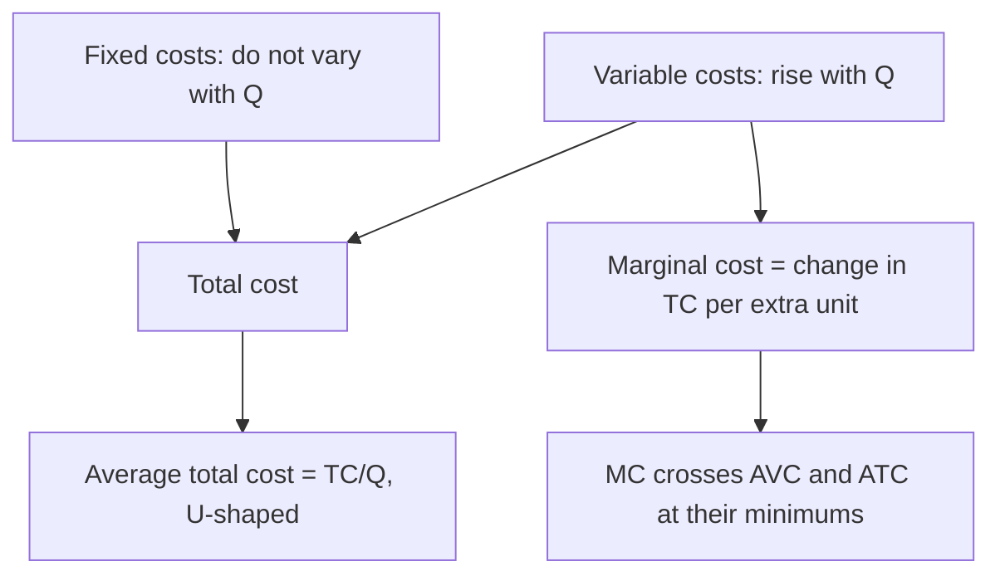

# Short-run costs

**Prerequisites:** [Diminishing marginal returns](03-diminishing-marginal-returns.md), [The firm](01-the-firm.md).

*A Roman bakery at Pompeii with its oven and grain mills: the fixed capital of a business that had to be paid for whatever its output. Credit: Isaac Harjo of Prowalk Tours. License: [CC BY-SA 4.0](https://creativecommons.org/licenses/by-sa/4.0). Source: [File:Bakery with oven and mills Pompeii ProWalk Tours.jpg](https://commons.wikimedia.org/wiki/File:Bakery_with_oven_and_mills_Pompeii_ProWalk_Tours.jpg).*

A firm's supply decisions depend on its costs. In the short run, some inputs are fixed, which splits costs into two kinds: those that do not change with output and those that do. This lesson defines the main cost concepts with a worked table.

## Fixed and variable costs

- **Fixed costs (FC)** do not vary with output in the short run. Rent on a lease, insurance, the salary of a manager, interest on a loan for equipment. A bakery pays them even if it bakes nothing.
- **Variable costs (VC)** rise with output: flour, electricity for the oven, wages of hourly bakers.
- **Total cost (TC) = FC + VC.**

All costs are opportunity costs, so they include implicit costs such as the owner's time and the return on their capital (see [the firm](01-the-firm.md)).

## Worked table

A bakery pays 200 dollars a day in fixed costs (rent, oven lease). Each baker costs 160 a day; ingredients cost 0.40 per loaf. Using the production numbers from [production functions](02-production-functions.md):

| Bakers | Loaves (Q) | FC | VC (wages + ingredients) | TC |
|---|---|---|---|---|
| 0 | 0 | 200 | 0 | 200 |
| 1 | 50 | 200 | 160 + 20 = 180 | 380 |
| 2 | 130 | 200 | 320 + 52 = 372 | 572 |
| 3 | 190 | 200 | 480 + 76 = 556 | 756 |
| 4 | 230 | 200 | 640 + 92 = 732 | 932 |
| 5 | 250 | 200 | 800 + 100 = 900 | 1,100 |

## Average and marginal costs

From total costs come several per-unit measures:

- **Average fixed cost (AFC)** = FC / Q. It always falls as output rises, because the fixed cost is spread over more units ("spreading the overhead").
- **Average variable cost (AVC)** = VC / Q.
- **Average total cost (ATC)** = TC / Q = AFC + AVC. This is the cost per unit.
- **Marginal cost (MC)** = ΔTC / ΔQ = ΔVC / ΔQ. The cost of producing one more unit. Fixed costs do not affect marginal cost, because they do not change with output.

| Q | AFC | AVC | ATC | MC (per loaf over the range) |
|---|---|---|---|---|
| 50 | 4.00 | 3.60 | 7.60 | 180 / 50 = 3.60 |
| 130 | 1.54 | 2.86 | 4.40 | 192 / 80 = 2.40 |
| 190 | 1.05 | 2.93 | 3.98 | 184 / 60 = 3.07 |
| 230 | 0.87 | 3.18 | 4.05 | 176 / 40 = 4.40 |
| 250 | 0.80 | 3.60 | 4.40 | 168 / 20 = 8.40 |

Notice the pattern:

- **MC first falls, then rises.** It falls while marginal product is rising (the second baker is very productive) and rises once diminishing returns set in.
- **AVC and ATC are U-shaped.** They fall at first and then rise.
- **MC cuts AVC and ATC at their minimum points.** When MC is below an average, it pulls the average down; when above, it pulls it up. ATC is lowest around 190 loaves (3.98), close to where MC rises above it.

## Why fixed costs do not matter for short-run decisions

Fixed costs must be paid whatever the firm does in the short run, so they are, for that period, sunk. They do not affect how much to produce or even whether to produce this week. A firm deciding whether to bake another batch should compare the extra revenue with the **marginal cost**; a firm deciding whether to open at all this week should compare revenue with **variable cost**. Both decisions ignore fixed costs. This is the logic of the shutdown rule in [[the-competitive-firm-in-the-short-run|the competitive firm in the short run]].

Fixed costs do matter in the long run, when the firm decides whether to renew its lease, buy new equipment, or leave the industry.

## Quasi-fixed and sunk costs

Some costs are fixed but avoidable: if the bakery shuts down entirely, it might stop paying for heating or sublet the space. Economists sometimes call these **avoidable fixed costs**, as distinct from **sunk costs** that cannot be recovered at all (a non-refundable licence fee, specialised equipment with no resale value). The distinction matters for entry and exit decisions and for how competitive an industry can be: large sunk costs deter entry, a theme in [[monopoly|monopoly]] and [[competition-policy|competition policy]].

## Key ideas

- Fixed costs do not vary with output in the short run; variable costs do.
- ATC = AFC + AVC; AFC always falls as output rises.
- Marginal cost first falls then rises, reflecting rising then diminishing marginal product.
- MC crosses AVC and ATC at their minimum points.
- Fixed costs do not affect short-run output decisions.

## Where this leads

- Next: [cost curves](06-cost-curves.md), which turns these numbers into shapes.
- Glossary: [[g:fixed-cost|fixed cost]], [[g:variable-cost|variable cost]], [[g:average-total-cost|average total cost]], [[g:marginal-cost|marginal cost]].
