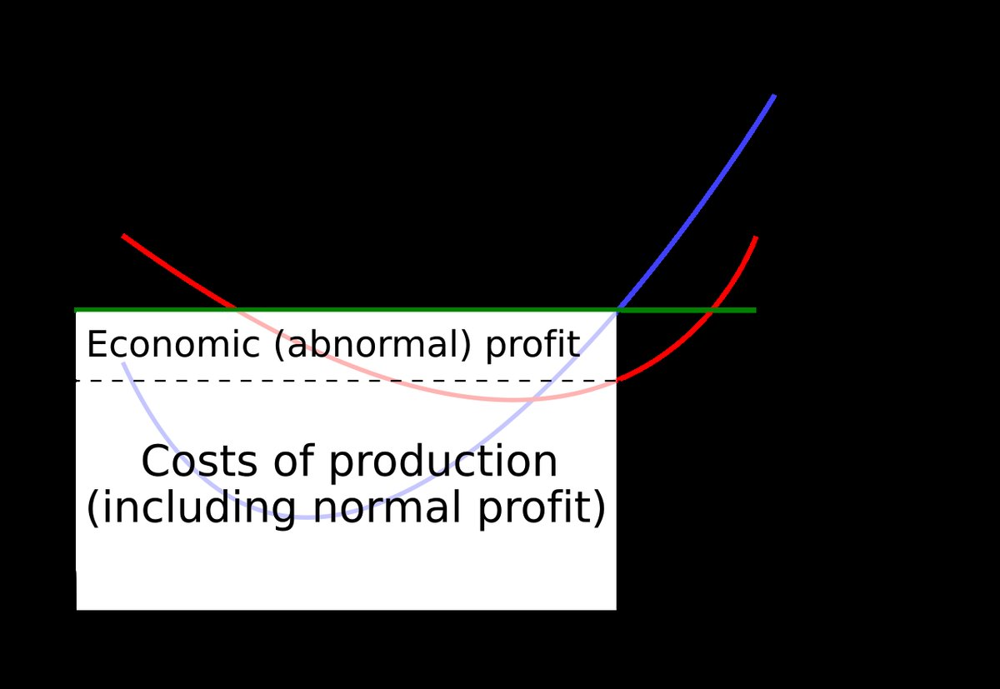
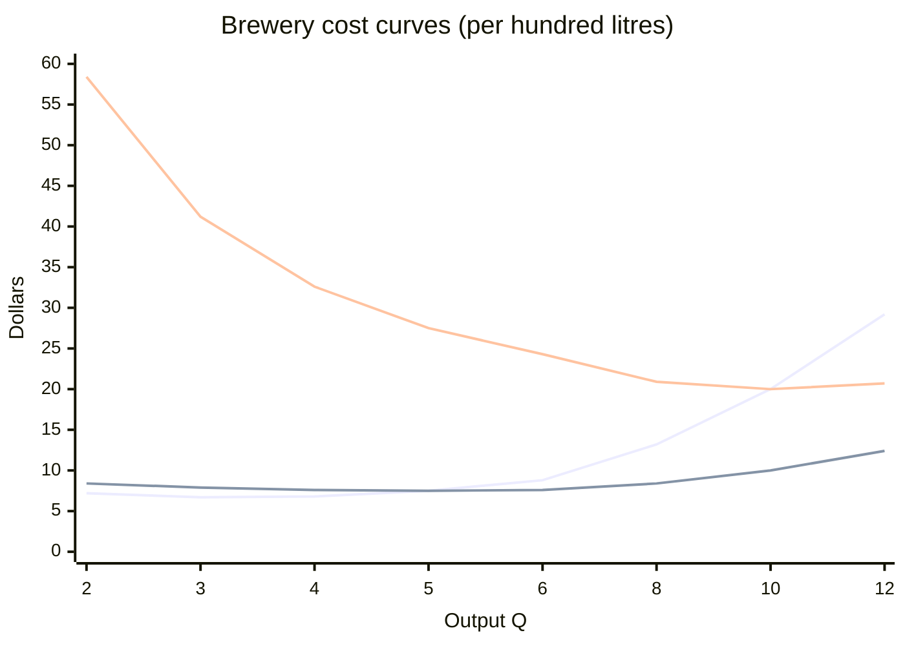
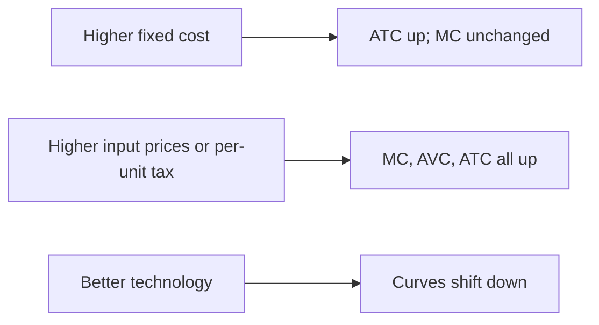

# Cost curves

**Prerequisites:** [Short-run costs](05-short-run-costs.md).

*Short-run cost curves of a competitive firm: marginal cost cuts average total cost at its minimum, and a price above that minimum yields a profit. Credit: Jarry1250. License: [CC BY-SA 3.0](https://creativecommons.org/licenses/by-sa/3.0). Source: [File:Perfect competition in the short run.svg](https://commons.wikimedia.org/wiki/File:Perfect_competition_in_the_short_run.svg).*

The previous lesson computed costs in a table. Economists usually picture them as curves: the U-shaped average cost curves and the rising marginal cost curve that cuts through them. These shapes are the foundation for every later lesson on market structure, so it is worth learning to read them fluently.

## A smooth example

Suppose a small brewery's short-run total cost of producing Q hundred litres a week is:

**TC = 100 + 10Q − Q² + 0.1Q³**

- Fixed cost: FC = 100 (the cost at Q = 0).
- Variable cost: VC = 10Q − Q² + 0.1Q³.
- Marginal cost (the derivative): MC = 10 − 2Q + 0.3Q².
- Average variable cost: AVC = 10 − Q + 0.1Q².
- Average total cost: ATC = 100/Q + 10 − Q + 0.1Q².

| Q | MC | AVC | AFC | ATC |
|---|---|---|---|---|
| 1 | 8.3 | 9.1 | 100 | 109.1 |
| 2 | 7.2 | 8.4 | 50 | 58.4 |
| 3 | 6.7 | 7.9 | 33.3 | 41.2 |
| 4 | 6.8 | 7.6 | 25 | 32.6 |
| 5 | 7.5 | 7.5 | 20 | 27.5 |
| 6 | 8.8 | 7.6 | 16.7 | 24.3 |
| 8 | 13.2 | 8.4 | 12.5 | 20.9 |
| 10 | 20.0 | 10.0 | 10 | 20.0 |
| 12 | 29.2 | 12.4 | 8.3 | 20.7 |

*(Lines from bottom to top at Q = 2: MC, AVC, ATC.)*

## Reading the curves

**Marginal cost** dips (to its minimum near Q ≈ 3.3) and then rises steeply. The dip reflects increasing marginal returns at low output; the rise reflects diminishing returns as the fixed brewing equipment is pushed harder.

**AVC** is U-shaped with its minimum at **Q = 5**, where AVC = MC = 7.5.

**ATC** is U-shaped too, with its minimum at **Q = 10**, where ATC = MC = 20. That is the **efficient scale** of this plant: the output at which cost per unit is lowest.

**AFC** falls continuously. The vertical gap between ATC and AVC equals AFC, so the two curves get closer as output rises.

## Why MC cuts the averages at their minimums

This is the marginal-average rule from [production functions](02-production-functions.md) again. If the cost of the next unit (MC) is below the current average, producing it pulls the average down. If MC is above the average, it pulls the average up. So the average is falling whenever MC is below it and rising whenever MC is above it, which means MC must pass through the average at its lowest point. You can check: at Q = 8, MC (13.2) is below ATC (20.9), so ATC is still falling; at Q = 12, MC (29.2) is above ATC (20.7), so ATC is rising.

## Shifts in cost curves

- **A rise in fixed costs** (higher rent) shifts ATC up but leaves MC and AVC unchanged. It does not change the profit-maximising output in the short run.
- **A rise in variable input prices** (dearer malt or higher wages) shifts MC, AVC and ATC all up.
- **Better technology** shifts the curves down.
- **A per-unit tax** shifts MC, AVC and ATC up by the amount of the tax; a lump-sum tax (a fixed licence fee) shifts only ATC.

## What the curves are used for

These curves answer the firm's key questions:

- **How much to produce?** Where marginal revenue equals marginal cost ([profit maximization](09-profit-maximization.md)).
- **Is the firm making a profit?** Compare price with ATC at that output.
- **Should it keep operating in the short run?** Compare price with AVC (the shutdown rule).
- **Will it stay in the industry in the long run?** Compare price with the minimum of long-run ATC.

## Key ideas

- Short-run cost curves: MC is U-shaped or rising; AVC and ATC are U-shaped; AFC falls.
- MC passes through the minimum of AVC and of ATC.
- The gap between ATC and AVC is AFC, which shrinks with output.
- Fixed-cost changes move only ATC; variable-cost changes move MC, AVC and ATC.
- Minimum ATC is the plant's efficient scale.

## Where this leads

- Next: [long-run costs](07-long-run-costs.md).
- Glossary: [[g:marginal-cost|marginal cost]], [[g:average-variable-cost|average variable cost]], [[g:average-total-cost|average total cost]], [[g:efficient-scale|efficient scale]].
