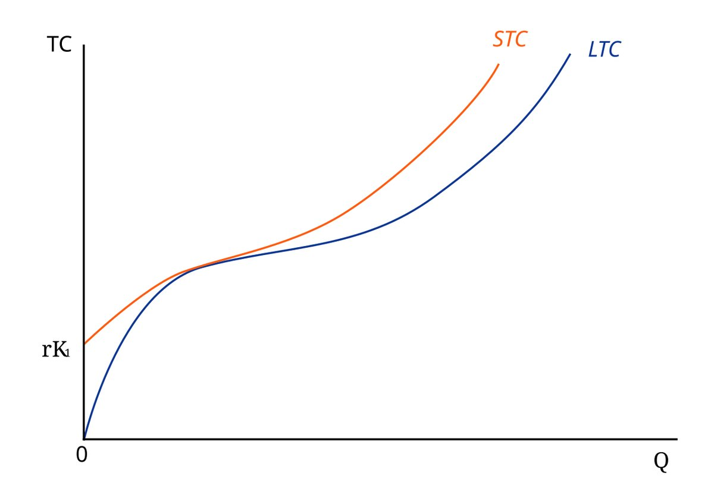
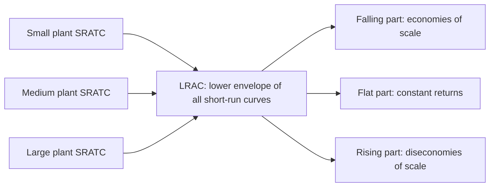

# Long-run costs

**Prerequisites:** [Cost curves](06-cost-curves.md), [Isoquants and input choice](04-isoquants-and-input-choice.md).

*The relationship between a short-run cost curve (with capital fixed) and the long-run cost curve. Credit: Kwj2772. License: [CC BY-SA 4.0](https://creativecommons.org/licenses/by-sa/4.0). Source: [File:Relationship between Long-run Cost Curve and Short-run Cost Curve.svg](https://commons.wikimedia.org/wiki/File:Relationship_between_Long-run_Cost_Curve_and_Short-run_Cost_Curve.svg).*

In the long run, a firm can choose the size of its plant. A brewery can build a small, medium or large brewhouse; a hospital can add wings; an airline can buy more planes. **Long-run costs** describe the lowest cost of producing each level of output when every input can be adjusted.

## A family of short-run curves

Each possible plant size has its own short-run average total cost curve (SRATC). A small plant has low fixed costs and is cheap at low output, but its costs climb steeply as it is pushed beyond its design capacity. A large plant has high fixed costs, so it is expensive at low output, but it can produce large quantities cheaply.

| Output (thousand litres/week) | Small plant ATC | Medium plant ATC | Large plant ATC |
|---|---|---|---|
| 10 | **4.00** | 5.50 | 8.00 |
| 20 | 3.60 | **3.20** | 4.50 |
| 30 | 4.80 | **2.70** | 3.00 |
| 40 | 7.00 | 3.10 | **2.40** |
| 60 | – | 5.00 | **2.60** |

(Illustrative numbers.) For each output, the firm picks the plant with the lowest average cost, shown in bold.

## The long-run average cost curve

The **long-run average cost curve (LRAC)** traces the lowest attainable average cost at each output, when the firm can choose any plant size. With many possible plant sizes, the LRAC is a smooth curve that touches each short-run curve at one point, forming what economists call an **envelope** of the short-run curves. Jacob Viner's 1931 article "Cost Curves and Supply Curves" is a classic analysis; it became famous partly because Viner asked his draftsman to draw the envelope through the minimum points of every short-run curve, which is mathematically impossible when the envelope is U-shaped, and the error was pointed out by the draftsman, Y. K. Wong.

The general lesson from Viner's slip: the LRAC touches each short-run curve at its minimum only at the very bottom of the LRAC. On the falling part of the LRAC, it is cheaper to run a slightly larger plant below its efficient scale; on the rising part, to run a smaller plant beyond it.

## The shape of the LRAC

The LRAC's shape depends on what happens to cost per unit as the whole operation grows:

- **Falling LRAC**: **economies of scale**. Bigger is cheaper per unit.
- **Flat LRAC**: **constant returns to scale**. Size does not affect unit cost.
- **Rising LRAC**: **diseconomies of scale**. Bigger becomes more expensive per unit.

The textbook LRAC is U-shaped, but empirical studies of many manufacturing industries suggest LRACs often fall steeply at first and then flatten out over a wide range of output, more like an L than a U. The output at which the LRAC first reaches its minimum is the **minimum efficient scale** (MES). The sources and consequences of these shapes are the subject of [economies of scale](08-economies-of-scale.md).

## Long-run marginal cost

The **long-run marginal cost (LRMC)** is the extra cost of one more unit of output when all inputs can adjust. It relates to the LRAC exactly as short-run MC relates to short-run ATC: LRMC is below LRAC when LRAC is falling, above it when LRAC is rising, and equal at LRAC's minimum.

## Short run versus long run in practice

The distinction matters for decisions and for predictions:

- **Price wars and recessions.** In a downturn, a firm with a large plant may keep producing at a loss in the short run, covering variable costs and some fixed costs, rather than shut down. In the long run it may downsize or exit. See [the competitive firm in the short run](../05-market-structures/02-the-competitive-firm-in-the-short-run.md).
- **Capacity planning.** A firm expecting demand to grow chooses a plant larger than today's demand requires, accepting higher unit costs now for lower ones later.
- **Flexibility.** Some firms deliberately choose plants with flatter short-run cost curves, sacrificing minimum cost for the ability to vary output cheaply, an idea developed by George Stigler in 1939.

## Learning by doing

Costs can fall not only with the scale of output per period but with **cumulative** output: as a firm produces more over time, workers and managers learn to do things better. Studies of aircraft production in the 1930s, notably by T. P. Wright in 1936, found that labour hours per plane fell by a roughly constant percentage each time cumulative output doubled. Similar **learning curves** or experience curves have been documented in shipbuilding, semiconductors and solar panels, where module prices have fallen dramatically as cumulative installed capacity grew. Learning by doing gives early entrants a cost advantage and is one reason some industries become concentrated.

## Key ideas

- In the long run, the firm chooses its plant size to minimise cost at each output.
- The LRAC is the lower envelope of short-run ATC curves.
- Falling, flat and rising LRAC correspond to economies, constant returns and diseconomies of scale.
- Minimum efficient scale is where the LRAC first reaches its lowest level.
- Learning by doing lowers costs with cumulative output.

## Where this leads

- Next: [economies of scale](08-economies-of-scale.md).
- Glossary: [long run](../glossary/long-run.md), [long-run average cost](../glossary/long-run-average-cost.md), [minimum efficient scale](../glossary/minimum-efficient-scale.md), [learning curve](../glossary/learning-curve.md).
