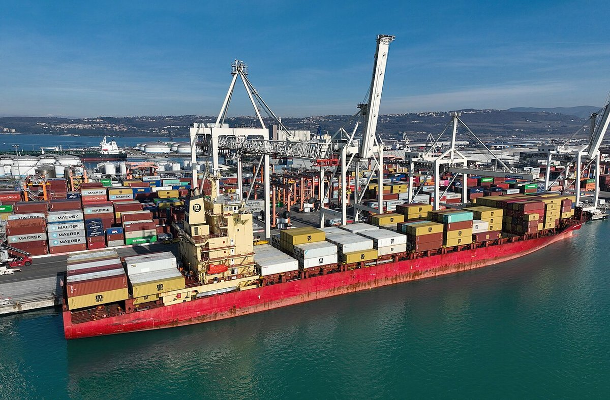
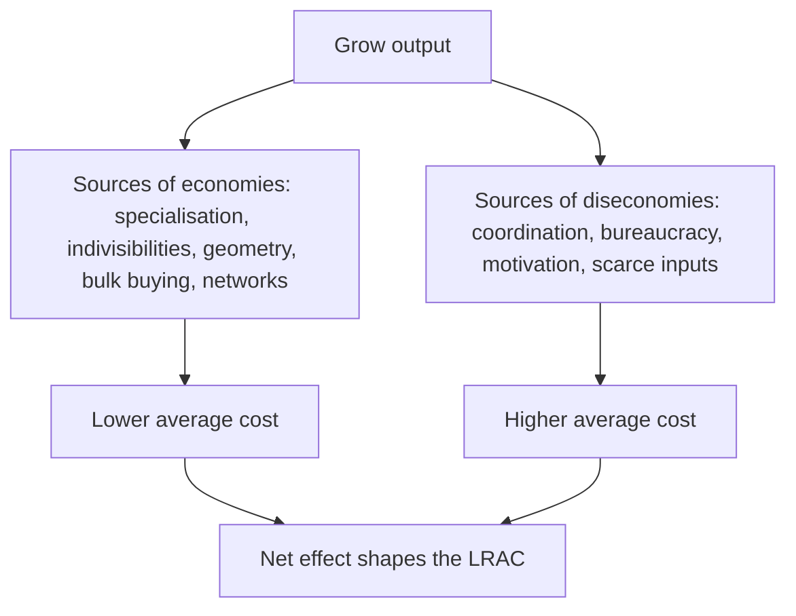

# Economies of scale

**Prerequisites:** [Long-run costs](07-long-run-costs.md).

*The container ship MSC Harmony III in the port of Koper, Slovenia: large ships carry each container more cheaply. Credit: Petar Milošević. License: [CC BY-SA 4.0](https://creativecommons.org/licenses/by-sa/4.0). Source: [File:MSC HARMONY III (container ship, 2006) in Port Koper (SIKOP, 2024).jpg](https://commons.wikimedia.org/wiki/File:MSC_HARMONY_III_(container_ship,_2006)_in_Port_Koper_(SIKOP,_2024).jpg).*

Why do some industries have thousands of small firms and others only a handful of giants? A large part of the answer is **economies of scale**: the tendency of average cost to fall as the scale of production grows. This lesson explains where scale economies come from, why they eventually run out, and what they mean for market structure.

## Returns to scale and economies of scale

Two related ideas:

- **Returns to scale** describe technology: what happens to output when **all inputs** increase in the same proportion. If doubling every input more than doubles output, there are **increasing returns**; exactly doubles, **constant returns**; less than doubles, **decreasing returns**.
- **Economies of scale** describe costs: what happens to **long-run average cost** as output rises. Increasing returns to scale (with constant input prices) produce economies of scale.

For a Cobb-Douglas production function Q = A·L^α·K^β, returns to scale depend on α + β: greater than 1 means increasing returns, equal to 1 constant returns, less than 1 decreasing returns. Doubling both inputs multiplies output by 2^(α+β).

## Sources of economies of scale

1. **Specialisation of labour and machines.** A large firm can divide work finely, as in Smith's pin factory, and use dedicated machines that would be idle in a small firm.
2. **Indivisibilities.** Some inputs come in minimum sizes: a blast furnace, a pharmaceutical research lab, a national advertising campaign, a software platform. Their cost is spread over more units as output grows.
3. **Geometric relationships.** The capacity of a tank, pipeline or ship's hull rises with its volume (roughly the cube of its dimensions), while the material needed rises with its surface area (roughly the square). Bigger containers carry more per tonne of steel. This "two-thirds rule" is one reason oil tankers and container ships have grown so large.
4. **Purchasing and financing.** Large firms can buy inputs in bulk at discounts and often borrow more cheaply.
5. **Network and platform effects.** For some digital goods, the cost of serving one more user is nearly zero, while value to users rises with the number of users.

## Worked example: container shipping

Containerisation transformed world trade after Malcolm McLean's first container voyage in 1956. Container ships grew from a few hundred twenty-foot equivalent units (TEU) in the 1960s to over 20,000 TEU in the 2010s and 2020s. Suppose (illustratively) a 4,000 TEU ship costs 40,000 dollars a day to operate and a 16,000 TEU ship costs 100,000 a day. Fully loaded, the cost per container-day is 10 dollars for the small ship and 6.25 for the large one, a 37.5 percent saving per box. That kind of saving, multiplied across millions of containers, helped make long-distance trade far cheaper. Marc Levinson's *The Box* (2006) tells this history.

## Diseconomies of scale

Average costs cannot fall forever. As firms grow very large, they can face **diseconomies of scale**:

- **Coordination and information costs.** More layers of management, slower decisions, and information distorted as it passes up and down the hierarchy.
- **Motivation and monitoring.** In a huge organisation, individual effort is harder to observe and reward. Workers may feel less connected to results.
- **Scarce inputs.** A firm that expands may need to bid up the price of specialised labour or materials, or move to less suitable locations.

Coase's theory of the firm predicts this limit: a firm stops growing when the cost of organising one more transaction inside it rises to equal the cost of using the market. See [the firm](01-the-firm.md).

## Economies of scope

Related but distinct, **economies of scope** arise when producing two products together is cheaper than producing them separately. A bakery that makes bread can make pastries with the same ovens and staff. An airline carries passengers and cargo on the same flights. Economies of scope help explain why firms diversify into related products.

## External economies of scale

Costs can also fall for every firm in an industry as the **industry** grows, even if each firm stays the same size. Clusters of firms in one place share specialised suppliers, a pool of skilled workers and knowledge that spreads through informal contact. Alfred Marshall described these **external economies** in *Principles of Economics* (1890), writing that in such industrial districts the "mysteries of the trade become no mysteries; but are as it were in the air". Silicon Valley, the film industry in Los Angeles, and the auto parts industry in southern Ontario are often cited as examples.

## Scale and market structure

Compare minimum efficient scale (MES) with total market demand:

- If MES is **small** relative to the market, many firms can operate at low cost: competition is natural (farming, restaurants, hairdressing).
- If MES is **large** relative to the market, only a few firms fit: oligopoly is likely (aircraft manufacturing, where Airbus and Boeing dominate large jets).
- If one firm can supply the whole market more cheaply than two or more, the industry is a **natural monopoly** (water mains, electricity transmission). See [natural monopoly and regulation](../05-market-structures/07-natural-monopoly-and-regulation.md).

## Key ideas

- Returns to scale concern technology; economies of scale concern costs.
- Sources: specialisation, indivisibilities, geometry, bulk purchasing, networks.
- Diseconomies arise from coordination, monitoring and scarce inputs.
- Economies of scope come from producing related goods together; external economies come from industry clusters.
- The size of MES relative to the market shapes how many firms an industry can support.

## Where this leads

- Next: [profit maximization](09-profit-maximization.md).
- Later: [natural monopoly and regulation](../05-market-structures/07-natural-monopoly-and-regulation.md), [oligopoly](../05-market-structures/09-oligopoly.md).
- Glossary: [economies of scale](../glossary/economies-of-scale.md), [diseconomies of scale](../glossary/diseconomies-of-scale.md), [economies of scope](../glossary/economies-of-scope.md), [returns to scale](../glossary/returns-to-scale.md).
