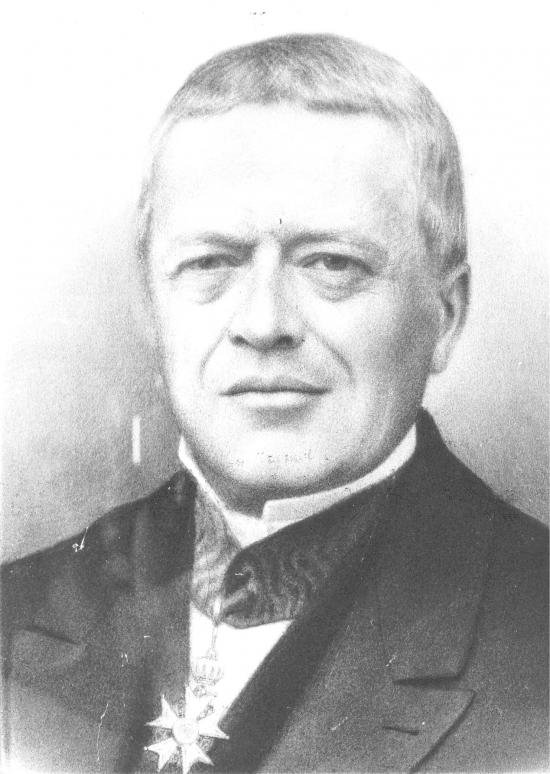
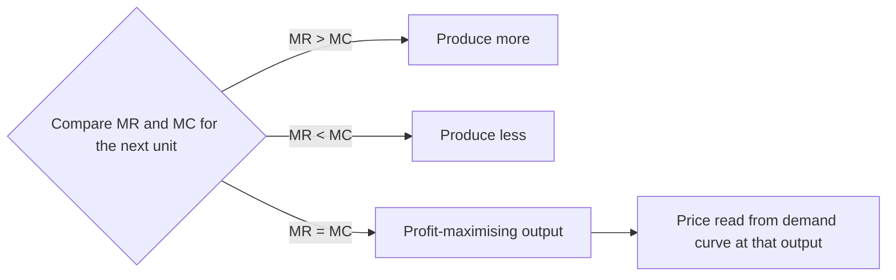

# Profit maximization

**Prerequisites:** [Cost curves](06-cost-curves.md), [Marginal thinking](../01-foundations/05-marginal-thinking.md), [Price elasticity of demand](../02-supply-and-demand/07-price-elasticity-of-demand.md).

*Antoine Augustin Cournot (1801–1877), who in 1838 first stated profit maximisation using marginal revenue and marginal cost. Credit: Unknown author. License: Public domain. Source: [File:Antoine Augustin Cournot.jpg](https://commons.wikimedia.org/wiki/File:Antoine_Augustin_Cournot.jpg).*

The firm has costs. It also has revenue, which depends on how much it sells and at what price. Profit maximization combines the two. The rule is the same for every kind of firm, from a wheat farmer to a monopolist: **produce the quantity at which marginal revenue equals marginal cost**. What differs between market structures is what marginal revenue looks like.

## Revenue concepts

- **Total revenue (TR)** = price × quantity.
- **Average revenue (AR)** = TR / Q = price. So the firm's demand curve is also its average revenue curve.
- **Marginal revenue (MR)** = ΔTR / ΔQ: the extra revenue from selling one more unit.

## Two cases for marginal revenue

**A price-taking firm** (one of many small sellers of an identical product, such as a wheat farmer) can sell as much as it wants at the market price. Selling one more unit adds exactly the price to revenue: **MR = P**. Its demand curve is horizontal.

**A price-setting firm** (one with market power, which faces a downward-sloping demand curve) must lower its price to sell more. Selling one more unit adds the price of that unit but also lowers the price on all the units it was already selling. So **MR < P**.

**Example.** A firm faces demand P = 20 − Q.

| Q | P | TR | MR |
|---|---|---|---|
| 0 | 20 | 0 | – |
| 1 | 19 | 19 | 19 |
| 2 | 18 | 36 | 17 |
| 3 | 17 | 51 | 15 |
| 4 | 16 | 64 | 13 |
| 5 | 15 | 75 | 11 |
| 6 | 14 | 84 | 9 |
| 7 | 13 | 91 | 7 |
| 8 | 12 | 96 | 5 |
| 9 | 11 | 99 | 3 |
| 10 | 10 | 100 | 1 |

Selling the 5th unit brings in its price of 15, but the firm had to cut the price on the first 4 units from 16 to 15, losing 4. Net MR = 15 − 4 = 11. For a straight-line demand P = a − bQ, MR = a − 2bQ: it has the same intercept and twice the slope.

## The MR = MC rule

The firm keeps increasing output as long as each extra unit adds more to revenue than to cost (**MR > MC**) and stops where **MR = MC**. Beyond that point, each extra unit costs more than it brings in.

**Example continued.** Suppose the firm's marginal cost is a constant 5 per unit, plus fixed costs of 20.

- MR = 20 − 2Q = 5, so **Q = 7.5**. With whole units, compare Q = 7 (MR of the 7th unit = 7 > 5, worth producing) and Q = 8 (MR of the 8th = 5 = MC, break-even on that unit). Either 7 or 8 gives the maximum.
- Using the continuous version: Q = 7.5, P = 20 − 7.5 = **12.50**.
- Profit = TR − TC = 12.50 × 7.5 − (20 + 5 × 7.5) = 93.75 − 57.50 = **36.25**.

## Profit, loss and the ATC curve

MR = MC tells the firm how much to produce. Whether it makes a profit depends on price relative to average total cost at that quantity:

**Profit = (P − ATC) × Q**

- P > ATC: economic profit.
- P = ATC: zero economic profit (normal profit).
- P < ATC: economic loss. In the short run the firm may still produce if P covers AVC; in the long run it will exit unless conditions improve.

## Markup pricing and elasticity

For a price-setting firm, there is an elegant link between price, marginal cost and elasticity. Marginal revenue can be written as:

**MR = P × (1 − 1/|Ed|)**

Setting MR = MC and rearranging gives the **Lerner index**, named after Abba Lerner (1934):

**(P − MC) / P = 1 / |Ed|**

The markup over marginal cost, as a share of price, equals the inverse of the elasticity of demand. If demand is very elastic (many substitutes), the markup is small. If demand is less elastic, the markup is larger. A firm never sets price on the inelastic part of its demand curve: there, MR would be negative, so cutting output would raise revenue and lower costs.

**Check with the example:** at Q = 7.5, P = 12.50, elasticity |Ed| = (1/slope) × (P/Q) = 1 × 12.5/7.5 = 1.67. Lerner index = (12.50 − 5)/12.50 = 0.6 = 1/1.67. ✓

## Do firms really do this?

Surveys from the 1930s onward found that many managers say they set prices by adding a markup to average cost ("cost-plus pricing") rather than by computing marginal revenue. Economists have responded that if the markup chosen responds to competition and demand, cost-plus pricing can approximate MR = MC. Like consumers, firms need not compute derivatives to behave roughly as if they did, especially when competition punishes firms that get it badly wrong. But real pricing also involves strategy, customer goodwill and imperfect information, which later lessons address.

## Key ideas

- Profit is maximised where marginal revenue equals marginal cost.
- For a price taker, MR = P; for a firm with market power, MR < P.
- Profit = (P − ATC) × Q; MR = MC sets the quantity, the demand curve sets the price.
- The Lerner index: (P − MC)/P = 1/|Ed|; markups are higher when demand is less elastic.
- Firms with market power always operate on the elastic part of demand.

## Where this leads

- Next section: [[perfect-competition|market structures]], starting with perfect competition.
- Glossary: [[g:marginal-revenue|marginal revenue]], [[g:profit-maximization|profit maximization]], [[g:lerner-index|Lerner index]], [[g:markup|markup]].
