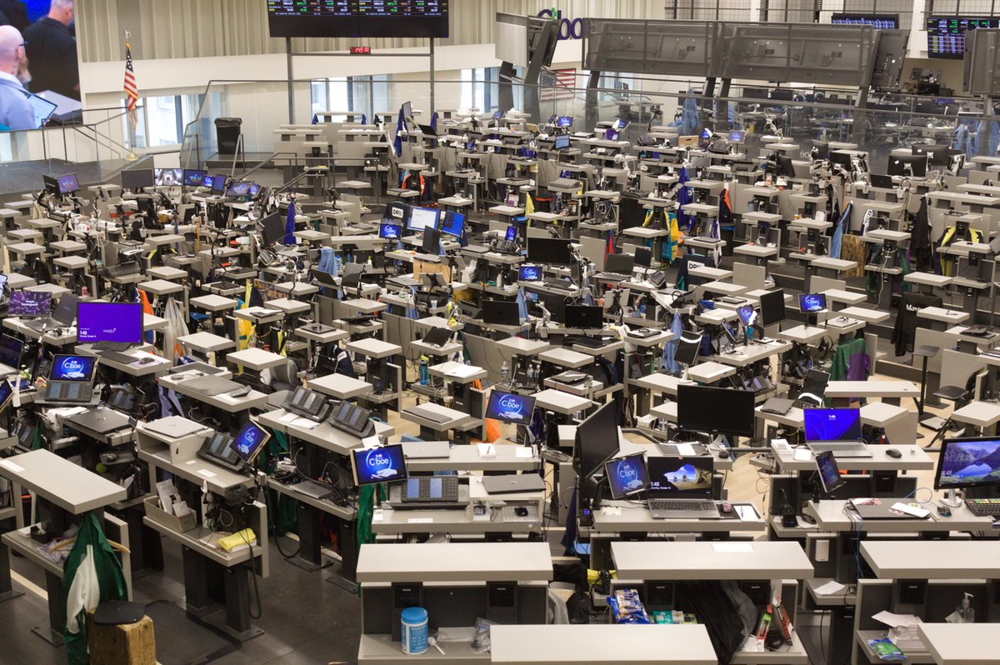
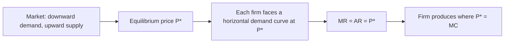

# Perfect competition

**Prerequisites:** [[profit-maximization|Profit maximization]], [[market-equilibrium|Market equilibrium]].

*The trading floor of the Chicago Board of Trade, where grain was traded in a market close to perfect competition. Credit: Fixedsun. License: [CC0](http://creativecommons.org/publicdomain/zero/1.0/deed.en). Source: [File:Trading Floor in the Chicago Board of Trade Building.png](https://commons.wikimedia.org/wiki/File:Trading_Floor_in_the_Chicago_Board_of_Trade_Building.png).*

Markets differ in how much power individual sellers have over price. At one end is **perfect competition**, where no seller has any power at all. It is an idealised benchmark, rarely matched exactly in reality, but it is the yardstick against which every other market structure is measured, and it explains where the supply curve of the earlier lessons comes from.

## The assumptions

A perfectly competitive market has:

1. **Many buyers and sellers**, each too small to affect the market price.
2. **A homogeneous product**: every seller's output is identical, so buyers do not care whom they buy from.
3. **Free entry and exit**: firms can enter or leave the industry in the long run without special barriers.
4. **Perfect information**: buyers and sellers know prices and product quality.

Agricultural commodities such as wheat or canola come close: thousands of farmers grow essentially the same crop, and prices are set on commodity exchanges like the Chicago Board of Trade (now part of CME Group). Foreign-exchange markets and many financial markets also come close on several criteria.

## Price takers

Under these conditions each firm is a **price taker**. If it charged even slightly above the market price, buyers would go elsewhere and it would sell nothing. It has no reason to charge less, since it can sell all it wants at the market price. So the firm's demand curve is **horizontal** at the market price, even though the market demand curve slopes down. A single farmer's harvest is a drop in the ocean of world wheat supply.

## The firm's decision

Because the firm sells every unit at the market price, **marginal revenue equals price**. Applying the profit-maximisation rule MR = MC gives:

**P = MC**

The competitive firm produces up to the point where the market price equals its marginal cost.

**Worked example.** A brewery has the cost curves from [[cost-curves|cost curves]]: MC = 10 − 2Q + 0.3Q², AVC = 10 − Q + 0.1Q², ATC = 100/Q + 10 − Q + 0.1Q². The market price is 20.

- Set P = MC: 20 = 10 − 2Q + 0.3Q², so 0.3Q² − 2Q − 10 = 0. Solving, Q = (2 + √(4 + 12))/0.6 = (2 + 4)/0.6 = **10**.
- At Q = 10, ATC = 20. Profit = (P − ATC) × Q = (20 − 20) × 10 = **0**.

At a price of 20, the brewery just covers all its costs, including normal profit. If the price rose to 29.2, it would produce where MC = 29.2, at Q = 12, with ATC = 20.7, earning (29.2 − 20.7) × 12 ≈ **102** in economic profit.

## Why perfect competition matters

Perfect competition has three properties economists value:

1. **Allocative efficiency.** Price equals marginal cost, so the value buyers place on the last unit (price) equals the cost of producing it. No mutually beneficial trades are left out, and none that cost more than they are worth are made. Total surplus is maximised, as shown in [[producer-surplus-and-total-surplus|producer surplus and total surplus]].
2. **Productive efficiency** in the long run. Entry and exit push price to the minimum of average total cost, so goods are produced at the lowest possible cost. See [[long-run-competitive-equilibrium|long-run competitive equilibrium]].
3. **No economic profit in the long run.** Consumers capture the benefits of cost reductions.

## How realistic is it?

Critics, including economists of the Austrian school such as Friedrich Hayek, have pointed out that the model of perfect competition describes an end state in which competition, in the everyday sense of rivalry, innovation and advertising, has nothing left to do. In "The Meaning of Competition" (1946), Hayek argued that real competition is a process of discovery, through which firms find out what consumers want and how to produce it cheaply. Joseph Schumpeter, in *Capitalism, Socialism and Democracy* (1942), argued that the most important competition comes from new products and technologies, a process he called **creative destruction**, and that firms with some market power may be better placed to innovate.

Defenders of the model reply that it is a benchmark, not a description, and that it makes accurate predictions in markets with many small sellers of similar products. Both views are useful: the model tells you what efficiency requires; the critics remind you that real markets are dynamic.

## Key ideas

- Perfect competition: many small firms, identical products, free entry and exit, perfect information.
- Each firm is a price taker facing a horizontal demand curve; MR = P.
- The competitive firm produces where P = MC.
- Perfect competition achieves allocative efficiency and, in the long run, productive efficiency.
- It is a benchmark; Hayek and Schumpeter emphasised competition as a dynamic process.

## Where this leads

- Next: [[the-competitive-firm-in-the-short-run|the competitive firm in the short run]].
- Contrast: [[monopoly|monopoly]].
- Glossary: [[g:perfect-competition|perfect competition]], [[g:price-taker|price taker]], [[g:allocative-efficiency|allocative efficiency]], [[g:creative-destruction|creative destruction]].
