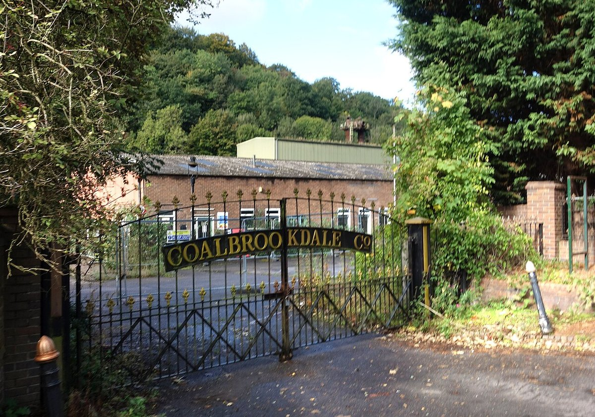
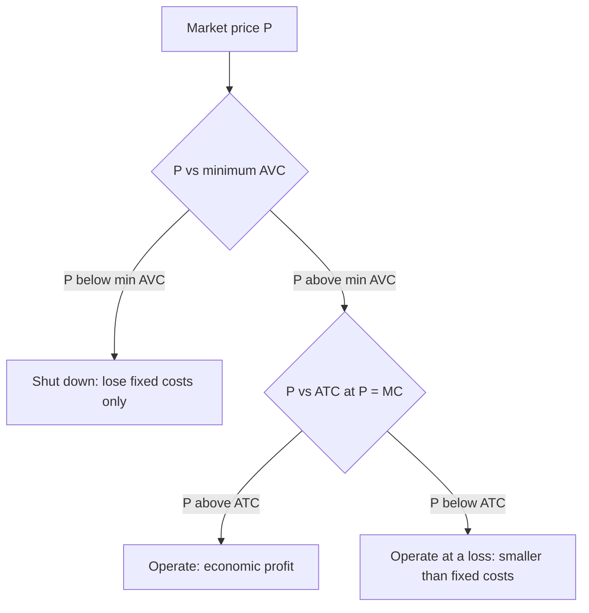

# The competitive firm in the short run

**Prerequisites:** [[perfect-competition|Perfect competition]], [[short-run-costs|Short-run costs]].

*Closed factory gates: when price falls below average variable cost, a firm does better producing nothing. Credit: Des Blenkinsopp. License: [CC BY-SA 2.0](https://creativecommons.org/licenses/by-sa/2.0). Source: [File:Closed Factory Gates - geograph.org.uk - 7300223.jpg](https://commons.wikimedia.org/wiki/File:Closed_Factory_Gates_-_geograph.org.uk_-_7300223.jpg).*

In the short run, a competitive firm cannot change its plant or leave the industry, but it can change how much it produces, and it can temporarily stop producing altogether. This lesson works out when a firm makes a profit, when it should keep operating at a loss, when it should shut down, and how these decisions produce the short-run supply curve.

## Three possible situations

At the output where P = MC, compare price with average total cost (ATC) and average variable cost (AVC):

1. **P > ATC: economic profit.** The firm covers all its costs and earns more than its next-best alternative.
2. **AVC < P < ATC: loss, but keep operating.** Revenue covers all variable costs and part of fixed costs. Shutting down would lose all the fixed costs; operating loses less.
3. **P < AVC: shut down.** Revenue does not even cover variable costs. Every unit produced adds to the loss. Producing nothing limits the loss to fixed costs.

## The shutdown rule

The firm should shut down temporarily if **total revenue is less than total variable cost**, which is the same as **P < AVC**. The minimum point of the AVC curve is the **shutdown point**.

Why are fixed costs ignored? Because in the short run they must be paid whether the firm produces or not. They are sunk for this decision. The only question is whether producing adds more to revenue than to cost, and that depends on variable costs alone.

## Worked example

The brewery again: AVC is minimised at Q = 5, where AVC = MC = 7.5. ATC is minimised at Q = 10, where ATC = MC = 20. Fixed costs are 100.

| Market price | Output (P = MC) | ATC | AVC | Profit | Decision |
|---|---|---|---|---|---|
| 29.2 | 12 | 20.7 | 12.4 | +102 | Operate, profit |
| 20 | 10 | 20 | 10 | 0 | Operate, normal profit |
| 13.2 | 8 | 20.9 | 8.4 | −62 | Operate at a loss |
| 7.5 | 5 | 27.5 | 7.5 | −100 | Indifferent: loss equals fixed costs |
| 6 | – | – | – | −100 | Shut down |

At a price of 13.2, the brewery loses 62 by operating. If it shut down, it would lose its full fixed cost of 100. So operating is better: revenue (105.6) covers variable cost (67.2) and contributes 38.4 toward fixed costs.

At a price of 6, below the minimum AVC of 7.5, every unit loses money on variable costs alone. The brewery should stop producing and lose only the 100 of fixed costs.

## The short-run supply curve

At any price above the shutdown point, the firm produces where P = MC. So the firm's **short-run supply curve is its marginal cost curve above the minimum of AVC**. Below that price it supplies zero.

This is the origin of the upward-sloping supply curve from [[supply|supply]]. It slopes up because marginal cost rises, which reflects [[diminishing-marginal-returns|diminishing marginal returns]] with fixed plant. The **short-run market supply curve** is the horizontal sum of all firms' supply curves.

## Shutdown versus exit

A **shutdown** is a short-run decision to produce nothing for a while; the firm still pays fixed costs and can restart. **Exit** is a long-run decision to leave the industry, which ends fixed costs too. Seasonal businesses illustrate shutdowns: a ski resort closes in summer because summer revenue would not cover the variable costs of staffing and running lifts, but it does not sell the mountain. A drive-in cinema may close for winter. In contrast, a firm that expects prices to stay below ATC for good will exit when its leases and contracts allow.

## Sunk costs and real decisions

The shutdown rule is a clean application of the [[opportunity-cost|sunk-cost principle]]. In practice firms sometimes keep operating below AVC for a while, for example to keep skilled staff, maintain customer relationships, or avoid the cost of restarting a blast furnace or a mine. Those considerations can be folded into the analysis as additional costs of shutting down. The core logic remains: decisions should depend on costs that the decision can still change.

## Key ideas

- A competitive firm produces where P = MC, then compares P with ATC and AVC.
- If P > ATC it profits; if AVC < P < ATC it operates at a loss smaller than fixed costs.
- If P < AVC it should shut down temporarily; the minimum of AVC is the shutdown point.
- The firm's short-run supply curve is its MC curve above minimum AVC.
- Shutdown is temporary; exit is a long-run decision.

## Where this leads

- Next: [[long-run-competitive-equilibrium|long-run competitive equilibrium]].
- Glossary: [[g:shutdown-point|shutdown point]], [[g:break-even-point|break-even point]], [[g:sunk-cost|sunk cost]].
