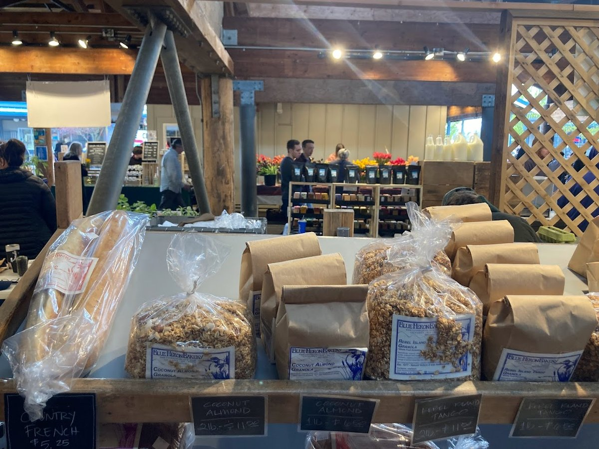
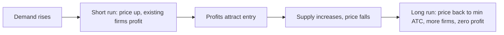

# Long-run competitive equilibrium

**Prerequisites:** [[the-competitive-firm-in-the-short-run|The competitive firm in the short run]], [[long-run-costs|Long-run costs]].

*Olympia Farmers Market, Washington: many small sellers with free entry and exit. Credit: Mattsjc. License: [CC BY-SA 4.0](https://creativecommons.org/licenses/by-sa/4.0). Source: [File:Olympia Farmers Market 01.jpg](https://commons.wikimedia.org/wiki/File:Olympia_Farmers_Market_01.jpg).*

In the short run, competitive firms can earn profits or suffer losses. In the long run, firms can enter and leave the industry, and that changes everything. Entry and exit push the market toward a **long-run equilibrium** in which every firm earns zero economic profit and produces at the lowest possible average cost.

## Entry and exit

- If firms are earning **economic profits**, outsiders see an opportunity. New firms enter, market supply increases, and the price falls.
- If firms are making **economic losses**, some leave. Market supply decreases, and the price rises.

The process stops only when there is no incentive to enter or exit: when price equals the minimum of long-run average total cost and each firm earns **zero economic profit**.

**Long-run equilibrium conditions:**

**P = MC = minimum ATC**

- P = MC: each firm maximises profit (allocative efficiency).
- P = minimum ATC: each firm produces at its efficient scale (productive efficiency), and economic profit is zero.

## Worked example

Suppose every brewery has the cost curves from earlier lessons, with minimum ATC of 20 at Q = 10. Market demand is Qd = 2,000 − 50P, measured in the same units as each brewery's output (hundreds of litres a week).

**Long-run equilibrium:** price = 20. Market quantity = 2,000 − 50 × 20 = 1,000. Each brewery produces 10, so the industry has **100 breweries**.

**Demand increases** to Qd = 2,500 − 50P. In the short run, with 100 breweries, price rises. Each brewery supplies along its MC curve. At a price of 25, for example, each firm would produce about 11.2 (where MC = 25), so market supply would be about 1,120, while market demand at 25 is 2,500 − 1,250 = 1,250: still a shortage, so the price rises further. The short-run price settles at about 26.9, where 100 firms each producing about 11.5 supply roughly 1,155, matching demand. At that output each firm's ATC is about 20.4, so breweries earn economic profits of about 6.5 per unit.

**In the long run**, those profits attract entry. New breweries keep entering until price is back at 20. Market quantity = 2,500 − 1,000 = 1,500. With each firm producing 10, the industry now has **150 breweries**. The extra demand has been met entirely by new firms, at the same price.

## The long-run supply curve

In the example, the long-run market supply curve is **horizontal** at the minimum ATC of 20: the industry can supply any quantity at that price by adjusting the number of firms. This is a **constant-cost industry**.

Two other cases occur:

- **Increasing-cost industry.** As the industry expands, it bids up the price of scarce inputs (specialised labour, suitable land, a mineral). Every firm's costs rise, so the long-run supply curve slopes **upward**. Wine-growing regions are an example: there is only so much good vineyard land.
- **Decreasing-cost industry.** Industry expansion lowers costs for all firms, through [[economies-of-scale|external economies]] such as specialised suppliers and pools of skilled workers. The long-run supply curve slopes **downward**.

In all cases, long-run supply is **more elastic** than short-run supply, because entry and exit add a margin of adjustment.

## Why zero profit is not bad news

Zero economic profit sounds grim but it is not: it means owners earn **normal profit**, a return on their time and capital equal to what they could earn elsewhere. They stay in business because they can do no better. Accounting profits are positive.

Some firms in a competitive industry can earn more than others in the long run if they own a scarce, unique resource: an exceptionally fertile field, a prime location, a uniquely talented chef. These extra returns are **economic rents** to the scarce factor, not profits of the business. In the long run, the rent tends to be captured by the owner of the factor, for example through higher land prices or a higher salary for the chef. See [[land-and-rent|land and rent]].

## Implications

The long-run competitive model makes clear predictions:

- **Cost reductions are passed on to consumers.** If a new technology lowers costs, early adopters profit briefly; then entry and imitation push prices down to the new, lower minimum ATC.
- **Taxes on a constant-cost industry are borne entirely by consumers in the long run**, because long-run supply is perfectly elastic (see [[taxes-and-tax-incidence|tax incidence]]).
- **Profits are signals.** High profits draw resources into an industry where consumers value output highly; losses push resources out. This is the coordinating role of prices from [[markets-prices-and-property-rights|markets, prices and property rights]].

## Key ideas

- In the long run, profits attract entry and losses cause exit.
- Long-run equilibrium: P = MC = minimum ATC, zero economic profit.
- Constant-cost industries have horizontal long-run supply; increasing-cost industries slope up; decreasing-cost industries slope down.
- Zero economic profit means normal profit, not failure.
- Scarce unique resources earn rents rather than profits.

## Where this leads

- Next: [[monopoly|monopoly]], where entry is blocked.
- Glossary: [[g:free-entry-and-exit|free entry and exit]], [[g:normal-profit|normal profit]], [[g:economic-rent|economic rent]].
