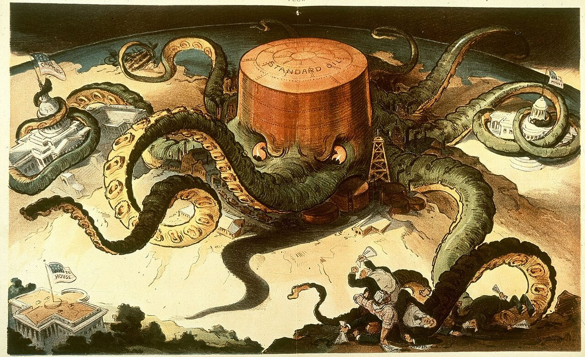
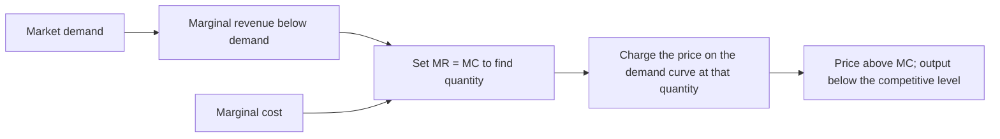

# Monopoly

**Prerequisites:** [[profit-maximization|Profit maximization]], [[perfect-competition|Perfect competition]].

*"Next!", a 1904 Puck cartoon by Udo Keppler showing Standard Oil as an octopus with its tentacles around industry and government. Credit: Udo Keppler. License: Public domain. Source: [File:Standard oil octopus loc color.jpg](https://commons.wikimedia.org/wiki/File:Standard_oil_octopus_loc_color.jpg).*

A **monopoly** is a market with a single seller of a product that has no close substitutes. Where a competitive firm is a price taker, a monopolist is a **price maker**: it faces the whole downward-sloping market demand curve and chooses where on it to be. This lesson explains how monopolies arise and how they set output and price.

## Sources of monopoly: barriers to entry

A monopoly can persist only if something stops other firms entering. These **barriers to entry** include:

1. **Control of a key resource.** De Beers controlled most of the world's diamond supply for much of the twentieth century, although its share has fallen substantially since the 1990s as new mines opened in Canada, Russia and elsewhere.
2. **Legal barriers.**
   - **Patents** grant inventors exclusive rights for a limited time, typically 20 years from filing. Pharmaceutical companies hold monopolies on new drugs this way.
   - **Copyrights** protect books, music, films and software.
   - **Government licences and franchises**: for example, a single provincially authorised liquor retailer, or a postal monopoly on certain letters.
3. **Economies of scale.** When one firm can supply the whole market more cheaply than two or more, the industry is a **natural monopoly** (see [[natural-monopoly-and-regulation|natural monopoly and regulation]]).
4. **Network effects.** When a product becomes more valuable as more people use it, the market can "tip" to a dominant firm. Operating systems, social networks and online marketplaces show this pattern.
5. **Strategic behaviour.** Incumbents may deter entry by threatening price wars, building excess capacity or tying up distribution channels. Many such tactics are restricted by [[competition-policy|competition law]].

## Monopoly and marginal revenue

Because the monopolist faces the market demand curve, it must lower its price to sell more. As shown in [[profit-maximization|profit maximization]], this makes **marginal revenue less than price**. For a straight-line demand curve P = a − bQ, MR = a − 2bQ.

## The monopolist's choice

The monopolist maximises profit where **MR = MC**, then charges the highest price buyers will pay for that quantity, read from the demand curve.

**Worked example.** A drug company holds a patent on a medicine. Demand is P = 100 − Q (thousands of doses, price per dose in dollars). Marginal cost of production is a constant 20 per dose. Fixed costs (including research already spent) are 1,000 (thousand dollars).

- MR = 100 − 2Q. Set MR = MC: 100 − 2Q = 20, so **Q = 40** thousand doses.
- Price from demand: P = 100 − 40 = **60** dollars.
- Revenue = 60 × 40 = 2,400. Variable cost = 20 × 40 = 800. Profit = 2,400 − 800 − 1,000 = **600** (thousand dollars).

**Compare with competition.** If the drug were produced competitively (say after the patent expires and generics enter), price would fall to marginal cost: P = 20, Q = 80. Output doubles and price falls by two-thirds. This is broadly what tends to happen when generics enter markets for off-patent drugs, though the size of price falls varies with the number of generic makers.

## Monopolists do not charge "any price they like"

A monopolist is constrained by demand. It can choose price or quantity, but not both: a higher price means fewer sales. It never operates on the inelastic part of the demand curve, because there MR is negative, so cutting output would raise revenue while lowering costs. And a monopoly does not guarantee profit: if demand is weak relative to costs, a monopolist can lose money.

## No supply curve

A competitive industry has a supply curve: a fixed relationship between price and quantity supplied. A monopoly does not. The monopolist's output depends on the shape of demand (through MR), not just on price. Two different demand curves can lead a monopolist to sell the same quantity at different prices, or different quantities at the same price.

## Is monopoly always bad?

Monopoly produces less and charges more than competition, causing a deadweight loss examined in the next lesson. But there are counterarguments in particular cases:

- **Innovation.** Patents trade a temporary monopoly for the incentive to invent. Without them, a drug that costs hundreds of millions to develop and pennies to copy might never be developed. Economists debate the right length and breadth of patents.
- **Natural monopoly.** Splitting a natural monopoly into several firms would raise costs.
- **Schumpeterian competition.** Joseph Schumpeter argued that the prospect of temporary monopoly profits drives innovation, and that dominant firms are constantly threatened by new technologies. Critics respond that incumbent monopolies can also suppress innovation by buying or blocking potential rivals.

## Key ideas

- A monopoly is a single seller of a product without close substitutes, protected by barriers to entry.
- Barriers include control of resources, patents and licences, economies of scale, network effects and strategic behaviour.
- The monopolist sets MR = MC and charges the price on the demand curve.
- Monopoly output is lower and price higher than under competition.
- Patents and natural monopolies show cases where some monopoly power may serve a purpose.

## Where this leads

- Next: [[monopoly-pricing-and-deadweight-loss|monopoly pricing and deadweight loss]].
- Glossary: [[g:monopoly|monopoly]], [[g:barriers-to-entry|barriers to entry]], [[g:market-power|market power]], [[g:patent|patent]].
