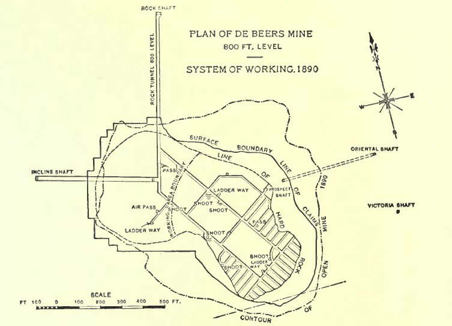
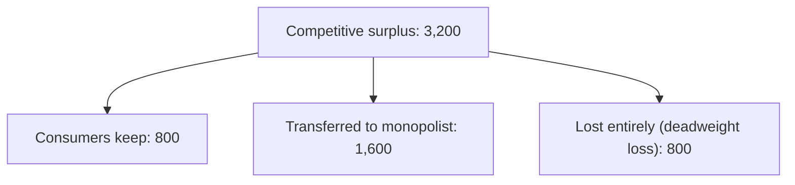

# Monopoly pricing and deadweight loss

**Prerequisites:** [Monopoly](04-monopoly.md), [Deadweight loss](../02-supply-and-demand/14-deadweight-loss.md).

*An old illustration of the De Beers mine in South Africa; the De Beers company long controlled most of the world's diamond supply. Credit: Gardner F. Williams. License: Public domain. Source: [File:De Beers Mine.png](https://commons.wikimedia.org/wiki/File:De_Beers_Mine.png).*

Monopoly harms consumers in two ways. Some of the surplus they would have enjoyed under competition is transferred to the monopolist as profit. And some surplus disappears entirely, because the monopolist restricts output below the level where price equals marginal cost. The second effect is the **deadweight loss of monopoly**, and it is the main reason economists treat monopoly as an efficiency problem rather than just a distributional one.

## Measuring the losses

Continue the drug example: demand P = 100 − Q, marginal cost 20.

**Under competition:** P = 20, Q = 80.
- Consumer surplus = ½ × 80 × (100 − 20) = **3,200**.
- Producer surplus = 0 (constant MC, price equals MC).
- Total surplus = **3,200**.

**Under monopoly:** P = 60, Q = 40.
- Consumer surplus = ½ × 40 × (100 − 60) = **800**.
- Producer surplus (monopoly profit before fixed costs) = (60 − 20) × 40 = **1,600**.
- Total surplus = **2,400**.

**Deadweight loss = 3,200 − 2,400 = 800**: the triangle between the demand curve and MC from Q = 40 to Q = 80, ½ × 40 × (60 − 20) = 800.

So of the 3,200 consumer surplus under competition, 1,600 becomes monopoly profit (a **transfer**), 800 stays with consumers, and 800 vanishes (the **deadweight loss**).

## Why the loss occurs

At the monopoly output of 40, a buyer is willing to pay 60 for one more dose, and it costs only 20 to make. That trade would make both sides better off, but the monopolist does not make it, because to sell that extra unit it would have to cut the price on all units, and the extra revenue (MR = 20 at Q = 40, falling below MC beyond it) does not justify it. Every unit between 40 and 80 is worth more to someone than it costs to produce, yet goes unmade. The cause is the gap between price and marginal cost: **P > MC**.

## How big is the loss in practice?

In 1954, Arnold Harberger estimated the deadweight loss from monopoly in US manufacturing at about one-tenth of one percent of national income, a surprisingly small figure that sparked debate. Later economists argued that Harberger's method underestimated the costs, for several reasons:

- **Rent-seeking.** Gordon Tullock (1967) and Richard Posner (1975) argued that firms spend resources competing to obtain or protect monopoly positions: lobbying, litigation, excess capacity. If firms spend up to the value of the monopoly profit to obtain it, part or all of the transfer is also a social cost. See [government failure](../07-market-failure/15-government-failure.md).
- **X-inefficiency.** Harvey Leibenstein (1966) argued that firms sheltered from competition become sloppy, with costs above the minimum possible. The British economist John Hicks had earlier quipped that "the best of all monopoly profits is a quiet life".
- **Rising markups.** Some recent research, notably by Jan De Loecker, Jan Eeckhout and Gabriel Unger (2020), has estimated that average markups of US publicly traded firms rose substantially since 1980. Other economists dispute how to measure markups and interpret the trend. The debate about market power in modern economies is very active.

## Monopoly and consumer welfare

Not all monopoly effects are negative:

- **Innovation**: the prospect of monopoly profits funds research, as with patents.
- **Scale**: a natural monopoly has lower costs than several competitors would.
- **Contestability**: William Baumol, John Panzar and Robert Willig argued in *Contestable Markets and the Theory of Industry Structure* (1982) that if entry and exit are costless, even a single firm may be forced to price close to cost by the threat of entry. Few markets are perfectly contestable, but the idea shows that potential competition matters as well as actual competition.

## Policy responses

Governments respond to monopoly in several ways, each discussed elsewhere:

- **Competition (antitrust) law** to prevent monopolisation and anti-competitive mergers: [competition policy](15-competition-policy.md).
- **Regulation of natural monopolies**, setting prices or rates of return: [natural monopoly and regulation](07-natural-monopoly-and-regulation.md).
- **Public ownership** of some natural monopolies, such as many water utilities and some electricity providers.
- **Limits on patent length and scope**, and compulsory licensing in emergencies.

## Key ideas

- Monopoly charges P > MC and produces less than the competitive quantity.
- Part of consumer surplus is transferred to the monopolist; part becomes deadweight loss.
- The deadweight loss arises from trades that are worth more than they cost but are not made.
- Harberger's estimate was small; rent-seeking, X-inefficiency and markups may enlarge the true cost.
- Contestable markets and innovation qualify the case against monopoly.

## Where this leads

- Next: [price discrimination](06-price-discrimination.md), how monopolists can capture more surplus.
- Glossary: [deadweight loss](../glossary/deadweight-loss.md), [rent-seeking](../glossary/rent-seeking.md), [X-inefficiency](../glossary/x-inefficiency.md), [contestable market](../glossary/contestable-market.md).
