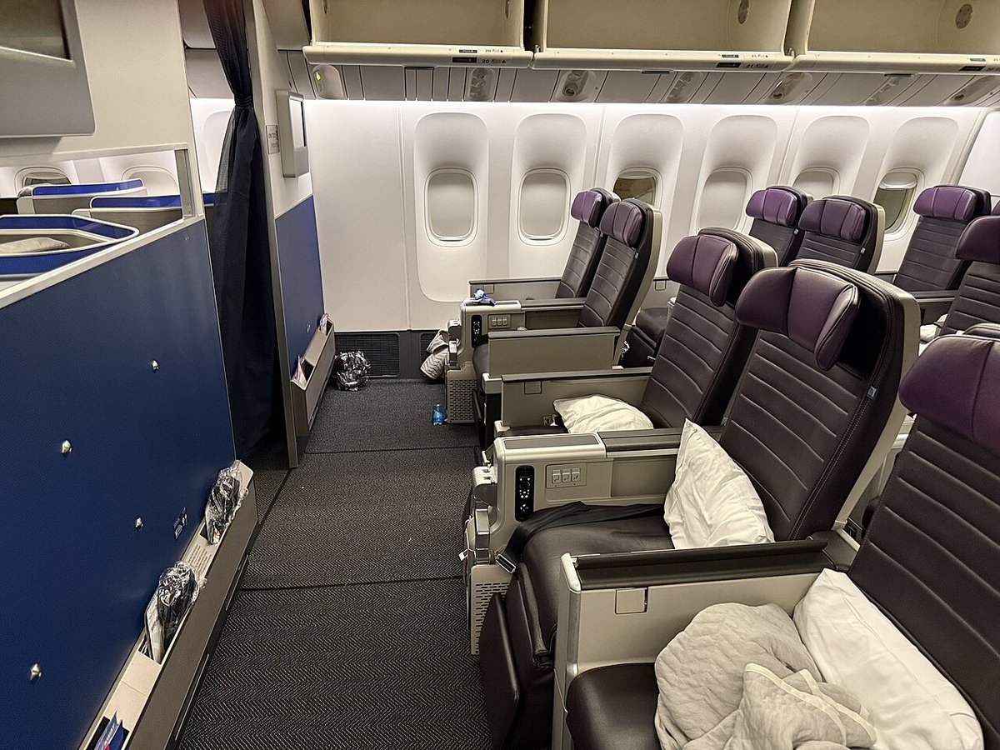
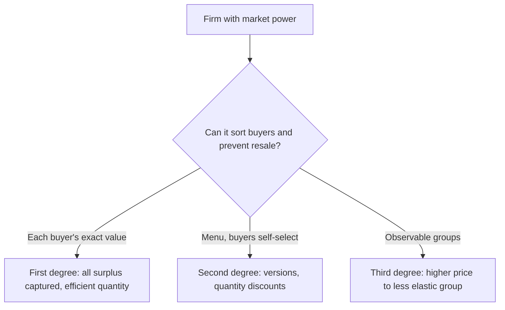

# Price discrimination

**Prerequisites:** [Monopoly pricing and deadweight loss](05-monopoly-pricing-and-deadweight-loss.md), [Price elasticity of demand](../02-supply-and-demand/07-price-elasticity-of-demand.md).

*Premium economy seats on a Boeing 777: airlines sell seats on the same flight at many different prices. Credit: 4300streetcar. License: [CC BY 4.0](https://creativecommons.org/licenses/by/4.0). Source: [File:Premium Plus seats on United Airlines Boeing 777-300ER N2250U February 2026.jpg](https://commons.wikimedia.org/wiki/File:Premium_Plus_seats_on_United_Airlines_Boeing_777-300ER_N2250U_February_2026.jpg).*

So far the monopolist has charged every buyer the same price. But buyers differ in how much they are willing to pay. If a firm can charge different prices to different buyers for the same good, for reasons unrelated to cost, it is practising **price discrimination**. Student discounts, airline fare classes, seniors' movie tickets, coupons and software editions are all examples.

## Conditions

Price discrimination requires three things:

1. **Market power.** The firm must face a downward-sloping demand curve. Competitive firms are price takers and cannot discriminate.
2. **Ability to sort buyers.** The firm must be able to identify, directly or indirectly, who is willing to pay more.
3. **No resale (arbitrage).** If low-price buyers could resell to high-price buyers, the scheme would collapse. That is why price discrimination is easiest for services (haircuts, flights, concerts) and goods tied to a person (tickets with names, software licences).

## The three degrees

The British economist Arthur Cecil Pigou classified price discrimination in *The Economics of Welfare* (1920):

**First degree (perfect) price discrimination.** The firm charges each buyer exactly their willingness to pay. Every buyer's consumer surplus becomes profit. The firm sells to every buyer whose willingness to pay exceeds marginal cost, so output equals the **competitive** level and there is **no deadweight loss**. It is efficient but leaves consumers with no surplus. Perfect discrimination is rare, but negotiated prices for cars, houses and university financial aid packages can approach it, and online sellers with detailed data on customers can attempt personalised pricing.

**Second degree price discrimination.** The firm offers a menu of options and lets buyers sort themselves: quantity discounts ("buy two, get one free"), versions (basic and premium software), or bundles. Buyers with high willingness to pay choose the premium option; others choose the basic one. Firms sometimes deliberately degrade the basic version to make the premium one more attractive, a practice studied by Raymond Deneckere and Preston McAfee in "Damaged Goods" (1996).

**Third degree price discrimination.** The firm divides buyers into groups based on observable characteristics (age, student status, location, time of purchase) and charges each group a different price. This is the most common form.

## Worked example: third degree

A theatre has two groups of customers. Marginal cost per seat is 4.

- **Adults**: demand P = 24 − Q.
- **Students**: demand P = 14 − Q.

For each group, set MR = MC:

- Adults: MR = 24 − 2Q = 4, so Q = 10, P = **14**. Profit = (14 − 4) × 10 = 100.
- Students: MR = 14 − 2Q = 4, so Q = 5, P = **9**. Profit = (9 − 4) × 5 = 25.
- **Total profit: 125.**

**Single price for comparison.** Combined demand (for prices below 14, both groups buy): Q = (24 − P) + (14 − P) = 38 − 2P, so P = 19 − Q/2 and MR = 19 − Q. Setting MR = 4 gives Q = 15, P = 11.50. Adults buy 12.5, students 2.5. Profit = (11.50 − 4) × 15 = **112.50**.

Discrimination raises profit from 112.50 to 125. Students pay less (9 instead of 11.50) and buy more; adults pay more (14 instead of 11.50) and buy less. The rule: **charge the higher price to the group with less elastic demand**. Students have lower incomes and more alternatives, so their demand is more elastic.

## Welfare effects

Is price discrimination good or bad?

- **It raises profits**, always, compared with a single price.
- **It can raise output.** If a single price would leave a group out of the market entirely (say, students in poorer countries priced out of a textbook), discrimination can open new sales and benefit both the firm and those buyers.
- **Its effect on total surplus is ambiguous** for third-degree discrimination. If total output does not increase, total surplus usually falls, because goods are misallocated between groups. If output rises enough, total surplus rises.
- **Fairness concerns.** Consumers often resent paying more than others for the same thing, especially when prices are based on personal data. Some jurisdictions restrict discrimination based on protected characteristics.

## Examples

- **Airlines** use advance-purchase requirements, Saturday-night stays and refundability to separate business travellers (inelastic, book late) from leisure travellers (elastic, book early).
- **Pharmaceutical companies** often charge different prices in different countries, a practice that can improve access in poorer countries if resale between countries is prevented.
- **Movie theatres and museums** offer discounts to students, seniors and children.
- **Peak-load pricing** of electricity, transit or hotel rooms charges more at busy times. Part of this reflects higher marginal cost at peak times, so it is not purely discrimination.

## Key ideas

- Price discrimination charges different prices for the same good for reasons unrelated to cost.
- It needs market power, a way to sort buyers, and no resale.
- First degree captures all surplus and is efficient; second degree uses menus; third degree uses groups.
- The less elastic group pays more.
- Effects on welfare are ambiguous; discrimination can expand access but raises fairness concerns.

## Where this leads

- Next: [natural monopoly and regulation](07-natural-monopoly-and-regulation.md).
- Related: [Arthur Cecil Pigou](../10-history-of-thought/thinkers/10-arthur-cecil-pigou.md).
- Glossary: [price discrimination](../glossary/price-discrimination.md), [arbitrage](../glossary/arbitrage.md), [peak-load pricing](../glossary/peak-load-pricing.md).
