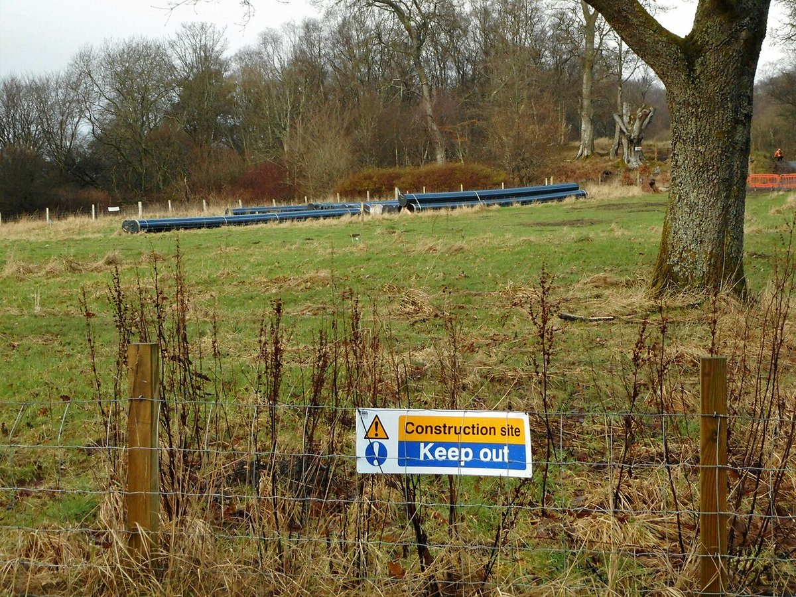
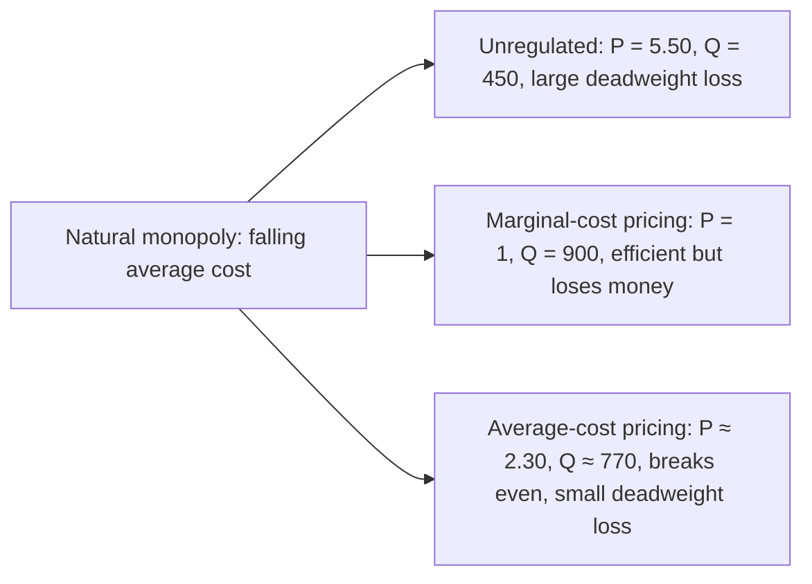

# Natural monopoly and regulation

**Prerequisites:** [[monopoly|Monopoly]], [[economies-of-scale|Economies of scale]].

*Pipes laid out for a new water main: duplicating such networks would multiply fixed costs, which makes water supply a natural monopoly. Credit: Richard Sutcliffe. License: [CC BY-SA 2.0](https://creativecommons.org/licenses/by-sa/2.0). Source: [File:Pipes for the new water main - geograph.org.uk - 7091165.jpg](https://commons.wikimedia.org/wiki/File:Pipes_for_the_new_water_main_-_geograph.org.uk_-_7091165.jpg).*

Some industries are monopolies not because of patents or strategy but because of their cost structure. It is cheaper for one firm to serve the whole market than for two or more to share it. These **natural monopolies** pose a dilemma: competition would raise costs, but an unregulated monopoly would charge too much. This lesson examines how governments respond.

## What makes a monopoly natural

An industry is a **natural monopoly** when a single firm can produce the market's entire output at a lower total cost than any combination of two or more firms. This usually happens when there are very large fixed costs and low marginal costs, so average cost keeps falling over the whole range of market demand.

Classic examples involve networks:

- **Water and sewer systems**: laying a second set of pipes down every street would double the fixed cost for little benefit.
- **Electricity transmission and distribution**: one set of power lines serves a neighbourhood.
- **Natural gas pipelines**, **railway track**, and historically **local telephone lines**.

Note that the network part is often the natural monopoly, while activities using the network (generating electricity, selling gas, running trains) may support competition.

## The pricing dilemma

Suppose a water utility has fixed costs of 1,000 (thousand dollars a year) and a constant marginal cost of 1 per cubic metre. Demand is P = 10 − Q/100, where Q is thousand cubic metres.

**Unregulated monopoly:** MR = 10 − Q/50 = 1, so Q = 450, P = **5.50**. Revenue = 5.50 × 450 = 2,475; variable cost = 450; profit = 2,475 − 450 − 1,000 = **1,025**.

**Marginal-cost pricing (efficient):** set P = MC = 1. Then Q = 900. Revenue = 900, variable cost = 900, so the utility loses its entire fixed cost of **1,000**. Average cost = (1,000 + 900)/900 = 2.11, above the price. Because average cost is falling, marginal cost is below average cost, and **pricing at marginal cost guarantees a loss**. Someone must cover it: a government subsidy, funded by taxes.

**Average-cost pricing:** set P = ATC so the utility just breaks even. Solve P = 10 − Q/100 and P = 1 + 1,000/Q: this gives Q ≈ 770 and P ≈ 2.30. Output is below the efficient 900, so there is some deadweight loss, but much less than under monopoly, and no subsidy is needed.

## Regulatory approaches

**Rate-of-return regulation.** Regulators allow the firm to charge prices that cover its costs plus a "fair" return on its capital. This was the dominant approach for North American utilities for much of the 20th century. A known problem, analysed by Harvey Averch and Leland Johnson in 1962, is that if the allowed return exceeds the true cost of capital, the firm has an incentive to over-invest in capital to expand its rate base (the **Averch-Johnson effect**). Rate-of-return regulation also blunts incentives to cut costs, since savings are passed to customers.

**Price-cap regulation.** Introduced in the United Kingdom in the 1980s following work by Stephen Littlechild, it sets a maximum price that rises with inflation minus an efficiency factor ("RPI − X"). The firm keeps any savings it achieves within the period, giving it an incentive to cut costs. The cap is reset periodically.

**Two-part tariffs.** Charge a fixed connection fee to cover fixed costs and a per-unit price equal to marginal cost. This can achieve efficient usage without a subsidy, though a high fixed fee may push some low-income households off the network. Many utility bills combine a fixed monthly charge with a usage charge.

**Public ownership.** Many countries run water, and sometimes electricity, through publicly owned enterprises. In Canada, several provinces own their main electricity utilities, such as Hydro-Québec and BC Hydro. Advocates argue public ownership aligns the utility with public goals; critics argue it weakens incentives for efficiency and exposes pricing to political pressure.

**Franchise bidding.** Harold Demsetz argued in 1968 that governments could auction the right to be the monopolist to the firm offering the lowest price, introducing competition **for** the market even if there cannot be competition **in** it.

## Regulatory capture

George Stigler argued in "The Theory of Economic Regulation" (1971) that regulatory agencies tend to be "captured" by the industries they regulate, because the industry has concentrated interests, expertise and resources, while consumers are dispersed. Captured regulators may protect incumbents from competition instead of protecting consumers. This is one form of [[government-failure|government failure]].

## Key ideas

- A natural monopoly arises when one firm can serve the market more cheaply than several.
- Marginal-cost pricing is efficient but causes losses because MC is below falling average cost.
- Average-cost pricing breaks even with a small deadweight loss.
- Regulation options: rate of return, price caps, two-part tariffs, public ownership, franchise bidding.
- Regulators risk capture by the industries they oversee.

## Where this leads

- Next: [[monopolistic-competition|monopolistic competition]].
- Glossary: [[g:natural-monopoly|natural monopoly]], [[g:two-part-tariff|two-part tariff]], [[g:regulatory-capture|regulatory capture]].
