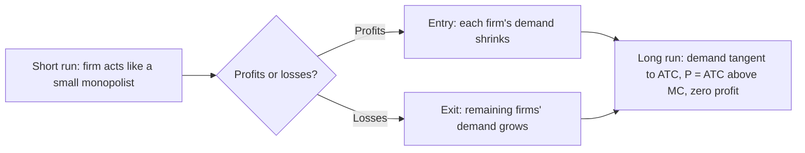

# Monopolistic competition

**Prerequisites:** [[long-run-competitive-equilibrium|Long-run competitive equilibrium]], [[monopoly|Monopoly]].

*Restaurants side by side on the Place du Tertre, Paris: many sellers of similar but differentiated products. Credit: Pierre Blaché from Paris, France. License: [CC0](http://creativecommons.org/publicdomain/zero/1.0/deed.en). Source: [File:Restaurants, Place du Tertre, Paris 30 September 2019.jpg](https://commons.wikimedia.org/wiki/File:Restaurants,_Place_du_Tertre,_Paris_30_September_2019.jpg).*

Most firms are neither perfectly competitive price takers nor lone monopolists. Restaurants, hair salons, clothing brands, coffee shops and dentists each have some control over their price, because their products differ, but they face many competitors and new rivals can open easily. This market structure is called **monopolistic competition**.

## The model

Monopolistic competition was analysed independently in 1933 by the American economist Edward Chamberlin, in *The Theory of Monopolistic Competition*, and the British economist Joan Robinson, in *The Economics of Imperfect Competition*. Its features are:

1. **Many sellers.**
2. **Differentiated products**: each firm's product is somewhat different, by quality, style, location, service or brand image. Buyers have preferences among them.
3. **Free entry and exit** in the long run.

Product differentiation gives each firm a **downward-sloping demand curve**: if it raises its price, it loses some customers but not all, because some prefer its particular product. But demand is quite elastic, because close substitutes are available.

## Short run: like a monopolist

In the short run, each firm behaves like a small monopolist: it sets MR = MC and charges the price on its demand curve. It may earn economic profits if its product is popular, or losses if not.

## Long run: like perfect competition

If firms are making profits, new firms enter with similar products. Each existing firm loses some customers, so its demand curve shifts left and becomes more elastic. Entry continues until economic profit is zero. Losses cause exit, shifting the remaining firms' demand to the right.

In **long-run equilibrium**:

- Each firm sets MR = MC (profit maximisation).
- Price equals average total cost (zero economic profit). Graphically, the demand curve is **tangent** to the ATC curve, a result often called the **Chamberlin tangency solution**.

## Worked example

A neighbourhood has many cafés. At first, a typical café faces demand P = 9 − 0.01Q (cups per day) and has total cost TC = 400 + 1Q: fixed costs of 400 a day (rent, equipment, salaried staff) and a marginal cost of 1 per cup.

- MR = 9 − 0.02Q = MC = 1, so Q = 400, P = 9 − 4 = **5**.
- ATC at Q = 400 = 400/400 + 1 = **2**. Price exceeds ATC by 3, so profit = 3 × 400 = 1,200: the café earns economic profit.
- New cafés open nearby. Each existing café's demand shrinks. Entry continues until demand has fallen enough that the café's best price just equals its ATC.

Suppose entry shifts demand to P = a − 0.01Q. The café maximises profit at MR = a − 0.02Q = 1, so Q = (a − 1)/0.02 and P = (a + 1)/2. Zero profit requires P = ATC = 400/Q + 1. Solving gives a = 5, Q = 200 cups, P = **3**, and ATC = 400/200 + 1 = **3**. Price equals average cost: zero economic profit, as theory predicts.

## Excess capacity and markup

Compared with perfect competition, the long-run equilibrium of monopolistic competition differs in two ways:

1. **Markup over marginal cost.** Price exceeds marginal cost (in the example, 3 against 1). So there is some allocative inefficiency: buyers who value a coffee at more than its marginal cost go without.
2. **Excess capacity.** Because demand is tangent to the downward-sloping part of ATC, each firm produces less than the output that minimises ATC. With fixed costs of 400 and constant MC, ATC falls forever here, but in general the firm operates below its efficient scale. There are "too many" firms, each too small.

## Is this wasteful?

Chamberlin argued that the inefficiency is the price of **variety**. Consumers value having many different cafés, cuisines and styles to choose from. If the market had fewer, larger firms producing at minimum cost, costs would be lower but choice would be narrower. Whether the market produces too much or too little variety is theoretically ambiguous: entrants do not consider that they take business from existing firms (suggesting too much entry), nor that they create surplus for consumers who love their particular product (suggesting too little). Work by Michael Spence (1976) and Avinash Dixit and Joseph Stiglitz (1977) formalised this trade-off; the Dixit-Stiglitz model later became a foundation of modern trade theory.

## Advertising and brands

Firms in monopolistic competition advertise to differentiate their products. Economists disagree about its effects:

- **Critics** argue that advertising manipulates tastes, creates artificial differences between nearly identical products and builds barriers to entry.
- **Defenders** argue that advertising informs buyers about prices, products and new entrants, and that spending heavily on advertising can **signal** quality, because only firms confident of repeat business would pay for it (an argument developed by Phillip Nelson in the 1970s). See [[signalling-and-screening|signalling and screening]].

Brand names can help consumers by guaranteeing consistent quality and giving firms an incentive to maintain it.

## Key ideas

- Monopolistic competition: many firms, differentiated products, free entry.
- Each firm faces a downward-sloping but elastic demand curve.
- In the long run, entry drives economic profit to zero: demand is tangent to ATC.
- Price exceeds marginal cost and firms have excess capacity.
- The inefficiency may be the price of variety; advertising has both critics and defenders.

## Where this leads

- Next: [[oligopoly|oligopoly]].
- Glossary: [[g:monopolistic-competition|monopolistic competition]], [[g:product-differentiation|product differentiation]], [[g:excess-capacity|excess capacity]].
